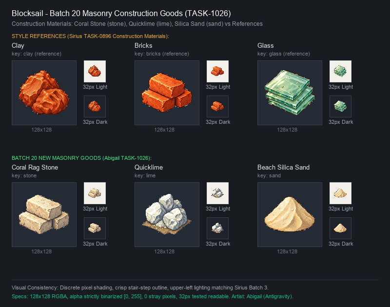

# 🖼️ 《Blocksail》第20批資源圖示：石造建材

當城鎮由早期的粗糙木構與茅草聚落邁向長治久安的堡壘與石造街區，沉重的石灰岩、雪白的生石灰與細膩的海沙便成了大地獻給營造者的基石。本批資源圖示為配合 [TASK-1023](../../../AgentCommands/Tasks/tasks/1023.md)（建築工與公共工程體系）所繪製之核心建材資產，完整補齊了城鎮營建所需的採石場產物石材（`stone`）、石灰窯燒製的石灰（`lime`）以及玻璃坊與灰漿不可或缺的細沙（`sand`）。

本批三張原稿嚴格依循 `RESOURCE_ART` 規範，以 Sirius 在 TASK-0896 繪製的建材原稿（黏土 `clay`、紅磚 `bricks`、玻璃 `glass`）為風格與材質表現基準：
- **石材 (`stone`)**：考證 17 世紀加勒比海殖民時期的珊瑚石灰岩（coral rag），描繪 3 塊琢磨整齊的方正條石層疊堆砌。色調採溫暖的米白、淺象牙與砂灰，細緻點綴珊瑚孔洞與微型化石質感，展現沉穩厚重的砌石質感。
- **石灰 (`lime`)**：描繪剛自石灰窯 calcine 出爐的高純度生石灰塊。不規則的多角白堊碎塊與散落的微細白粉安放在粗織麻布片上，以純白高光搭配冷灰色階，表現出乾燥、高吸水性與強烈化學活性的生石灰特徵。
- **沙 (`sand`)**：描繪篩洗純淨的加勒比海金黃海沙。自然聚攏為緊湊的小沙丘，沙面帶有微風吹拂的細膩微紋，點綴少許細碎白貝殼微光，兼具建築灰漿原料與玻璃熔融矽砂之雙重用途。

整體嚴守 16/32-bit 精緻像素風格、左上方自然光照、階梯狀輪廓線與深色收邊防暈原則。在 128×128 原寸與 32×32 實機介面縮圖下，無論在羊皮紙白底還是暗色深底，皆能與既有的土石建材成套呼應、清晰辨識。

完整白底原稿（1024×1024）留存於 `RawImages/`，遊戲交付版去背為 128×128 RGBA 獨立圖示（主體最大邊 104px、Alpha 嚴格二值化為 0/255），並與既有黏土、磚塊、玻璃完成並排橫向對照。



## 完整實際提示詞與規格

畫風與材質參考：
- 砌石與堆疊參考：`RawImages/sirius_blocksail_goods_batch3_bricks_master.png`
- 天然土石質地：`RawImages/sirius_blocksail_goods_batch3_clay_master.png`
- 矽質顆粒與折光：`RawImages/sirius_blocksail_goods_batch3_glass_master.png`

### 石材 (stone)

```text
Create ONE Blocksail inventory icon of CARIBBEAN CORAL STONE BLOCKS (coral rag / limestone blocks): A compact stack of 2 to 3 neatly quarried, rectangular / square-cut limestone ashlar blocks stacked together in a three-quarter isometric view. Material: Authentic 17th-century Caribbean colonial coral rag stone - warm pale cream, ivory, sandy beige and warm light grey tones with subtle visible surface pores, embedded tiny fossil fragments and chiseled stone surface texture. Upper-left illumination with crisp highlights, discrete shaded pixel clusters, crisp stair-step pixel contours, restrained dark outline (dark brownish-grey / slate), and tactile dimensional depth. Centered compact three-quarter view, generous margins on all 4 sides. Pure solid white (#FFFFFF) background. Absolutely NO ground plane, NO cast shadow on the ground, NO text, NO labels, NO barrels, NO border, NO checkerboard.
```

[獨立白底原稿](../RawImages/abigail_blocksail_goods_batch20_stone_master.png)

### 石灰 (lime)

```text
Create ONE Blocksail inventory icon of KILN-BURNT QUICKLIME (lump lime / cal viva for construction mortar): A compact cluster of irregular kiln-calcined white lump lime rocks and chunks with powdery crumbled lime dust, resting on a flat, coarse woven burlap cloth patch. Material: 17th-century kiln-burnt limestone quicklime - bright chalky white and pale ivory with delicate soft grey and cool pale slate shaded facets, chalky powdery texture with crisp crystalline fractures. DO NOT draw wooden barrels, buckets, or closed sacks. Draw the physical lumps of quicklime directly. Upper-left illumination with brilliant highlights, discrete shaded pixel clusters, crisp stair-step pixel contours, restrained dark outline (dark charcoal / cool slate), and tactile dimensional depth. Centered compact three-quarter view, generous margins on all 4 sides. Pure solid white (#FFFFFF) background. Absolutely NO ground plane, NO cast shadow on the ground, NO text, NO labels, NO border, NO checkerboard.
```

[獨立白底原稿](../RawImages/abigail_blocksail_goods_batch20_lime_master.png)

### 沙 (sand)

```text
Create ONE Blocksail inventory icon of FINE CARIBBEAN SILICA BEACH SAND (sand for glassmaking and construction mortar): A neat, compact conical heap/mound of clean fine pale golden beach sand, showing gentle natural sand ripples and a few tiny crushed white shell flecks embedded near the surface. Material: Warm pale golden beach sand, sun-bleached dune silica, warm ivory, soft amber-yellow and warm sandy beige shaded clusters, fine granular pixel texture. DO NOT draw buckets, wooden barrels, or sacks. Draw the physical pile of sand directly. Upper-left illumination with crisp highlights, discrete shaded pixel clusters, crisp stair-step pixel contours, restrained dark outline (warm dark umber / deep sepia), and tactile dimensional depth. Centered compact three-quarter view, generous margins on all 4 sides. Pure solid white (#FFFFFF) background. Absolutely NO ground plane, NO cast shadow on the ground, NO text, NO labels, NO border, NO checkerboard.
```

[獨立白底原稿](../RawImages/abigail_blocksail_goods_batch20_sand_master.png)
