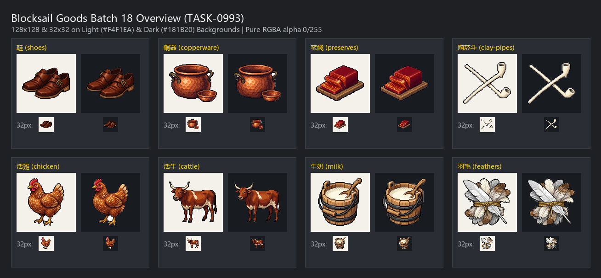

# 🖼️ 《Blocksail》第18批資源圖示：城鎮生活與畜產物產

加勒比海的城鎮港口，除了軍需砲火與大宗作物，真實流淌在市井街道上的，是生活本身的重量。這批資源圖示涵蓋了製鞋坊的厚實皮鞋、銅匠敲打出的紅銅鍋具、以糖漬提煉的番石榴蜜餞、水手與鎮民指間的白陶菸斗，以及牧場、養雞場與屠宰場完整的畜產體系——鮮活的母雞、威嚴的長角克里奧牛、木桶裝滿的鮮牛奶，與拔取後作為日用品原料的柔軟羽毛。

本批八張原稿依循 `RESOURCE_ART` 規範，以統一的精緻像素風格（Pixel Art）呈現，採左上方入射光、清楚階梯輪廓、飽滿材質固有色與克制深色外框。活雞與活牛描繪完整的生命姿態，與屠宰後的生肉嚴格區分；牛奶以木桶呈現乳白液面，避免畫成空容器；蜜餞呈現切片結晶與甜食光澤；鞋、銅器與陶菸斗則忠實反映 17 世紀中葉加勒比海港口的器物造型。

完整白底原稿（1024×1024）保存於館內 `RawImages/`，遊戲交付版去背為 128×128 RGBA 獨立圖示，並於 32px 白底與深底環境全數驗證剪影辨識度。

## 完整實際提示詞與規格

畫風參考附圖：`RawImages/sirius_blocksail_goods_refresh932_cocoa_master.png`。

### 鞋 (shoes)

```text
ONE inventory icon of a pair of 17th-century utilitarian LEATHER SHOES: a handsome pair of sturdy historical low-heeled shoes made of rich dark oiled brown leather, square toes, stacked low wooden heels, with brass buckle fastenings on the side flaps. Placed neatly side-by-side in three-quarter view, showing supple leather creases and visible welt stitching along the soles.
Style: Crisp, refined 16/32-bit pixel art inventory sprite (RPG / simulation game icon).
Rich material-specific colours (deep warm russet leather, dull polished brass), upper-left lighting highlights, discrete shaded pixel clusters, crisp stair-step pixel contours, restrained dark outline and tactile dimensional depth.
Keep its silhouette distinct and recognizable even when scaled down to 32x32.
Centered compact three-quarter object or group, generous margins. Pure solid uniform WHITE #FFFFFF background.
NO ground plane, NO external cast shadow, NO floor, NO text, NO labels, NO border, NO checkerboard, NO scenery.
```

[獨立白底原稿](../RawImages/kaguya_blocksail_goods_batch18_shoes_master.png)

### 銅器 (copperware)

```text
ONE inventory icon of utilitarian COPPERWARE itself: one squat round-bellied reddish hammered copper cooking cauldron/pot with flared rim and two riveted brass/iron side handles, with distinct hand-hammered dimple facets catching the light, and one smaller shallow hammered copper bowl resting neatly beside its base.
Style: Crisp, refined 16/32-bit pixel art inventory sprite (RPG / simulation game icon).
Rich material-specific colours (warm burnished reddish-copper, orange-amber specular gleam, cool dark coppery shaded crevices), upper-left lighting highlights, discrete shaded pixel clusters, crisp stair-step pixel contours, restrained dark outline and tactile dimensional depth.
Keep its silhouette distinct and recognizable even when scaled down to 32x32.
Centered compact three-quarter object or group, generous margins. Pure solid uniform WHITE #FFFFFF background.
NO ground plane, NO external cast shadow, NO floor, NO text, NO labels, NO border, NO checkerboard, NO scenery.
```

[獨立白底原稿](../RawImages/kaguya_blocksail_goods_batch18_copperware_master.png)

### 蜜餞 (preserves)

```text
ONE inventory icon of PRESERVES (traditional guava fruit paste / dulce de guayaba): a firm rectangular brick of rich translucent ruby-red guava paste, with two thick cut slices lying fanned out in front, revealing glistening sugary amber-garnet jelly texture with crystallized edge glints, resting on a small rustic wooden slab. Clearly recognizable as a sweet confectionery treat.
Style: Crisp, refined 16/32-bit pixel art inventory sprite (RPG / simulation game icon).
Rich material-specific colours (deep translucent ruby red, glowing amber-orange highlights, dark garnet shadows), upper-left lighting highlights, discrete shaded pixel clusters, crisp stair-step pixel contours, restrained dark outline and tactile dimensional depth.
Keep its silhouette distinct and recognizable even when scaled down to 32x32.
Centered compact three-quarter object or group, generous margins. Pure solid uniform WHITE #FFFFFF background.
NO ground plane, NO external cast shadow, NO floor, NO text, NO labels, NO border, NO checkerboard, NO scenery.
```

[獨立白底原稿](../RawImages/kaguya_blocksail_goods_batch18_preserves_master.png)

### 陶菸斗 (clay-pipes)

```text
ONE inventory icon of utilitarian WHITE KAOLIN CLAY TOBACCO PIPES: two historical 17th-century European (Dutch/English) long clay pipes crossed at a shallow angle; slender chalky-white stems with smooth tapering lines and small upright angled pipe bowls, with fine warm ivory shading, subtle clay texture, and faint dark interior bowl charring.
Style: Crisp, refined 16/32-bit pixel art inventory sprite (RPG / simulation game icon).
Rich material-specific colours (warm ivory white, pale beige shaded edges, subtle charcoal inner rim), upper-left lighting highlights, discrete shaded pixel clusters, crisp stair-step pixel contours, restrained dark outline and tactile dimensional depth.
Keep its silhouette distinct and recognizable even when scaled down to 32x32.
Centered compact three-quarter object or group, generous margins. Pure solid uniform WHITE #FFFFFF background.
NO ground plane, NO external cast shadow, NO floor, NO text, NO labels, NO border, NO checkerboard, NO scenery.
```

[獨立白底原稿](../RawImages/kaguya_blocksail_goods_batch18_clay_pipes_master.png)

### 活雞 (chicken)

```text
ONE inventory icon of a LIVE FARM CHICKEN (hen): a healthy, plump domestic speckled brown-and-white hen standing alert in compact three-quarter side profile, with bright red comb and wattle, golden-amber eye, neat glossy plumage feathers, yellow beak and sturdy yellow legs. Distinctly alive, active, and whole (clearly distinct from meat, slaughtered carcass, or single eggs).
Style: Crisp, refined 16/32-bit pixel art inventory sprite (RPG / simulation game icon).
Rich material-specific colours (warm russet brown, creamy flecks, vivid crimson red comb, golden yellow legs), upper-left lighting highlights, discrete shaded pixel clusters, crisp stair-step pixel contours, restrained dark outline and tactile dimensional depth.
Keep its silhouette distinct and recognizable even when scaled down to 32x32.
Centered compact three-quarter object, generous margins. Pure solid uniform WHITE #FFFFFF background.
NO ground plane, NO external cast shadow, NO floor, NO text, NO labels, NO border, NO checkerboard, NO scenery.
```

[獨立白底原稿](../RawImages/kaguya_blocksail_goods_batch18_chicken_master.png)

### 活牛 (cattle)

```text
ONE inventory icon of a LIVE CATTLE (Caribbean Criollo working cow/ox): a sturdy, healthy livestock cattle standing in full profile/three-quarter view, rich reddish-brown hide with white flank patches, distinctive outward-curving lyre horns, gentle dark eye, dark hooves, and tufted tail. Distinctly alive and whole (clearly distinct from slaughtered beef meat or tanned leather hide).
Style: Crisp, refined 16/32-bit pixel art inventory sprite (RPG / simulation game icon).
Rich material-specific colours (warm chestnut/mahogany hide, creamy white belly/patches, bone-ivory horns with dark tips), upper-left lighting highlights, discrete shaded pixel clusters, crisp stair-step pixel contours, restrained dark outline and tactile dimensional depth.
Keep its silhouette distinct and recognizable even when scaled down to 32x32.
Centered compact three-quarter object, generous margins. Pure solid uniform WHITE #FFFFFF background.
NO ground plane, NO external cast shadow, NO floor, NO text, NO labels, NO border, NO checkerboard, NO scenery.
```

[獨立白底原稿](../RawImages/kaguya_blocksail_goods_batch18_cattle_master.png)

### 牛奶 (milk)

```text
ONE inventory icon of fresh MILK: a rustic wooden stave pail or round-bellied earthenware jug filled to the rim with pure fresh white milk, showing a visible silky white liquid surface with subtle creamy froth, and a carved wooden dipping ladle resting against its side.
Style: Crisp, refined 16/32-bit pixel art inventory sprite (RPG / simulation game icon).
Rich material-specific colours (opaque creamy porcelain-white milk, warm terracotta/amber-pine vessel, dark iron hoop accents), upper-left lighting highlights, discrete shaded pixel clusters, crisp stair-step pixel contours, restrained dark outline and tactile dimensional depth.
Keep its silhouette distinct and recognizable even when scaled down to 32x32.
Centered compact three-quarter object or group, generous margins. Pure solid uniform WHITE #FFFFFF background.
NO ground plane, NO external cast shadow, NO floor, NO text, NO labels, NO border, NO checkerboard, NO scenery.
```

[獨立白底原稿](../RawImages/kaguya_blocksail_goods_batch18_milk_master.png)

### 羽毛 (feathers)

```text
ONE inventory icon of FEATHERS: a tied bundle of fluffy, soft avian plumage (poultry chicken down and goose feathers) in gentle ivory-white, silver-grey, and soft warm brown speckles, neatly bound around the quills with rustic hemp twine, with one long elegant white goose quill pen angled across the cluster.
Style: Crisp, refined 16/32-bit pixel art inventory sprite (RPG / simulation game icon).
Rich material-specific colours (airy soft whites, delicate pearl-grey shadows, warm tan quill shafts, golden-brown twine), upper-left lighting highlights, discrete shaded pixel clusters, crisp stair-step pixel contours, restrained dark outline and tactile dimensional depth.
Keep its silhouette distinct and recognizable even when scaled down to 32x32.
Centered compact three-quarter object or group, generous margins. Pure solid uniform WHITE #FFFFFF background.
NO ground plane, NO external cast shadow, NO floor, NO text, NO labels, NO border, NO checkerboard, NO scenery.
```

[獨立白底原稿](../RawImages/kaguya_blocksail_goods_batch18_feathers_master.png)


