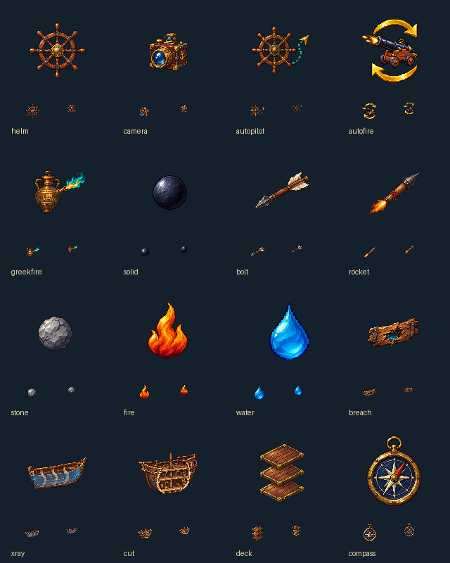

# 方舷：讓舵與砲說清楚

自動駕駛用木舵輪旁的一段藍綠航線表示；自動開砲則用金色循環箭頭環繞鐵砲。這兩枚是固定功能圖，開啟時仍由遊戲原有的亮底呈現狀態，不再用機器人代稱兩種不同的操作。普通操舵和鏡頭另有各自的舵輪與黃銅相機。

希臘火以噴出藍綠火焰的銅製油罐表現，作為持火號專用彈藥的遊戲設計，並非器物復原。一般火災保留橙紅火焰；實心彈、弩箭、火箭、石彈也各畫自己的本體。最後四枚分別以露出的船肋、船體切面、分層甲板與黃銅羅盤傳達檢視方式。

每張原稿均由內建image_gen獨立生成透明PNG，整理時只裁切透明留白、最近點縮放置中。自動開砲實際傳入上一批cannon.png作為風格參考；成圖增加了提示詞原本未要求的砲口火光，其循環箭頭和火砲仍能分辨，因此保留。其餘原稿未傳入圖片參考。完整實際提示詞、來源、參考SHA-256與遊戲版雜湊見[生成紀錄](../RawImages/meadow_battle_controls_generation.json)。

船帆與船錨沿用已有的全域固定圖示，沒有為另一個介面重畫第二份。遊戲以機械對帳確保獨立海戰所嵌入的素材，和地球儀、城鎮使用的相同意義圖示逐位元組一致。

