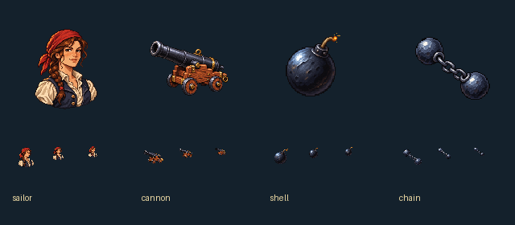

# 方舷：女水手與火砲

船員數以一位繫紅頭巾、穿亞麻襯衫與深藍背心的成年女水手表示。這是艦上人手的共用圖示，並非新招募角色，也不替換場景裡每一位水手的立繪。她的深棕髮辮與紅頭巾提供小尺寸下的輪廓和色彩識別。

火砲以鐵製長炮和木製四輪砲架呈現；爆裂彈保留短引信的火星，鏈彈則讓兩顆鐵球與短鏈在同一條斜線上。四張均採左上高光、離散像素色階和深色輪廓，不附文字或底框。原稿由內建image_gen獨立生成，未傳入參考圖片；完整實際提示詞與來源雜湊保存在[生成紀錄](../RawImages/meadow_battle_icons_generation.json)。

遊戲版以透明主體裁切、最近點縮放置入128×128畫布，保留原生alpha。下排依序展示32、22與18像素，最小尺寸僅作艦隊數字旁的識別提示，名稱與數值仍由介面提供。

