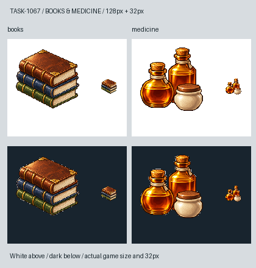

# 書籍與藥品：教學、診療的物資

學校需要的不只是一位老師，還有能被運輸、印製與消耗的書；醫院也需要看得見的診療物資。書籍畫成三本有紙張厚度的皮裝書冊，藥品則配合1064目前藥酒、糖漿的貨物設定，用琥珀玻璃瓶與素色小陶罐呈現。沒有在圖片上寫藥名、劑量或醫療符號，也不把遊戲藥品當成真實醫療建議。

兩張均以內建image_gen獨立生成，實際附上Sirius TASK-0896工具原稿，再分別參考紙張與醋瓶原稿的材質。沿用離散像素、左上光源、深輪廓，主體重新設計。書頁的象牙白與藥瓶的琥珀色，在縮成32px時仍保留書冊／瓶罐的差異；圖上不加文字，名稱由遊戲介面顯示。

白底原稿保留 `meadow_blocksail_bookmed1067_<key>_master.png`；派生圖只做邊界連通去白底、裁切、nearest縮至104px主體並置中128px。完整實際prompt、參考／原稿／遊戲圖SHA見[生成記錄](../RawImages/meadow_blocksail_bookmed1067_generation.json)。圖片完成不代表另一套採買或醫療機制，貨物註冊與學校／醫院菜單照1064的同一份資料。

