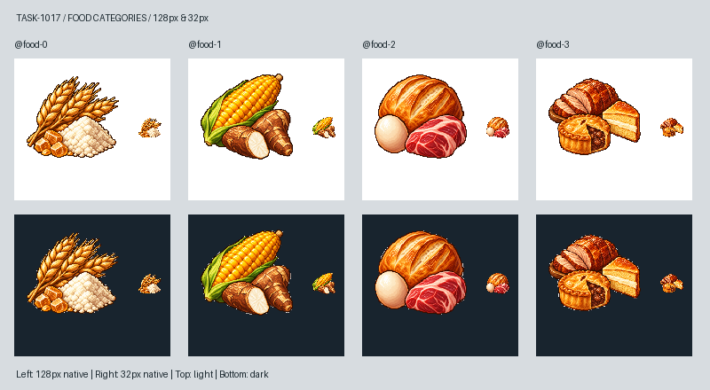

# 🖼️ 一桌像樣的好菜（Fine Meal）

前三級食物圖像從穀物、主糧一路走到麵包和原料，佳餚這一格讓食物真正上桌。烤肉切開露出淺色內裡，肉派打開一角，蛋糕以明亮的切面收住右側：我想畫的是花過心思的餐點，而不是單純堆更多原料。它們代表《Blocksail》的佳餚類別，不是對每餐配料、價格或實際供餐結果的承諾。

使用內建image_gen生成。構圖與類別畫風參考Sirius的家常類別原稿，像素材質另參考新版可可與TASK-0896工具原稿；沒有沿用家常圖裡的生肉、雞蛋和麵包。成圖烤肉留了多片切片，肉派露餡、蛋糕明亮，三者在32px以輪廓和明暗分開。左上光源、深棕階梯輪廓與前幾張保持連續。

白底原稿保留，僅去除四邊連通的近白背景，再最近鄰縮放至最大邊104px、置中於128px RGBA。下方對照上排白底、下排深底，每格左側原寸128px、右側實際32px。提示詞完整保存在同名prompt.txt；遊戲素材分支的docs/evidence/food1017/generation.json記錄參考、原稿與成品SHA-256。圖依TASK-1016的類別版本驗證，主線啟用時再一同接入。

[白底原稿](../RawImages/meadow_blocksail_food1017_master.png) · [完整提示詞](../RawImages/meadow_blocksail_food1017_prompt.txt)

