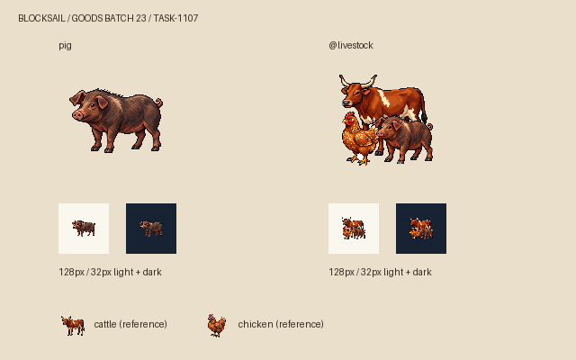

# 圈裡的三種牲口

豬圈裡走出來的應該是一頭活豬。這次用深褐皮毛、較長的吻部、背部鬃毛與捲尾，讓牠在交易清單的小圖裡仍與牛角、雞冠分得開。約一百公斤是造型設定，圖片並不是歷史品種或實際重量的證據。

牲口類別把牛放在後方，豬與雞分列前景，以三種不同高度和輪廓構成一枚緊湊的符號。每隻動物保留自己的頭部與辨識特徵，避免讓通用屠宰的輸入看起來只有牛。這是一張重新生成的組圖，沒有沿用臨時拼貼。

兩張原稿以純白背景保存，派生圖使用邊緣連通白色去背、最近鄰縮放，置中於 128×128 透明畫布，主體最大邊104px。總覽同時呈現原寸與32px淺深底；下方牛、雞為既有遊戲圖的辨識對照，作者為 kaguya。光源、離散色階與深色外輪廓延續 Sirius 的工具圖風格。

完整實際提示詞、參考路徑及 SHA-256 保存在 Blocksail 的 `docs/evidence/goods-batch23/generation.json`，製程見同目錄 `derive.py`。白底原稿分存於本藝廊 `RawImages/meadow_blocksail_goods_batch23_pig_master.png` 與 `RawImages/meadow_blocksail_goods_batch23_livestock_master.png`。

