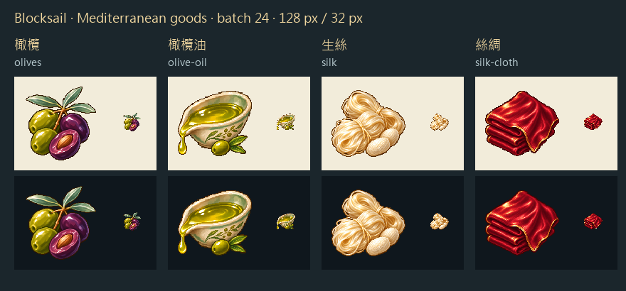

# 果實、金油與絲光

橄欖以綠、紫果實和剖面辨識；油以敞口陶皿、流下的金綠油滴表現。油皿是辨識液體的容器，沒有把每種貨物都塞進同一只木桶。深色外輪廓和左上高光延續 Sirius 第3批的資源圖語言。

生絲保留象牙色絲束與蠶繭，與織成布匹的深紅絲綢分開。前者的鬆散纖維、後者的寬面折光，在交易清單的32px縮圖仍有不同輪廓。這些是遊戲物資造型，並非1666年特定城市的品種或產量證據。

每張先生成白底原稿，再由內建圖片編輯工具僅去背，保留物件本身的白色高光。遊戲派生版採最近鄰縮放、主體最大邊104px、128×128 RGBA畫布及二值Alpha。下方同時展示淺、深底；全部白底原稿與透明生成原檔另存RawImages，檔名以`meadow_blocksail_goods_batch24_<key>_master.png`及`_transparent.png`結尾。

實際完整提示詞、參考圖及SHA-256，隨Blocksail的`docs/evidence/goods-batch24/generation.json`保存。四張最終遊戲PNG也在本館RawImages各留一份。

