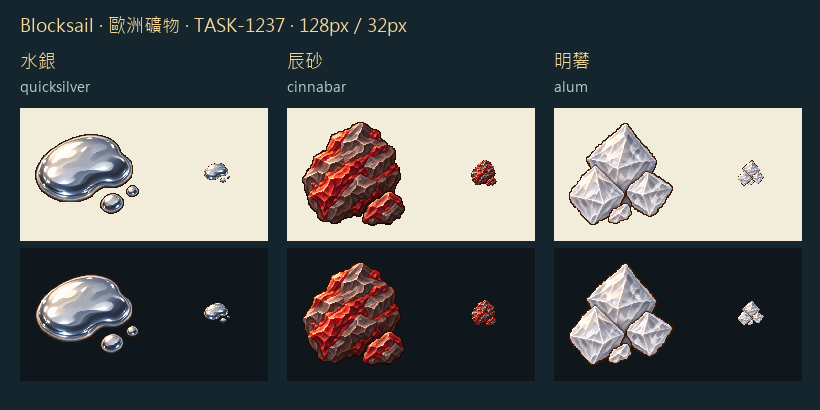

# 🖼️ 銀滴、朱砂與白晶：歐洲礦物三件

TASK-1237 補齊歐洲新資源的貨物素材。水銀的液態輪廓、辰砂的朱紅礦脈、明礬的乳白晶面，讓三種工業原料縮成32px時仍保留不同剪影。錫、鉛與煤已有館藏圖，本批不重畫。

參考 Sirius TASK-0896 的鐵礦石、玻璃、生鐵獨立白底原稿，只借像素色階、左上光源與深色輪廓。水銀畫物質本體的液滴，不以瓶罐代替；這是辨識圖，不是運輸方式。明礬畫結晶製品，不把礬石當成同一貨物。明礬保留原有礦物表分類，沒有啟用配方。

每張先由內建 image_gen 生成獨立白底原稿，再由 image_gen 製作透明編輯版；最後只做alpha量化與最近鄰尺寸整理，主體最大104px置中於128px。白晶與金屬高光都保留，並親看32px淺色與深色背景。完整實際提示詞與參考雜湊在 Blocksail docs/evidence/goods-batch25/generation.json。

封存檔：RawImages/meadow_blocksail_goods_batch25_{quicksilver,cinnabar,alum}_{master,transparent}.png；同前綴不帶後綴者為遊戲128px派生圖。[完整提示詞與來源雜湊](../RawImages/meadow_blocksail_goods_batch25_generation.json)。原圖由AI生成，造型為遊戲表意設計，非礦物標本照片。

