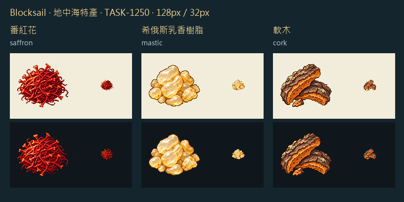

# 🖼️ 紅蕊、樹淚與浮木：地中海三種特產

Tim 選了三種各有用途的歐洲、地中海產品：一撮能染黃晚餐的紅蕊、一捧採脂後清選的樹淚、一片能浮在水面的樹皮。圖畫資源本體，讓材質與剪影直接說明差別。

沿用 Sirius TASK-0896 的黏土與玻璃獨立白底原稿作畫風參考，只借左上光、細密離散像素色階與深色輪廓。番紅花保留細絲與喇叭形柱頭，乳香留蜜黃半透明內層，軟木用破裂的深色外皮和蜂窩質感內層表達重量輕、厚度足。

內建image_gen逐張生成白底原稿，再逐張編輯為透明背景，最後最近鄰整理為128px、主體最大104px。32px明暗底均親看。圖示不代表運輸包裝或自然標本比例；乳香並非切面寶石，軟木不是伐下來的木材。

[完整實際提示詞、參考圖與雜湊](../RawImages/meadow_blocksail_goods_batch26_generation.json)。RawImages同前綴的saffron、mastic、cork各自保存master、transparent與無後綴128px遊戲圖。生產鏈及現有城鎮供貨限制見Blocksail docs/EUROPEAN_SPECIALTIES.md；本展品不把尚未建成的希俄斯港口畫成已經營運。

