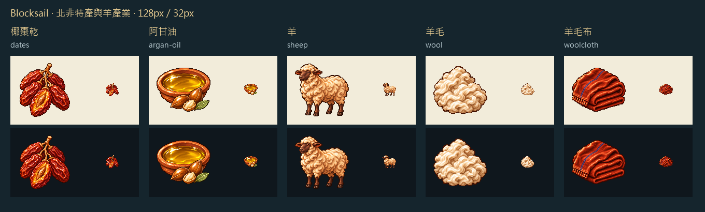

椰棗用細長紅褐果與露出的果核，阿甘油用淺陶盤盛出金色油面，旁邊留一枚剖開的果仁。羊的深褐臉和四蹄在縮圖裡仍看得到，剪下的毛另畫成暖白毛堆，織成的羊毛布折成厚實的赭紅布卷。

以 Sirius TASK-0896 黏土與玻璃原稿為畫風參考。逐張生成白底圖，再逐張去背，最後以最近鄰整理到 128px。椰棗乾與阿甘油等北非城鎮接入後才啟用，羊與羊毛布已有牧場及工坊配方。

[完整提示詞、原稿與雜湊](../RawImages/meadow_blocksail_goods_batch27_generation.json)

