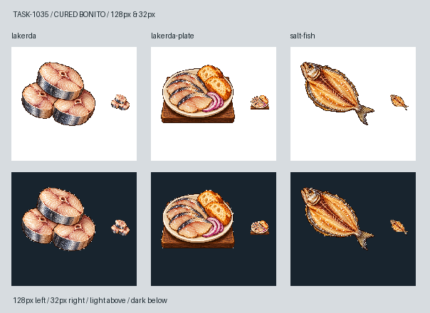

# 🖼️ 銀皮與鹽，從醃魚坊到酒館（Lakerda）

貨物圖保留三塊厚切鰹魚：銀藍皮圍著淡粉白肉，切面有肌理與小骨孔。它以圓短切塊區別既有鹹魚的整尾剖開剪影；菜單圖再把醃魚切片、麵包與紫洋蔥排進陶盤，木桌面只留在盤下，縮小後仍看得出這是一道已經端上桌的餐點。

魚肉的身分參考[伊斯坦堡商會對lakerda的說明](https://www.ito.org.tr/en/news/detail/bosphorus-unique-delights)與[製作者的醃鰹魚產品](https://www.kocamanfish.com.tr/en/urun/torik-lakerda-salamura)。這些資料用於辨認鹽醃鰹魚，不證明遊戲的中世紀配方、價格或加拉塔獨佔規則。遊戲題材與菜色組合來自TASK-1035。

兩張均由內建image_gen生成，附Sirius鹹魚、煎魚配麵包原稿作畫風與對照，另附TASK-0896工具原稿校準像素輪廓及材質。保留白底原稿，僅去除四邊連通近白背景，最近鄰縮放至最大邊104px、置中128px RGBA；淡色肉和陶盤的白不是背景。圖上魚片的數量與排列是美術構圖，不對應遊戲消耗桶數。

下圖左至右為醃鰹魚、醃鰹魚配麵包、既有鹹魚；上白底、下深底，每格左128px、右32px。完整實際提示詞與參考、原稿、成品SHA-256保存在遊戲docs/evidence/lakerda1035/generation.json與兩份prompt.txt。

[貨物白底原稿](../RawImages/meadow_blocksail_lakerda1035_lakerda_master.png) · [菜單白底原稿](../RawImages/meadow_blocksail_lakerda1035_lakerda-plate_master.png) · [貨物提示詞](../RawImages/meadow_blocksail_lakerda1035_lakerda_prompt.txt) · [菜單提示詞](../RawImages/meadow_blocksail_lakerda1035_lakerda-plate_prompt.txt)

