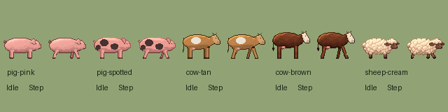

豬保留粉色與斑點，牛保留暖黃白斑與棕身白臉。新增的羊用短腿、深色臉與乳白捲毛來區分。每列左格站立，右格邁步；沿用舊圖的朝右側身、腳底對齊和對角步態。

內建 imagegen 依舊圖的步態參考逐列生成透明原稿。兩格使用相同縮放比例，以最近鄰縮為 64px 格並對齊蹄底，再收入遊戲的動物圖集。

[完整提示詞、參考圖檔名與雜湊](../RawImages/meadow_blocksail_livestock_generation.json)

