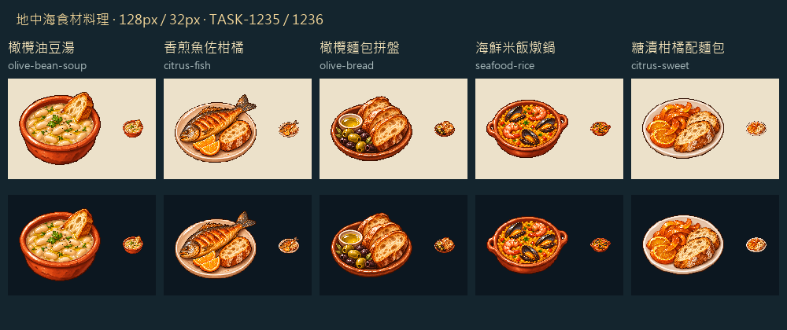

# 金油、海味與柑橘

一碗豆湯、一尾煎魚、一盤醃橄欖麵包、一鍋海鮮米飯，最後以糖漬柑橘收尾。五道料理以陶器暖棕、麵包金黃串起同一套餐桌；豆子的象牙色、橄欖的綠紫、柑橘的明橙和貝殼深色，則保留各自的32px輪廓。

這是地中海食材啟發的遊戲菜單，沒有將後世著名菜名或現代擺盤誤認成1666年五港的歷史菜單。Folger館藏介紹能支持17世紀的柑橘糖製技法，實際食材比例、名稱與供餐量仍是遊戲設計。完整史料邊界與配方在Blocksail的`docs/MEDITERRANEAN_MENU.md`。

每張由內建圖片工具獨立生成白底原稿，再以內建編輯去除背景；遊戲版128×128 RGBA，主體最大104px、二值Alpha。白盤、麵包和豆子內部高光保留。菜圖不畫羅馬數字、UI框或文字，III／IV由遊戲介面疊字。

本館RawImages留存`meadow_blocksail_menu1235_<key>_master.png`、`_transparent.png`與`_game.png`。完整實際提示詞、兩張參考圖路徑與SHA-256，以及原稿／透明／遊戲版對應，見Blocksail的`docs/evidence/menu1235/generation.json`。菜圖已掛入餐廳與酒館，實際供餐及缺料停供由同批功能驗證。

