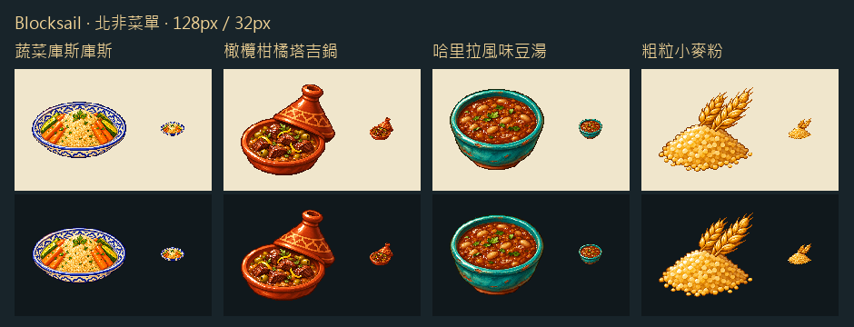

用藍白大盤襯庫斯庫斯的金黃細粒，塔吉鍋斜擱陶蓋露出橄欖與柑橘皮，豆湯以青釉深碗承接褐紅湯色。粗粒小麥粉用金色顆粒與麥穗，讓磨製原料和白麵粉能在貨單上分開辨識。

逐張生成白底原稿與透明版本，整理成 128px 遊戲圖，並在 32px 深淺背景檢視。配方是依遊戲現有食材改編的北非風味。

[完整提示詞與圖檔來源](../RawImages/meadow_blocksail_north_african_menu_generation.json)

