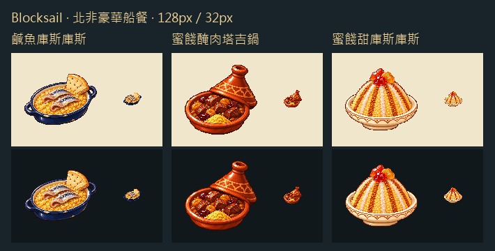

深藍船盤用銀皮鹹魚與金黃粗麥粒拉開明暗。塔吉鍋留著掀起的陶蓋，露出醃肉、琥珀色蜜餞與一勺庫斯庫斯。甜盤用船餅碎與糖紋勾勒蒸麥圓丘，頂端點幾塊紅金蜜餞。

以城鎮塔吉鍋的白底原稿作風格參考，逐道生成白底和透明版本，再整理成 128px 遊戲圖。份額與食材依遊戲的船艙供應設計。

[完整提示詞與原稿雜湊](../RawImages/meadow_blocksail_north_african_ship_menu_generation.json)

