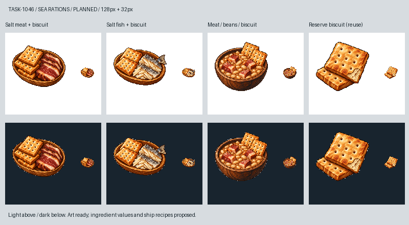

# 船上不是陸地餐館：水手耐存餐點

Tim 說，先用陸地菜單只是因為沒有圖片，海上仍可用耐放食材組合成餐。這批因此從三種不同的用餐感受出發：醃肉的厚切、鹹魚的薄片與魚皮、乾豆和肉塊慢煮成的一碗熱食。每一餐都帶硬餅乾，卻不把同一份餅乾額外再算一次。獨立的硬餅乾沿用 Sirius 在 TASK-0919 的貨物圖，作缺料或無火時的簡單備用餐。

帆船時代使用鹽醃肉魚與船餅的方向參考 [Royal Museums Greenwich](https://www.rmg.co.uk/stories/maritime-history/life-sea-age-sail)；乾豆、船餅與醃肉的搭配另參考 [USS Constitution Museum 的糧食展示](https://jointhecrew.ussconstitutionmuseum.org/outfitting/)。後者是1812年展示，這裡只借用耐存食材的組合邏輯，沒有宣稱還原1666年的統一海軍配給。遊戲的 beans 也不冒充史料中特定品種的豌豆。

三張新作使用內建 image_gen，逐張附上 Sirius 的 TASK-0896 工具白底原稿，以及 TASK-0919 硬餅乾、醃肉或鹹魚原稿。只借離散像素色階、左上光、深輪廓與材質厚度；主體改成木製餐盤與餐碗，沒有新鮮蔬果裝飾，讓畫面與食材表對得上。白底原稿保留為 `meadow_blocksail_sailor1046_<id>_master.png`；[完整實際提示詞、參考圖及SHA-256](../RawImages/meadow_blocksail_sailor1046_generation.json) 可逐項追溯。派生圖只去背景、裁切、nearest縮至104px並置中128px，沒有程式重畫。

總覽左至右依序為 `sailor-salt-meat-biscuit`、`sailor-salt-fish-biscuit`、`sailor-salt-meat-beans`、`sailor-biscuit-reserve`（沿用 `goods/hardtack`）。上方白底、下方深底，各自並列128px與32px。醃肉偏紅棕、魚皮灰銀、豆燉鍋用圓碗與明顯豆粒，縮小後保留餐點差異。菜圖將交給TASK-1032；採買、貨艙和每日供餐仍由同一套船隊系統處理。

