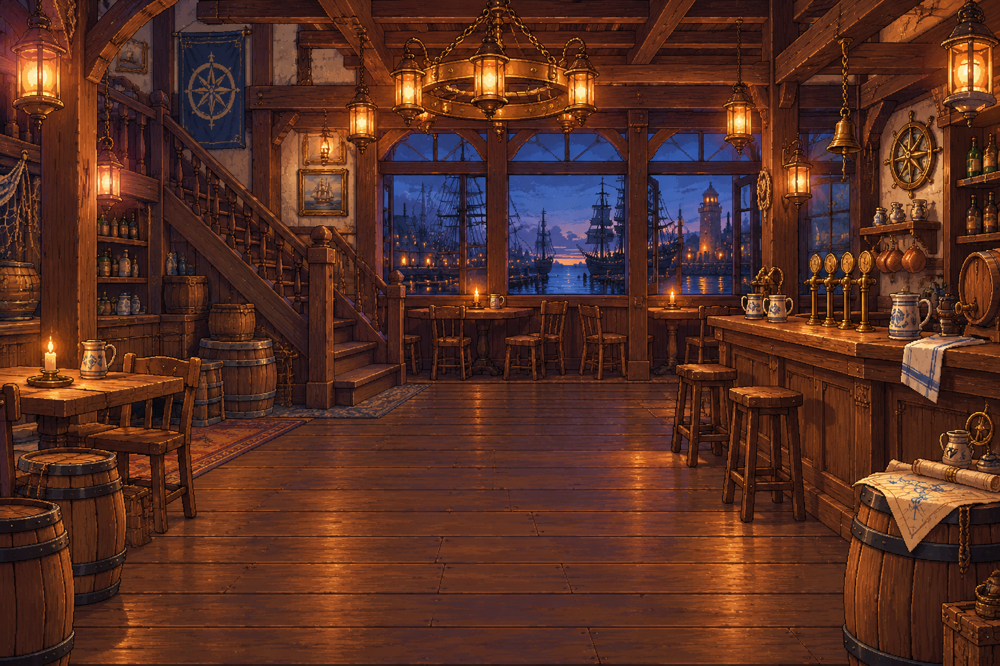

# 🖼️ 港邊酒館｜等待下一段航程

酒館是船員登船前能夠停下來說話的地方。暖色木梁、黃銅燈與窗外暮色港口連起日常和遠航；中央保留空地，讓角色與玩家的選擇成為畫面的主角。

本稿為無人物空景，不把候選名單、文字或操作按鈕畫進背景。桌面與手機介面另外疊加，窄螢幕以cover裁切，不拉伸原圖。人物採原稿白底卡片，保留原作者與完整輪廓；本張是meadow原創背景。

## 來源與完整實際提示詞

內建image_gen，兩張人物僅作畫風參考，不是改圖目標。

- `RawImages/meadow_captain_astrid_sprite_v1.png` SHA-256 `dc109884666dfdf056aba9ecbaab2dfc0220d459e2d1b3e85d1643462cb0361b`
- `RawImages/meadow_special_cook_bea_sprite_v1.png` SHA-256 `bf334b355026ad096510029c6641aeb24d6eee6edbf1107c81c2c0b38ad5d042`
- 原稿SHA-256 `72654867459c95fe4f58ecd51841e3c2908e8562799b96914650b61836c4c84b`

```text
Use case: stylized-concept. A finished exquisite Japanese anime PIXEL ART background for an age-of-sail harbor tavern recruitment game interface. Landscape 3:2 composition. Warm amber lanterns, rich dark oak beams and floorboards, a tasteful wooden bar on the RIGHT with brass taps and ceramic mugs, deep muted blue harbor evening visible through rear windows, folded nautical charts and a small wall compass, inviting believable architecture. EMPTY INTERIOR, absolutely NO people, silhouettes, portraits, text, lettering, labels, logos, UI, buttons, borders. Central lower floor area must stay uncluttered with restrained contrast to place a standing character later. Left 25 percent and right 25 percent are interface safe areas, no vital details there. Carefully drawn crisp stair-step contours and discrete pixel clusters, tactile wood and brass, fine refined pixel density matching the attached character portraits. Not smooth digital painting, not blurry low-resolution scaling, no pixel-noise filter. Background only; reference characters are style references only, do not include them.
```


