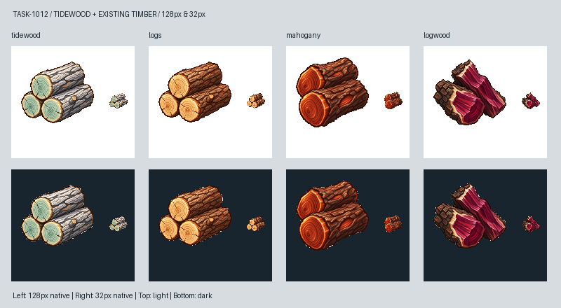

# 🖼️ 鹽霜裡的細年輪（Tidewood）

潮木是《Blocksail》向風海峽沿岸的奇幻硬木。這次我想讓它仍然像船匠手上的木料：三段短圓木堆在一起，有切口、枝節與樹皮。灰白鹽霜和淡海碧年輪提示它長在海邊，窄窄的暖色邊材則把它留在木頭的質感裡，不靠發光說明特殊性。設定來自 WORLD_LORE §3.4.1 與 TASK-1012，並非現實樹種。

構圖參考 Sirius 的新版原木與桃花心木白底原稿，另附 TASK-0896 工具原稿校準離散像素、左上光源與克制深框。成圖的年輪比「極細」更清楚，縮到 32px 後以冷綠切面和灰白樹皮區分普通原木的蜂蜜色、桃花心木的紅褐與染料木的紫紅；兩種底色都保留外輪廓。沒有改動三張既有圖。

原稿由內建 image_gen 生成，去除四邊連通近白背景後，最近鄰縮放至最大邊 104px，置中於 128px RGBA 畫布。完整實際提示詞保存在同名 prompt.txt；遊戲的 docs/evidence/tidewood1012/generation.json 記錄參考與原稿、交付圖的 SHA-256。下圖上排白底、下排深底，每格左側 128px、右側實際 32px。

[獨立白底原稿](../RawImages/meadow_blocksail_tidewood1012_master.png) · [完整生成提示詞](../RawImages/meadow_blocksail_tidewood1012_prompt.txt)

