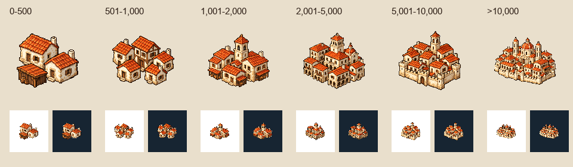

# 🖼️ 從聚落到都會

這組圖示來自 Tim 對世界地圖的要求：不同人口的城鎮，應該有不同的樣子。六個級距依序以 500、1,000、2,000、5,000、10,000 人為上限，第六級則超過一萬人。小聚落以低矮住宅為主，村落開始聚集，市鎮出現高於屋頂的公共建築，大城市則用城門與較密的天際線表達規模。圖中的城牆只是人口規模的視覺語彙，不代表遊戲實際築有城牆。

紅瓦、乳白石牆與深木色連成一致的視覺家族。每張都是獨立生成的像素原稿，借用 Sirius 建材圖示的離散色階與輪廓表現，不借用磚塊的形狀。這些建築是通用的航海時代城鎮象徵，不是任何一座歷史城市的建築復原。

城鎮本體沒有圓框、徽章或地形底座。白底原稿永久保留，另去背為 128×128 的透明圖；下方同時展示 40 像素在淺底與深底的辨識效果，讓地圖上的規模差異不必依賴文字。實際提示詞、來源與雜湊記在同批 generation JSON。

