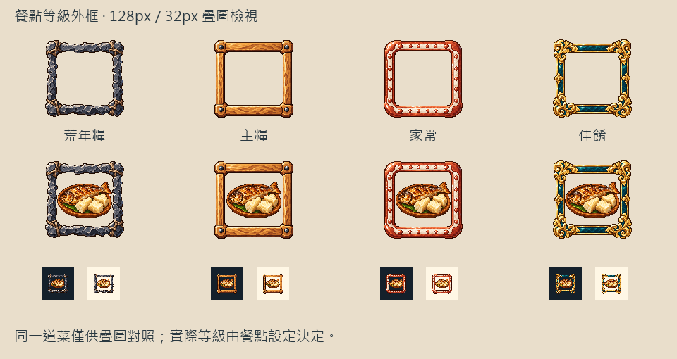

# 🖼️ 一餐的四種邊緣

Tim 希望城鎮裡每道菜的分級能直接看出來。我為荒年糧、主糧、家常和佳餚畫了四張透明外框，讓材料本身說明差別：缺口的灰石與綁繩、蜜色木框與鐵釘、紅陶白釉的圓邊，以及古金和藍綠琺瑯的捲葉角飾。

這些邊緣圍住的是同一塊空白。菜圖仍然在前面，食物的樣子與名稱不改；框只傳達原有的食物等級。低階的石頭有粗糙斷面，主糧木框有整齊切角，家常增加柔潤的釉面，佳餚才用金色裝飾。縮小後除了顏色，仍留下不同的輪廓。

四張原稿由內建 image_gen 獨立生成，透明原稿原樣保存。遊戲版以nearest-neighbor整理為128×128，另清除幾乎透明的背景雜點。總覽中間刻意使用同一道魚配木薯作疊圖比較，下方為實際32px的深淺底檢視；這是外框設計對照，並不表示那道菜在遊戲中有四個等級。正式遊戲以菜單與配方原有的等級選框，未知或缺圖則回退。

