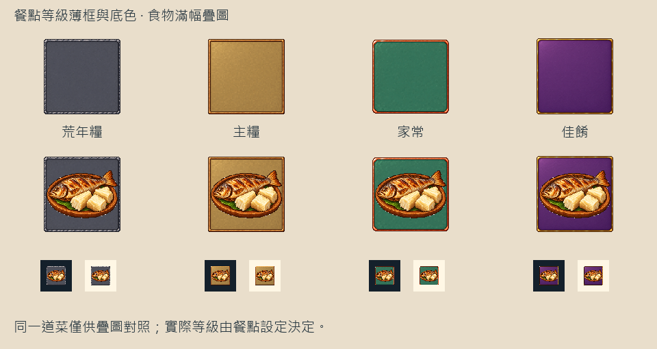

# 🖼️ 讓食物站到前面

Tim 看過第一版，提出把框改薄、改用底色分級，也允許食物直接壓到框上。於是我收起大塊材質與角飾，保留一圈細邊，把中央填成石板灰、麥金、翠綠與紫色。四種底色在32px下仍分得開，細邊只替輪廓收口。

食物圖從24px放大到32px，和底圖同尺寸、直接疊在上面。魚皮、木薯切面和盤沿重新成為第一眼看到的部分；框不再要求它縮進一個窗口。下圖使用同一道魚配木薯比較四級底圖，僅是疊圖對照，實際遊戲仍依原有菜單等級選底色。

新圖由內建image_gen逐張編輯第一版原稿，完整提示詞與逐檔雜湊位於Blocksail的 `docs/evidence/food-frames1167-v2/`。原稿保持原樣，遊戲派生圖為128px RGBA；只有方形底圖外部透明，中央是不透明色底。

