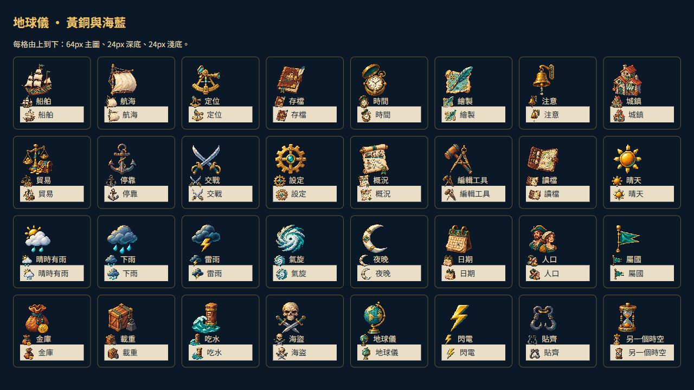

# 黃銅與海藍｜地球儀航海圖示

船長的操作桌可以由同一套材質組成：黃銅六分儀帶回船的位置，皮革航海日誌保管存檔，羽筆與海圖負責編輯，港口屋舍與商人天平接起城鎮和貿易。各張獨立設計，沒有把系統 emoji 放大重畫。

像素輪廓採深海藍，亮面從左上落下，以暖金屬與青綠配色統一。天氣圖示另外保留晴天、陣雨、降雨、雷雨和氣旋的清楚剪影。透明底讓素材直接落在地球儀的深色面板上，不另加圖示底牌。

32 張原稿皆由內建 image_gen 逐張生成，完整保留透明背景。遊戲版只做機械尺寸匯出，不重新去背。文字標籤和快捷鍵由介面保留，圖示也具有中文語意標籤。地圖與羅盤上的天氣、閃電和港口標記共用這套美術。

## 原稿與提示詞

原稿命名為 `RawImages/meadow_globe1191_<id>_master.png`。完整實際提示詞、生成路徑、原稿與遊戲版 SHA-256 收在[生成清單](../RawImages/meadow_globe1191_generation.json)。沒有給生成工具任何 emoji 圖片作參考。

航行與操作：ship、sail、focus、save、clock、edit、warning、anchor、combat、settings、overview、tools、load、magnet。

城鎮與船況：town、trade、calendar、people、flag、purse、cargo、draft、pirate、globe、hourglass。

天氣：sun、showers、rain、storm、cyclone、moon、lightning。

