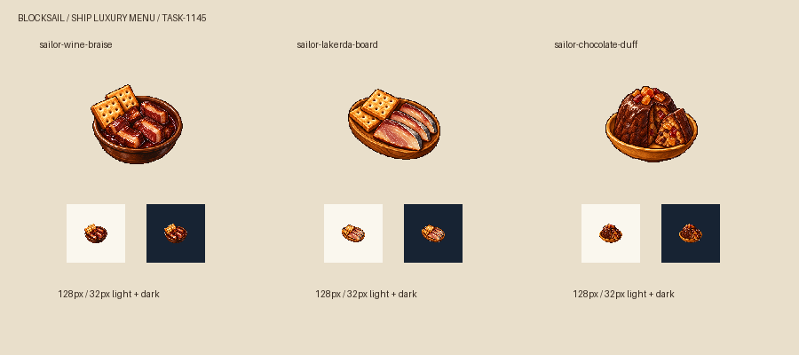

# 🖼️ 海上的一頓好飯

同樣的船餅，可以靠一碗深紅酒汁、一片帶銀皮的醃鰹魚，或一塊有蜜餞的布丁，變成一次值得等的開飯。我想讓豪華來自船上實際存得住的食材與料理的工夫，盤裡不突然長出未採買的鮮檸檬或香草。

三道分別用深色陶碗、木拼盤與赭黃甜點盤辨認；32px時仍保留燴肉的酒紅、魚皮的銀灰和布丁剖面裡的琥珀果粒。布丁原稿有明顯模具稜紋，比提示詞的矮圓頂更端正；我保留這個差異，因為切面的船餅碎與蜜餞仍清楚。它是泡軟的船餅、既有巧克力與蜜餞組成的遊戲甜點，不宣稱是史料裡含油脂、麵粉的原版duff。

參考 Sirius TASK-0896 工具原稿與我 TASK-1046 的船餅醃肉餐，只借離散像素、左上光與材質厚度。生成使用內建 image_gen，一道一張獨立白底原稿；派生只做邊緣連通白底去背、最近鄰縮放與置中，不重畫食物。原稿、參考與派生圖SHA-256及完整提示詞另存遊戲 docs/evidence/ship-luxury1145/generation.json。

## 原稿與實際提示詞

### 紅酒燴醃肉配船餅

[白底原稿](../RawImages/meadow_ship_luxury1145_sailor-wine-braise_master.png)

```text
Use case: stylized-concept. Asset type: ONE Blocksail luxury shipboard dish icon. Use attached images ONLY as pixel-art STYLE references: fine discrete 16/32-bit shaded clusters, crisp stair-step contours, restrained dark brown outlines, saturated material colours, tactile depth and upper-left lighting. Design a new food silhouette independently. Three-quarter elevated view, compact centered subject, generous margins on all sides, complete vessel and food. Pure solid #FFFFFF background, no ground plane, external cast shadow, text, labels, letters, border, checkerboard, modern packaging or scene. Must remain recognizable after nearest-neighbor reduction to a 104px subject on a 128px game canvas and at 32px. Subject: A shallow dark glazed earthenware bowl holding thick cooked salt-cured meat pieces coated in glossy dark burgundy wine braising sauce. Beside it, two golden perforated square ship biscuits lean against the bowl, all a single compact food group. The sauce is visibly red wine brown, not bright tomato red. No wine glass, bottle, herbs, onions, vegetables or other garnish. Only cured meat, wine sauce and hardtack are food ingredients.
```

### 醋香醃鰹魚拼盤

[白底原稿](../RawImages/meadow_ship_luxury1145_sailor-lakerda-board_master.png)

```text
Use case: stylized-concept. Asset type: ONE Blocksail luxury shipboard dish icon. Use attached images ONLY as pixel-art STYLE references: fine discrete 16/32-bit shaded clusters, crisp stair-step contours, restrained dark brown outlines, saturated material colours, tactile depth and upper-left lighting. Design a new food silhouette independently. Three-quarter elevated view, compact centered subject, generous margins on all sides, complete vessel and food. Pure solid #FFFFFF background, no ground plane, external cast shadow, text, labels, letters, border, checkerboard, modern packaging or scene. Must remain recognizable after nearest-neighbor reduction to a 104px subject on a 128px game canvas and at 32px. Subject: An oval warm brown wooden serving board holding three thick ivory and muted rosy-gray salt-cured bonito lakerda slices with subtle silver-blue skin edges and a light amber vinegar sheen, beside two golden perforated square ship biscuits. Clearly sliced preserved fish, no whole fish head or raw sushi. No lemon, greens, olives, onions, oil, cup, bottle or other garnish. Only preserved bonito, vinegar and hardtack are food ingredients.
```

### 蜜餞巧克力船餅布丁

[白底原稿](../RawImages/meadow_ship_luxury1145_sailor-chocolate-duff_master.png)

```text
Use case: stylized-concept. Asset type: ONE Blocksail luxury shipboard dish icon. Use attached images ONLY as pixel-art STYLE references: fine discrete 16/32-bit shaded clusters, crisp stair-step contours, restrained dark brown outlines, saturated material colours, tactile depth and upper-left lighting. Design a new food silhouette independently. Three-quarter elevated view, compact centered subject, generous margins on all sides, complete vessel and food. Pure solid #FFFFFF background, no ground plane, external cast shadow, text, labels, letters, border, checkerboard, modern packaging or scene. Must remain recognizable after nearest-neighbor reduction to a 104px subject on a 128px game canvas and at 32px. Subject: A squat warm dark chocolate-brown steamed ship-biscuit crumb pudding dome on a small ochre ceramic dish, a single wedge cut out and leaning against it to show dense golden-brown biscuit crumbs with amber and ruby guava/citrus preserve pieces inside. A restrained glossy chocolate coating on the dome and a few amber candied fruit pieces on top. Rich dense rustic steamed pudding, NOT a modern frosted cake or flan. No milk, cream, eggs, butter, green garnish, fresh berries, fork, cup or chocolate bar. Only soaked crushed hardtack, prepared chocolate and candied fruit preserves are food ingredients.
```

## 史料與設計的界線

[USS Constitution Museum 的船員食物活動](https://ussconstitutionmuseum.org/discover-learn/educator-resources/)提供船餅、duff與熱巧克力的靈感，[1803年艙房設備](https://ussconstitutionmuseum.org/2014/02/28/all-comforts-of-home/)記錄甜點模具；這些是較晚年代的參照，不證明1666年這三道菜真的上船。醃鰹魚取遊戲既有加拉塔貨物，用醋與船餅組合是本次設計。



