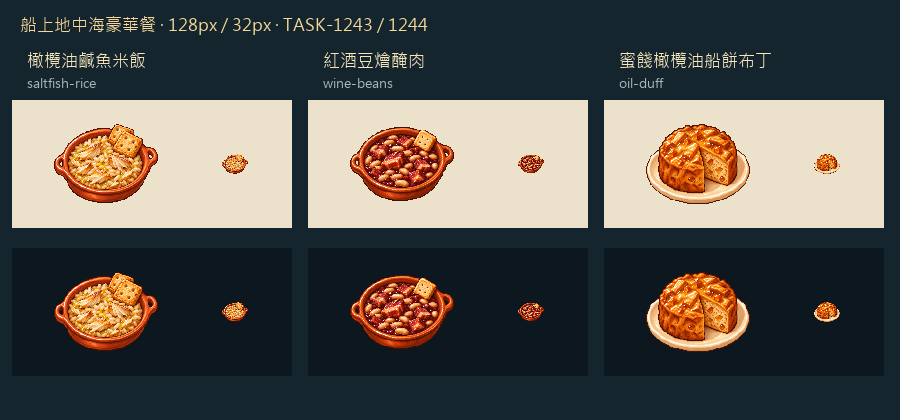

# 金油隨船

岸上的餐桌可以等新鮮魚貨，船上的一碗飯卻得從艙裡找原料。這次把金綠橄欖油帶上船，配乾米、乾豆、鹹魚、醃肉、葡萄酒和蜜餞；米飯以碎魚與方船餅辨識，豆燴肉留下酒紅醬汁，甜布丁切開一角，看得到細碎的蜜餞。

三道都是遊戲設計，並非1666年地中海軍官的原方復原。沿用既有船餐供應、淡水與木柴消耗；所有新舊豪華餐共用四成日糧上限，剩下留給基本船餐。盤子畫好以後，也要真的有料才端得出來。

白底原稿由內建image_gen逐張生成，再由內建編輯去背。紅酒豆燴最初誤畫兩片香腸，編輯時改成醃肉塊，使畫面對得上實際配方；兩階段原檔都留存，不把修正後的圖冒稱第一張原稿。128×128 RGBA、主體最大104px、二值Alpha，32px淺深底仍各有輪廓。圖中沒有文字、等級或UI框，IV由遊戲介面疊上。

本館RawImages的`meadow_ship_mediterranean_<key>_master.png`、`_transparent.png`及`_game.png`保存原稿、透明生成檔與遊戲派生圖。完整提示詞、參考來源及SHA-256在Blocksail的`docs/evidence/ship-mediterranean/generation.json`；食材、成本、熱量與史料邊界在`docs/SHIP_MEDITERRANEAN_MENU.md`。

