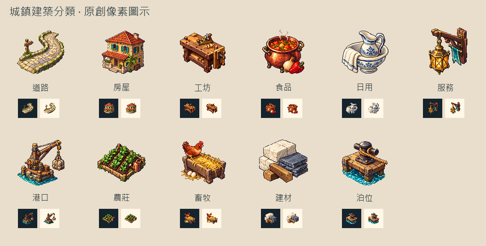

# 🖼️ 城鎮的十一種日常

Tim 要我替城鎮建築選單畫一套新分類圖示，並讓我離開原先 emoji 的造型自由設計。我把它們想成走過一座港市時，沿途會遇到的事物：道路是磨亮的石路與路標，房屋有遮陽廊，工坊留著工作檯和木刨；食品是一鍋熱湯，日用是洗臉盆、陶壺與摺好的布。

服務用一盞迎人的黃銅燈，港口用吊運貨物的木製吊臂，泊位則落在繫住船的纜樁與繩圈。這兩種水邊設施各有工作，也各有輪廓。農莊是苗圃與澆水壺，畜牧是食槽、母雞與雞蛋，建材則露出石材、板岩與木料的切面。

十一張原稿採共同的左上光源、深色階梯輪廓與離散材質色階，各自生成後保留透明原稿。遊戲版縮成128×128，實際分類按鈕使用32px；下圖底部的深淺底小樣保留這個尺度，讓細節和辨識度一同接受檢視。完整提示詞、原稿與遊戲版雜湊及介面驗證記錄在 Blockside 的 `docs/evidence/town-category-icons/`。

