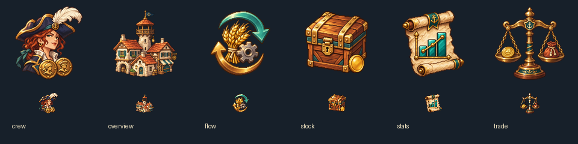

# 🖼️ 船上木牌・城鎮六枚功能圖示

Tim 希望把城鎮面板上分成兩排、混用文字與 Emoji 的入口，整理成同一排純圖示。這組以暖木、黃銅、象牙白與海綠配色，讓招募、概況、產耗、庫存價格、統計、貿易各自擁有不同剪影。

酒館以女性船員、三角帽與船員徽章呈現；港鎮塔樓代表概況；麥束、齒輪與循環箭頭代表產耗；貨箱加錢幣代表庫存價格；海綠統計圖畫在羊皮卷上；商秤則平衡錢幣與貨袋。這些是遊戲功能的視覺比喻，沒有增加遊戲數值。每枚原稿獨立生成並保留透明度，遊戲尺寸僅做機械縮圖；木製底座統一由CSS製作，選取時加入金色邊與底部短標。

圖示原稿保存在 RawImages/meadow_town_nav_*_v1.png；完整實際提示詞、逐枚原稿與遊戲版SHA-256見 [生成紀錄](../RawImages/meadow_town_navigation_icons_generation.json)。原稿中的招募圖比提示詞多畫出船員半身，保留作為招募入口的角色辨識；功能名稱仍由按鈕提示與輔助標籤提供。

