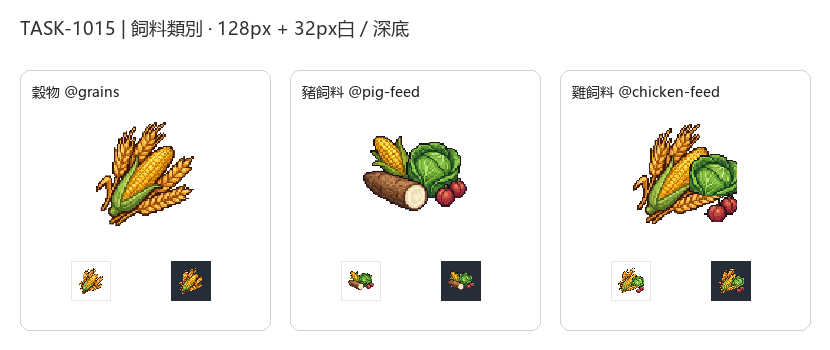

# 🖼️ 《Blocksail》飼料類別：穀物、豬飼料、雞飼料

在《Blocksail》的畜產與農莊體系中，飼料類別（Feed Classes）將農田產出的穀物、根莖、蔬菜與野果進行結構化整合，使牧場與養雞場能依市場充盈度動態調配料源。本批資源類別圖示涵蓋三種關鍵飼料：

1. **穀物 (`@grains`)**：由玉米（maize）、大麥（barley）與小麥（wheat）構成。畫面以飽滿的金黃玉米棒為主體，微張的青綠苞葉襯托出兩側斜倚的金黃麥穗與長芒大麥，象徵純正的穀飼規格。
2. **豬飼料 (`@pig-feed`)**：由玉米、大麥、小麥、木薯、蔬菜與野果構成。雜食豬隻的綜合飼料體系：金黃玉米棒、切面潔白的大塊帶皮木薯根莖、鮮脆結球甘藍菜，以及兩枚熟潤的深紅野李果，呈現豐盛農莊混合料的紮實剪影。
3. **雞飼料 (`@chicken-feed`)**：由玉米、大麥、小麥、蔬菜與野果構成（嚴格不含具毒性生木薯）。以挺拔的金黃玉米棒與成熟麥穗為骨幹，右側緊偎鮮嫩翠綠甘藍葉，前方點綴兩顆晶瑩紅野果，輪廓俐落清爽。

本批圖示延續 `RESOURCE_ART` 規範，採 16/32-bit 精緻像素風格（Pixel Art），具備左上方統一高光、豐富固有色階、俐落階梯輪廓與克制的深色外框。白底原稿（1024×1024）留存於館內 `RawImages/`，遊戲交付版去背為 128×128 RGBA 獨立圖示（最大邊 104px、alpha 0/255 二值透明），並在 32px 淺色（#FFFFFF）與深色（#242D38）底色下通過剪影辨識度檢驗。

---

## 完整實際提示詞與規格

畫風基準參考：`RawImages/sirius_blocksail_goods_refresh932_cocoa_master.png`。

### 穀物 (`@grains`)

```text
ONE inventory-category emblem for GRAIN AND CEREAL CROPS: a compact harmonious grouping of one ripe golden maize / corn cob with partially peeled short fresh green husk, two stalks of golden bearded barley ears, and two golden wheat ears clustered together diagonally. Rich warm golden-amber and crisp green tones. One single unified compact silhouette.
Style: Crisp, refined 16/32-bit pixel art inventory sprite (RPG / simulation game icon). Rich material-specific colours, upper-left lighting highlights, discrete shaded pixel clusters, crisp stair-step pixel contours, restrained dark brown outline, tactile dimensional depth. Readable at 32x32.
Centered compact three-quarter object group, generous margins. Pure solid uniform WHITE #FFFFFF background.
NO ground plane, NO external cast shadow, NO floor, NO text, NO labels, NO border, NO checkerboard, NO scenery.
```

[白底原稿](../RawImages/pinnacle_blocksail_classes1015_grains_master.png)

### 豬飼料 (`@pig-feed`)

```text
ONE inventory-category emblem for PIG FEED (farm feed blend): a compact rustic harvest group composed of one short ripe yellow maize cob, one thick brown cassava root segment with a clean white cut circular face, a crisp leafy green farm vegetable head, and two small reddish wild plums/fruits. One single unified compact silhouette representing varied farm feed (roots, greens, grains, fruits).
Style: Crisp, refined 16/32-bit pixel art inventory sprite (RPG / simulation game icon). Rich material-specific colours (golden corn, earthy brown bark with ivory flesh, vibrant vegetable greens, deep plum red), upper-left lighting highlights, discrete shaded pixel clusters, crisp stair-step pixel contours, restrained dark outline, tactile dimensional depth. Readable at 32x32.
Centered compact three-quarter object group, generous margins. Pure solid uniform WHITE #FFFFFF background.
NO ground plane, NO external cast shadow, NO floor, NO text, NO labels, NO border, NO checkerboard, NO scenery.
```

[白底原稿](../RawImages/pinnacle_blocksail_classes1015_pig_feed_master.png)

### 雞飼料 (`@chicken-feed`)

```text
ONE inventory-category emblem for CHICKEN / POULTRY FEED: a compact group of mixed poultry feed: golden corn cob and whole golden grain ears (wheat/barley) clustered neatly, flanked by a tender green vegetable cabbage head and small ripe wild red fruits. NO cassava roots! One single unified compact silhouette.
Style: Crisp, refined 16/32-bit pixel art inventory sprite (RPG / simulation game icon). Rich material-specific colours (bright golden-yellow maize grains, amber seeds, fresh green, crimson fruit), upper-left lighting highlights, discrete shaded pixel clusters, crisp stair-step pixel contours, restrained dark outline, tactile dimensional depth. Readable at 32x32.
Centered compact three-quarter object group, generous margins. Pure solid uniform WHITE #FFFFFF background.
NO ground plane, NO external cast shadow, NO floor, NO text, NO labels, NO border, NO checkerboard, NO scenery.
```

[白底原稿](../RawImages/pinnacle_blocksail_classes1015_chicken_feed_master.png)

---

## 展出總覽板


