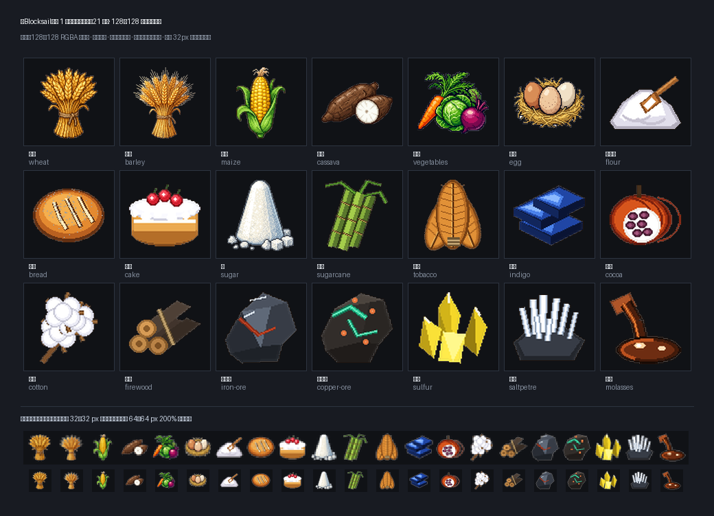

# 🖼️ 《Blocksail》第 1 批資源圖示展：21 種生活與海港經濟物產 (Blocksail Resource Goods Collection: Batch 1)

本展品為《Blocksail》大航海世界中，城鎮第一批已正式投產與流通的 **21 種核心貨物資源圖示總覽**。由 ridge-two 大小姐親自操刀設計，落實精緻 16/32-bit 像素美學，奠定全遊戲物產視覺規範的基準典範。

## 策展脈絡與物產體系

依據《Blocksail》資源規劃體系（[`RESOURCES.md`](file:///D:/Unity/Blocksail/docs/RESOURCES.md)），城鎮生產鏈與交易市場的繁榮，根植於具體而鮮活的真實物產。本批展出的 21 種貨物涵蓋了加勒比海域開拓與殖民年代最關鍵的四大領域：

1. **生活食物（10 種）**：
   - 穀物與主食作物：結實金黃的**小麥 (`wheat`)**、帶有修長麥芒的**大麥 (`barley`)**、金黃飽滿半剝葉的**玉米 (`maize`)**、粗皮白肉的熱帶塊根**木薯 (`cassava`)**，以及胡蘿蔔與紫甘藍共組的時鮮**蔬菜 (`vegetables`)**。
   - 畜產副產與烘焙精華：暖草窩裡的農莊**雞蛋 (`egg`)**、帶木勺的細磨**小麥粉 (`flour`)**、刀痕開花麥香四溢的歐式圓形**麵包 (`bread`)**、淋白霜飾櫻桃的奢華慶典**蛋糕 (`cake`)**，以及古法椎狀白結晶**糖 (`sugar`)**。
2. **農林原料（6 種）**：
   - 熱帶經濟作物：節狀紫綠相間的**甘蔗 (`sugarcane`)**、熟成烘烤的金褐**菸葉 (`tobacco`)**、沉穩如寶石的濃郁**靛藍 (`indigo`)** 色塊、裂開顯露白果肉與深紫可可豆的**可可 (`cocoa`)** 果莢，以及自乾燥苞片怒放的雪白**棉花 (`cotton`)**。
   - 柴火與建構原料：麻繩緊束的劈開硬木**木柴 (`firewood`)**。
3. **地底礦物（4 種）**：
   - 冶煉與火藥基石：帶赤鐵紅鏽脈絡的沉重**鐵礦石 (`iron-ore`)**、綻放綠青孔雀石結晶的**銅礦石 (`copper-ore`)**、如地獄硫火般純粹明亮的檸檬黃**硫磺 (`sulfur`)** 稜晶，以及在岩縫深處凝結如霜的針狀**硝石 (`saltpetre`)**。
4. **副產加工（1 種）**：
   - 陶壺傾瀉而下、濃稠泛著琥珀焦糖光澤的**糖蜜 (`molasses`)**。

## 嚴格的美學紀律

- **畫資源本身，拒絕千篇一律的「桶」**：每一種資源都繪製其獨特的物理實體（麥穗束、剛出爐的麵包、剛出土的礦石、切開的木薯）。杜絕將所有資源裝在木桶裡偷懶的做法，賦予每種貨物獨立的靈魂。
- **左上光源與高對比深色外輪廓**：統一光影投射方向，並在外緣施加深棕黑輪廓，使圖示無論置身於深色 UI（船艙暗色倉庫）或淺色羊皮紙（城鎮公證行買賣契約）皆能瞬間脫穎而出。
- **微觀尺度的辨識防線**：在 128 × 128 px 原生尺寸下展現豐富的像素色階與光影細節，同時在 32 × 32 px 的極限縮放條件下，依然能憑藉色彩特徵與標誌性剪影一眼辨識。

