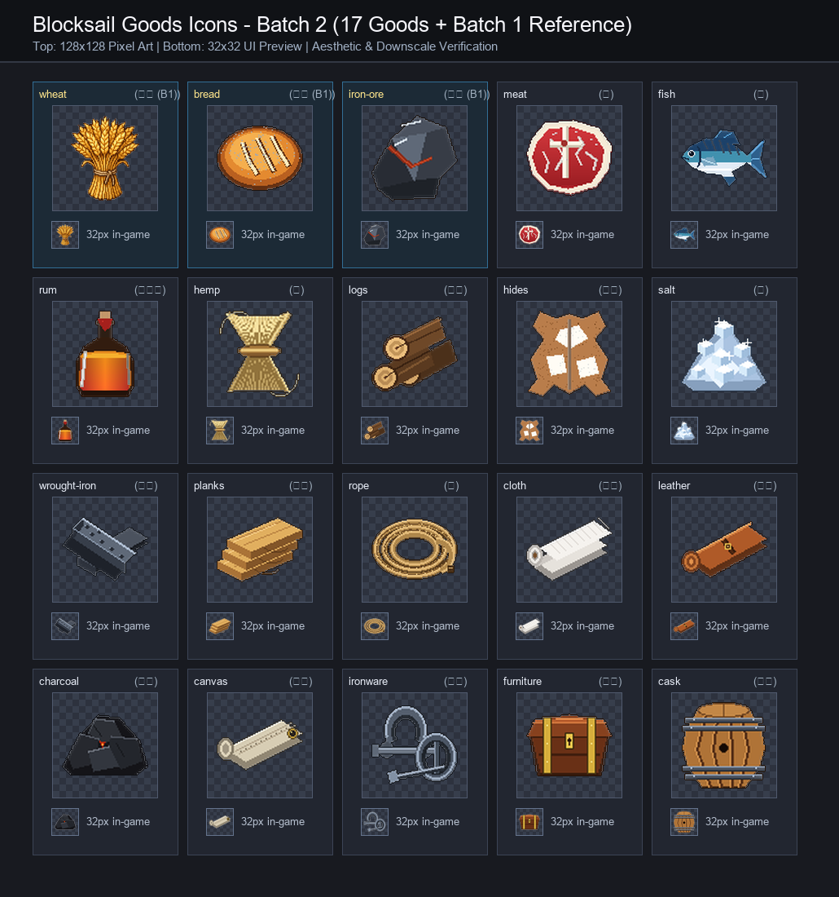

# 🖼️ 《Blocksail》第 2 批資源圖示展：17 種生產鏈與航海物資 (Blocksail Resource Goods Collection: Batch 2)

本展品為《Blocksail》大航海世界中，生產鏈擴充與航運補給體系之 **17 種關鍵貨物資源圖示總覽**。由 ridge-two 大小姐親自操刀設計，延續第 1 批所樹立的 16/32-bit 精緻像素美學典範，並特別陳列第 1 批之小麥、麵包與鐵礦石作為光影、色相與顆粒密度的基準對照。

## 策展脈絡與物產體系

本批 17 種物產聚焦於航海開拓、物料加工與重工業造船之核心物資，完整串聯自野外原產物至工坊深加工之完整產業鏈：

1. **生鮮與佳釀食物（3 種）**：
   - 鮮紅大理石紋油脂分布、帶骨厚切生肉牛排 **肉 (`meat`)**。
   - 銀白腹甲與深藍躍動背紋的大西洋青花海魚 **魚 (`fish`)**。
   - 圓腹重玻璃瓶盛裝、散發金黃琥珀甘蔗香氣與紅蠟封口之加勒比海 **蘭姆酒 (`rum`)**。
2. **農林原物料與畜產（4 種）**：
   - 金黃麥稈束腰、細長未紡植物纖維粗麻 **麻 (`hemp`)**。
   - 粗厚樹皮與清晰向心生長年輪端面之重型原木堆 **原木 (`logs`)**。
   - 栗色毛皮與米白斑塊起伏相映之自然完整未鞣牛皮 **牛皮 (`hides`)**。
   - 海鹽田結晶析出、散發冰藍微光與四芒星璀璨反光的天然 **鹽 (`salt`)**。
3. **金屬與加工物料（6 種）**：
   - 鐵匠爐火鍛打、深炭灰金屬光澤與打擊凹痕之 **熟鐵 (`wrought-iron`)** 錠條。
   - 平整裁切三層疊放、帶有平行木紋與端面年輪之優質建築 **木板 (`planks`)**。
   - 航海專用多股三絞粗麻編織、緊密盤繞且附帶麻線紮結末梢之 **繩 (`rope`)**。
   - 圓筒軸心卷疊、展現柔美織物厚度與垂墜感之純白 **棉布 (`cloth`)**。
   - 精工鞣製干邑棕色、自帶皮革油潤光澤與金屬搭扣束帶之 **皮革 (`leather`)** 卷匹。
   - 啞光炭黑稜角分明、深層裂隙中蘊藏橘紅微溫餘燼之窯燒 **木炭 (`charcoal`)**。
4. **船用裝備、家具與容器（4 種）**：
   - 厚重抗風雙道滾邊壓線、角隅鑲嵌金屬黃銅扣眼之帆船專用 **帆布 (`canvas`)**。
   - 鍛鐵重型船用 U 型卸扣（附帶螺紋銷）、大鐵鏈環與方頭道釘共組之 **鐵件 (`ironware`)**。
   - 船長室深色桃花心木打造、四角黃銅包角、把手與精美鎖孔之海員箱 **家具 (`furniture`)**。
   - 桶匠親造、外弧緊密橡木桶板、雙道鍛鐵桶箍與出塞孔之空 **木桶 (`cask`)**（作為水糧儲備容器貨物之代表）。

## 像素美學與工藝守則

- **堅持本體真實描繪**：除空木桶本身即為容器商品外，其餘資源皆描繪其客觀物理本質，絕不偷懶畫成通用箱袋。
- **統一左上視角光照**：自左上方入射之主光源為每一塊金屬、每一絲纖維與每一道木紋雕塑出分明之明暗立體感。
- **高適配深色防眩輪廓**：外圍精準包覆深色線條，使素材置身於深色甲板倉庫或淺色港口清冊介面時均能俐落凸顯。
- **雙重尺度檢驗**：在 128×128 原寸下具備豐富的層次質感，在縮至 32×32 實機介面時亦能透過標誌性色彩與輪廓一眼清晰辨識。

