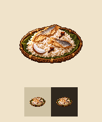

# 《Blocksail》安汶船餐

藤盤上鋪葉盛飯，白色椰肉與深色丁香用色差分開，鹹魚保留魚皮和魚肉兩段。藤盤的橢圓外形讓它和巴達維亞船餐的陶碗在小尺寸時容易分辨。

使用內建 ImageGen，參考巴達維亞船餐的像素輪廓與左上光。遊戲成品為 128×128 RGBA，驗過 32px 明暗底。完整提示詞及雜湊收在 Blocksail 的 TASK-1396 生成紀錄。

[透明原稿](../RawImages/sirius_blocksail_ambon_ship_menu1396_master.png)
