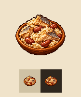

# 《Blocksail》巴達維亞船餐

鹹魚、乾豆和米飯是這道遊戲內常備熱餐的全部食材。陶碗與粗鹹魚片留出清楚的外緣，紅棕色豆與米白底的色差在 32px 仍把主食和配料分開。

這張圖以既有鹹魚配硬餅乾菜圖作視覺參考，經內建 ImageGen 產生。遊戲版是 128×128 RGBA，量過明暗底的 32px 縮圖。完整生成提示詞、來源和雜湊收在 Blocksail 的 TASK-1378 生成紀錄。

[透明生成原稿](../RawImages/sirius_blocksail_batavia_rations1378_master.png)
