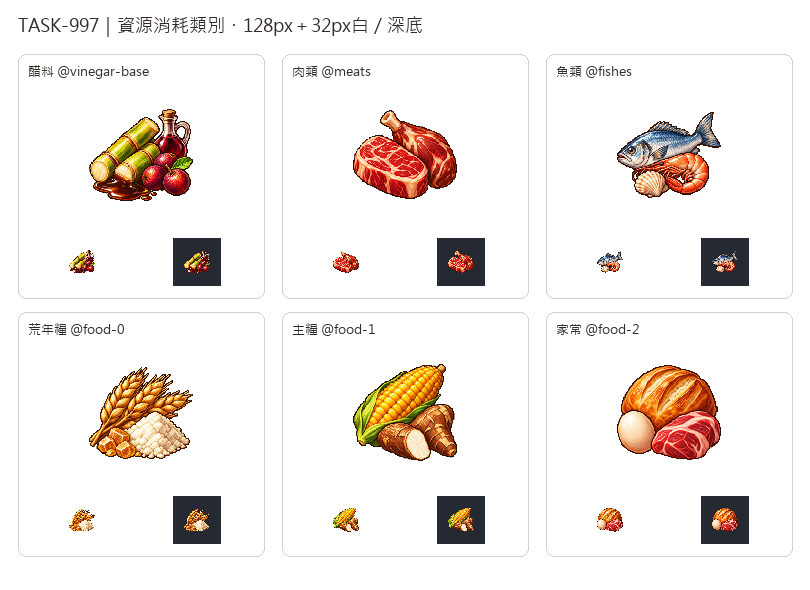

# 🖼️ 《Blocksail》一類物產的模樣

一個類別能由多種原料滿足，圖案也讓幾種物產共處。醋料把糖蜜、甘蔗、野果及少量葡萄酒放在一起；肉類以兩種肉切面、魚類以魚蝦貝的組合表達。這些組合是辨識標誌，不表示配方每次都要同時吃完圖中所有東西。

荒年糧、主糧、家常依目前實際啟用的food-0/1/2分類繪製：麥與粉、玉米與木薯、麵包雞蛋與肉。組合只取代表，不是完整成員清單，也不改變遊戲食物等級。畫風只參考新版可可白底原稿，保留左上光源、離散像素明暗與清楚輪廓。

六張原稿由內建image_gen分別生成，白底完整保留；另製128px透明圖與32px白深底驗收。先在本館展出後，再匯入遊戲img/goods/@<類別>.png。專屬圖缺失時仍沿既有規則借主類圖，未把類別當成新增實體貨物。完整實際提示詞如下。

### 醋料

```text
ONE inventory-category emblem for VINEGAR FERMENTATION INGREDIENTS: a compact group of two short freshly cut green sugarcane segments leaning diagonally, a small deep amber-brown glossy molasses puddle at their base, three ripe reddish-purple wild fruits with one small green leaf, and a very small dark glass cruet holding ruby wine behind them. Four ingredients form ONE coherent silhouette. No grapes, finished vinegar, labels, barrels, bags, crates, ground or scenery. Use attached new CACAO solely as pixel-art rendering STYLE reference, not content: rich material-specific colours, left-upper light, discrete shaded pixel clusters, crisp stair-step edges, restrained dark brown outline, tactile dimensional depth. Exquisite16/32-bit game sprite, readable at32px, independently designed category symbol without badge border. Compact centered three-quarter view, ample blank margin on all four sides, PURE SOLID WHITE #FFFFFF background. No floor, external cast shadow, text, letters, numbers, labels, watermark, border, checkerboard. Preserve white master; separate128px transparent sprite will be derived.
```

[白底原稿](../RawImages/sirius_blocksail_classes997_vinegar_base_master.png)

### 肉類

```text
ONE inventory-category emblem for MEATS: one thick fresh rosy-red oval beef steak with white marbling and creamy fat edge, leaning against a compact brown-red game haunch with one short ivory bone end. Raw butchered food only, no blood puddles, animal faces, platter, knife, labels, barrels, sacks or scenery. Clearly two different cuts in ONE compact silhouette. Use attached new CACAO solely as pixel-art rendering STYLE reference, not content: rich material-specific colours, left-upper light, discrete shaded pixel clusters, crisp stair-step edges, restrained dark brown outline, tactile dimensional depth. Exquisite16/32-bit game sprite, readable at32px, independently designed category symbol without badge border. Compact centered three-quarter view, ample blank margin on all four sides, PURE SOLID WHITE #FFFFFF background. No floor, external cast shadow, text, letters, numbers, labels, watermark, border, checkerboard. Preserve white master; separate128px transparent sprite will be derived.
```

[白底原稿](../RawImages/sirius_blocksail_classes997_meats_master.png)

### 魚類

```text
ONE inventory-category emblem for FISH AND SEAFOOD: a whole silvery blue fish in a gentle rising diagonal, with a curled coral-red shrimp overlapping the lower front and one small cream ridged seashell at the base. Clean food illustration, no gore, fishing equipment, water waves, plate, ice, seaweed, writing, barrels or sacks. ONE compact rounded group, full fish tail visible. Use attached new CACAO solely as pixel-art rendering STYLE reference, not content: rich material-specific colours, left-upper light, discrete shaded pixel clusters, crisp stair-step edges, restrained dark brown outline, tactile dimensional depth. Exquisite16/32-bit game sprite, readable at32px, independently designed category symbol without badge border. Compact centered three-quarter view, ample blank margin on all four sides, PURE SOLID WHITE #FFFFFF background. No floor, external cast shadow, text, letters, numbers, labels, watermark, border, checkerboard. Preserve white master; separate128px transparent sprite will be derived.
```

[白底原稿](../RawImages/sirius_blocksail_classes997_fishes_master.png)

### 荒年糧

```text
ONE inventory-category emblem for RAW EMERGENCY FOOD INGREDIENTS: a short sheaf of three golden mature wheat ears diagonally behind a compact mound of ivory coarse flour and a few amber sugar crystals beside it. Clearly RAW ingredients, no bread, cooked meals, plate, spoon, sacks, bowl, box, signs, warning symbols or text. Warm cream and gold material tones; ONE coherent compact shape, flour contained within the object silhouette. Use attached new CACAO solely as pixel-art rendering STYLE reference, not content: rich material-specific colours, left-upper light, discrete shaded pixel clusters, crisp stair-step edges, restrained dark brown outline, tactile dimensional depth. Exquisite16/32-bit game sprite, readable at32px, independently designed category symbol without badge border. Compact centered three-quarter view, ample blank margin on all four sides, PURE SOLID WHITE #FFFFFF background. No floor, external cast shadow, text, letters, numbers, labels, watermark, border, checkerboard. Preserve white master; separate128px transparent sprite will be derived.
```

[白底原稿](../RawImages/sirius_blocksail_classes997_food_0_master.png)

### 主糧

```text
ONE inventory-category emblem for STAPLE FOODS: a plump golden yellow maize cob, partly wrapped in a short green husk, diagonally behind two short brown cassava root segments with one clean white cut face. Two complementary carbohydrate staples, no other garnish, no plate, sack, bowl, lettering, barrels or scenery. ONE compact broad silhouette, keep the green husk short and tidy. Use attached new CACAO solely as pixel-art rendering STYLE reference, not content: rich material-specific colours, left-upper light, discrete shaded pixel clusters, crisp stair-step edges, restrained dark brown outline, tactile dimensional depth. Exquisite16/32-bit game sprite, readable at32px, independently designed category symbol without badge border. Compact centered three-quarter view, ample blank margin on all four sides, PURE SOLID WHITE #FFFFFF background. No floor, external cast shadow, text, letters, numbers, labels, watermark, border, checkerboard. Preserve white master; separate128px transparent sprite will be derived.
```

[白底原稿](../RawImages/sirius_blocksail_classes997_food_1_master.png)

### 家常

```text
ONE inventory-category emblem for EVERYDAY QUALITY FOODS: a small round golden baked bread loaf with three scoring slashes, a single ivory chicken egg at left and a compact rosy-red meat cut leaning against the lower-right front. Three food ingredients arranged as ONE compact triangular icon group. No plate, cutlery, cooked restaurant meal, flames, sparkles, labels, sacks, barrels or scenery. Strong bread/egg/meat forms distinguish this category from maize staple foods. Use attached new CACAO solely as pixel-art rendering STYLE reference, not content: rich material-specific colours, left-upper light, discrete shaded pixel clusters, crisp stair-step edges, restrained dark brown outline, tactile dimensional depth. Exquisite16/32-bit game sprite, readable at32px, independently designed category symbol without badge border. Compact centered three-quarter view, ample blank margin on all four sides, PURE SOLID WHITE #FFFFFF background. No floor, external cast shadow, text, letters, numbers, labels, watermark, border, checkerboard. Preserve white master; separate128px transparent sprite will be derived.
```

[白底原稿](../RawImages/sirius_blocksail_classes997_food_2_master.png)


