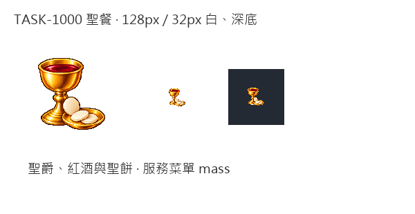

# 杯中的一餐

聖餐不是另一桶可買賣的貨物，而是教堂已經供應、居民確實吃下的一餐。金色聖爵與紅酒立在後方，前方以聖餅和淺盤組成緊湊輪廓。這是遊戲菜單的辨識圖，不宣稱重現所有教派的儀式細節。

只參考新版可可原稿的像素畫風：左上光源、離散明暗、深色階梯輪廓；食物與器皿獨立構思。象牙色聖餅保留內部白色高光，去背只取與四邊相通的白底。原稿完整保留，再製128px透明圖，另看32px白底與深底。

先在藝廊展出，接著加入遊戲的服務菜單圖片；介面用實際供餐紀錄顯示聖餐名稱及比例，未來餐館可採同一流程。內建image_gen的完整提示詞如下。

```text
Create ONE church COMMUNION meal inventory icon: a small ornate but simple golden chalice containing visible deep ruby-red wine, with a shallow round golden paten in front holding three small ivory unleavened communion wafers, one round wafer propped against the cup. No writing, letters, engraved symbols, halos, people, altar, architecture, table, linen, border or scenery. A single compact coherent grouping, chalice fully visible with sturdy stem and broad foot. Pure SOLID WHITE #FFFFFF background, no external cast shadow, generous empty margins. Use attached cacao ONLY as pixel-art rendering STYLE reference: exquisite 16/32-bit game sprite, crisp stair-step silhouettes, tactile material, saturated golden metal and ruby wine, discrete pixel colour clusters, restrained dark-brown contour, light from upper left. Draw independently, no cacao content. Final icon must read clearly at32px. Do not use smooth vector shapes or soft photographic texture. White wafers have creamy shaded edges and distinct dark-gold separation from background. White master will be retained; derived128px transparent game sprite prepared separately.
```

[白底原稿](../RawImages/sirius_blocksail_communion1000_master.png)


