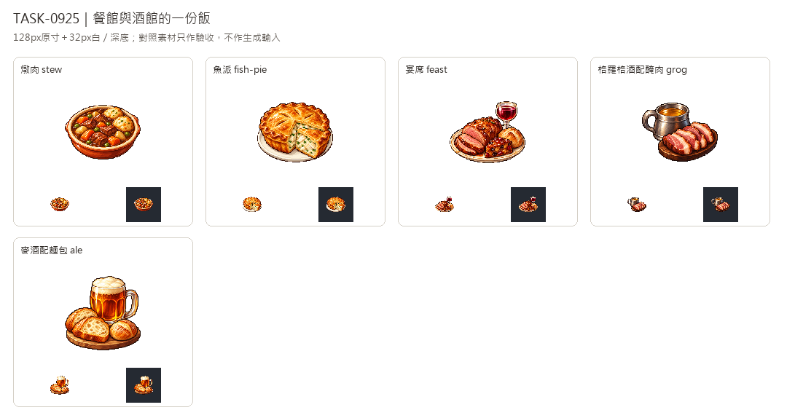

# 🖼️ 《Blocksail》從家灶到宴席｜餐館與酒館菜

Tim指定沿用新版畫風。五張各自用內建image_gen生成，唯一畫風附圖為新版可可獨立白底原稿，沿用左上光源、離散像素層次與深色階梯輪廓。依PRODUCTION §13.1的提案，這次畫的是一份上桌的餐點，保留盤、碗與飲用器皿。

燉肉用肉塊、根菜與濃醬，魚派以金黃酥皮及魚肉切面區分甜點。宴席最豐盛，一盤有烤肉、麵包與蛋糕，並配紅葡萄酒；格羅格酒配醃肉以無泡沫酒液和肉片呈現，麥酒則用帶泡沫的玻璃杯與麵包搭配。

透明版128×128、主體最大邊104px，另驗32px白深底及杯把孔洞。對照板保留家常麥粥、玉米糊、魚配木薯，讓餐館菜的豐盛與細緻呈現在同一套像素語彙中。完整白底原稿另存，提示詞與SHA見Blocksail docs/evidence/dishes-batch15/generation.json。

這批只是預繪菜圖，沒有啟用餐館酒館或更動配方。規劃菜表與家常菜配方分開登錄，貨物圖示數量不變；菜圖檢查器驗證兩者，避免把規劃圖誤認為多餘檔案。

## 完整實際提示詞

工具：內建image_gen。唯一畫風輸入：`RawImages/sirius_blocksail_goods_refresh932_cocoa_master.png`；菜色文字依`PRODUCTION.md` §13.1。

### 燉肉 (stew)

```text
Create ONE Blocksail DISH inventory icon of RESTAURANT MEAT STEW, one generous served portion in a shallow glazed terracotta bowl with a cream rim. Rich glossy dark-brown gravy with distinct tender browned meat cubes, orange carrot pieces, pale root-vegetable chunks and a few green peas; two small golden flour dumplings nestled at one side. Appetizing hearty cooked food with elegant compact plating, no raw meat, utensils, recipe text, steam cloud, table or scenery. More refined and abundant than a simple household porridge. Use attached NEW CACAO solely as pixel-art rendering STYLE reference: saturated material-specific colours, upper-left highlights, discrete fine shaded pixel clusters, crisp stair-step contour, restrained dark outlines, tactile dimensional depth. Design subject independently, no cacao and no forcing orange onto unrelated materials. Polished 16/32-bit inventory sprite, readable at32px. ONE compact centered three-quarter object or group, complete silhouette and generous margins, pure solid WHITE #FFFFFF background, no ground plane or external cast shadow, no text, labels, watermark, checkerboard or scenery. White original retained; separate transparent128px game version derived.
```

### 魚派 (fish-pie)

```text
Create ONE Blocksail DISH inventory icon of RESTAURANT FISH PIE, a small round golden-brown pastry-crust pie with one neat triangular slice pulled slightly forward on a simple cream ceramic plate. Flaky crimped crust, shallow vent scores, pale creamy filling visibly packed with ivory cooked fish flakes and small green herb flecks. Pie itself dominates with a savory substantial filling, no fruit, cherries, sugar glaze, sweet cake decorations, cutlery, text, table or steam cloud. Use attached NEW CACAO solely as pixel-art rendering STYLE reference: saturated material-specific colours, upper-left highlights, discrete fine shaded pixel clusters, crisp stair-step contour, restrained dark outlines, tactile dimensional depth. Design subject independently, no cacao and no forcing orange onto unrelated materials. Polished 16/32-bit inventory sprite, readable at32px. ONE compact centered three-quarter object or group, complete silhouette and generous margins, pure solid WHITE #FFFFFF background, no ground plane or external cast shadow, no text, labels, watermark, checkerboard or scenery. White original retained; separate transparent128px game version derived.
```

### 宴席 (feast)

```text
Create ONE Blocksail DISH inventory icon of FEAST SERVED FOR ONE, the richest of this game's meal icons: one compact elegant cream oval platter holding a generous browned roast meat portion with two thick slices, a small crusty bread roll and a neat little slice of glazed fruit cake arranged distinctly. A small clear stemmed goblet of ruby red wine immediately behind the platter, all objects grouped tightly and completely visible. Rich appetizing warm food colours, ivory dish, restrained silver detail, celebratory abundance but readable simple masses at32px. No whole banquet table, extra plates, fruit bowl, candles, utensils, people, text, scenery or floating steam. Use attached NEW CACAO solely as pixel-art rendering STYLE reference: saturated material-specific colours, upper-left highlights, discrete fine shaded pixel clusters, crisp stair-step contour, restrained dark outlines, tactile dimensional depth. Design subject independently, no cacao and no forcing orange onto unrelated materials. Polished 16/32-bit inventory sprite, readable at32px. ONE compact centered three-quarter object or group, complete silhouette and generous margins, pure solid WHITE #FFFFFF background, no ground plane or external cast shadow, no text, labels, watermark, checkerboard or scenery. White original retained; separate transparent128px game version derived.
```

### 格羅格酒配醃肉 (grog)

```text
Create ONE Blocksail DISH inventory icon of GROG WITH SALT MEAT, one served tavern meal: a low squat unadorned pewter handled cup filled with translucent light amber diluted rum, next to a small dark wooden oval serving board carrying several thick slices of cooked cured salt meat, pinkish-brown lean centres with narrow ivory fat edges. Compact cup-plus-meat group, drink has NO foam, no beer head, no citrus or garnish. Visually rustic but well plated, no bottles, barrel, raw meat, bread, branding, text, table, cutlery or scenery. Cup handle interior is plain white background. Use attached NEW CACAO solely as pixel-art rendering STYLE reference: saturated material-specific colours, upper-left highlights, discrete fine shaded pixel clusters, crisp stair-step contour, restrained dark outlines, tactile dimensional depth. Design subject independently, no cacao and no forcing orange onto unrelated materials. Polished 16/32-bit inventory sprite, readable at32px. ONE compact centered three-quarter object or group, complete silhouette and generous margins, pure solid WHITE #FFFFFF background, no ground plane or external cast shadow, no text, labels, watermark, checkerboard or scenery. White original retained; separate transparent128px game version derived.
```

### 麥酒配麵包 (ale)

```text
Create ONE Blocksail DISH inventory icon of ALE WITH BREAD, one served tavern meal: a tall rounded clear glass tankard of warm amber-brown ale with a modest thick ivory foam head and one simple handle, next to two golden crusty bread slices and a small bread roll on a compact pale wooden serving board. Crisp bread crumb and toasted crust, translucent ale and foam clearly visible; compact tankard-plus-bread composition readable at32px. No meat, rum bottle, labels, logos, text, cutlery, table, scenery or external foam splashes. Handle opening is plain white background. Use attached NEW CACAO solely as pixel-art rendering STYLE reference: saturated material-specific colours, upper-left highlights, discrete fine shaded pixel clusters, crisp stair-step contour, restrained dark outlines, tactile dimensional depth. Design subject independently, no cacao and no forcing orange onto unrelated materials. Polished 16/32-bit inventory sprite, readable at32px. ONE compact centered three-quarter object or group, complete silhouette and generous margins, pure solid WHITE #FFFFFF background, no ground plane or external cast shadow, no text, labels, watermark, checkerboard or scenery. White original retained; separate transparent128px game version derived.
```



[含三道家常菜的驗收對照](../RawImages/sirius_blocksail_dishes_batch15_comparison.png)
