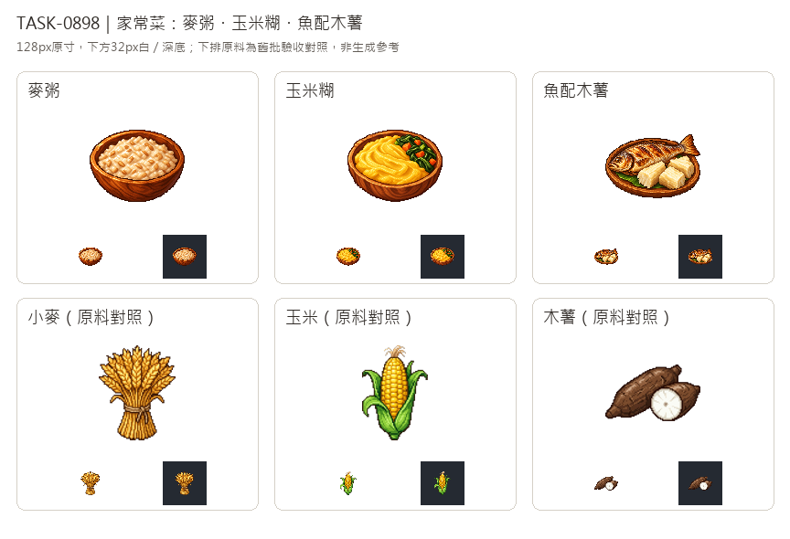

# 🖼️ 《Blocksail》家裡的灶｜三道家常菜

這三份飯是遊戲「家裡的灶」配方的圖像：麥粥用膨軟的米白麥粒表現煮食的黏稠感；玉米糊以明亮黃色、柔軟旋紋和蔬菜區分；魚配木薯則讓整魚與淺色纖維根塊佔據盤面。器皿承接食物，也讓它們和還沒下鍋的原料有清楚差別。這是遊戲配方的美術設定，並非特定歷史菜餚的考證。

依 Tim 最新指示，畫風只參考 Sirius 第3批的黏土及工具獨立白底原稿：左上光源、深色輪廓、離散像素色階與材質厚度；沒有把參考物件本身畫進飯裡。三道各自生成，白底原稿完整留存，另整理為128×128透明遊戲圖，主體最大邊104px。煮好的白色麥粒及木薯高光也保留，不因去背而挖空。

總覽上排是菜、下排是任務指定的小麥、玉米及木薯舊批原料對照；舊批原料沒有送入生成工具。每格128px原寸並列32px白／深底縮圖，檢視剪影、食材差別與去背邊緣。配方食物等級照遊戲設定為1、1、2，不以圖片自行更改模擬規則。

## 完整實際提示詞

工具：內建 image_gen。風格參考原稿：`RawImages/sirius_blocksail_goods_batch3_clay_master.png`、`RawImages/sirius_blocksail_goods_batch3_tools_master.png`。

### 麥粥 (porridge)

```text
Use case: stylized-concept. ONE prepared home-cooked meal inventory icon for a Caribbean age-of-sail game. STYLE ONLY from the attached Sirius batch-3 icons: fine 16/32-bit pixel art, rich material-specific colours, discrete shaded pixel clusters, crisp stair-step edges, restrained dark brown outline and tactile dimensional depth. Do not copy the tools or clay objects. Upper-left lighting. Compact centered three-quarter top/front view, entire serving visible, generous equal margins, clear silhouette at32px. PURE SOLID WHITE #FFFFFF background, no ground plane or external shadow, no steam, no lettering, no label, no border, no checkerboard. White master for later transparent128px delivery. SUBJECT: a humble shallow dark honey-brown wooden bowl filled with thick WHEAT PORRIDGE: pale beige swollen broken wheat grains visibly simmered into a moist creamy uneven mash, a few darker wheat flecks, soft small glossy highlights. Plain everyday staple, not rice, not soup, no milk jug, no fruit, no garnish or side dishes, no spoon. Bowl lip and front wood grain distinct from light grain texture. Exactly one bowl.
```

### 玉米糊 (maize-mush)

```text
Use case: stylized-concept. ONE prepared home-cooked meal inventory icon for a Caribbean age-of-sail game. STYLE ONLY from the attached Sirius batch-3 icons: fine 16/32-bit pixel art, rich material-specific colours, discrete shaded pixel clusters, crisp stair-step edges, restrained dark brown outline and tactile dimensional depth. Do not copy the tools or clay objects. Upper-left lighting. Compact centered three-quarter top/front view, entire serving visible, generous equal margins, clear silhouette at32px. PURE SOLID WHITE #FFFFFF background, no ground plane or external shadow, no steam, no lettering, no label, no border, no checkerboard. White master for later transparent128px delivery. SUBJECT: one rustic shallow wooden bowl holding a smooth thick GOLDEN YELLOW MAIZE MUSH, clearly creamy coarsely ground cornmeal with broad swirls, a small tuft of cooked dark green leafy vegetables and a few small diced carrot pieces on one side only. Saturated warm golden corn colour strongly distinct from beige wheat porridge. Humble everyday Caribbean-style staple, not corn on cob, not rice, no fish, no cutlery, no side dishes. Exactly one bowl.
```

### 魚配木薯 (fish-cassava)

```text
Use case: stylized-concept. ONE prepared home-cooked meal inventory icon for a Caribbean age-of-sail game. STYLE ONLY from the attached Sirius batch-3 icons: fine 16/32-bit pixel art, rich material-specific colours, discrete shaded pixel clusters, crisp stair-step edges, restrained dark brown outline and tactile dimensional depth. Do not copy the tools or clay objects. Upper-left lighting. Compact centered three-quarter top/front view, entire serving visible, generous equal margins, clear silhouette at32px. PURE SOLID WHITE #FFFFFF background, no ground plane or external shadow, no steam, no lettering, no label, no border, no checkerboard. White master for later transparent128px delivery. SUBJECT: one modest oval WOODEN PLATE with exactly ONE whole cooked golden-brown fish lying horizontally, intact head and eye on left and clear fan-shaped tail at right, a few dark roasted skin marks and pale silvery highlights, beside THREE short thick boiled CASSAVA chunks with pale ivory fibrous cut faces and rough cut edges. One little green leaf underneath only. The entire fish must read unmistakably as a fish, the cassava as root chunks, not bread or potatoes. Food occupies most of plate. Humble home meal, no lemon, no cutlery, no raw fish, no extravagant garnish, no second fish.
```


