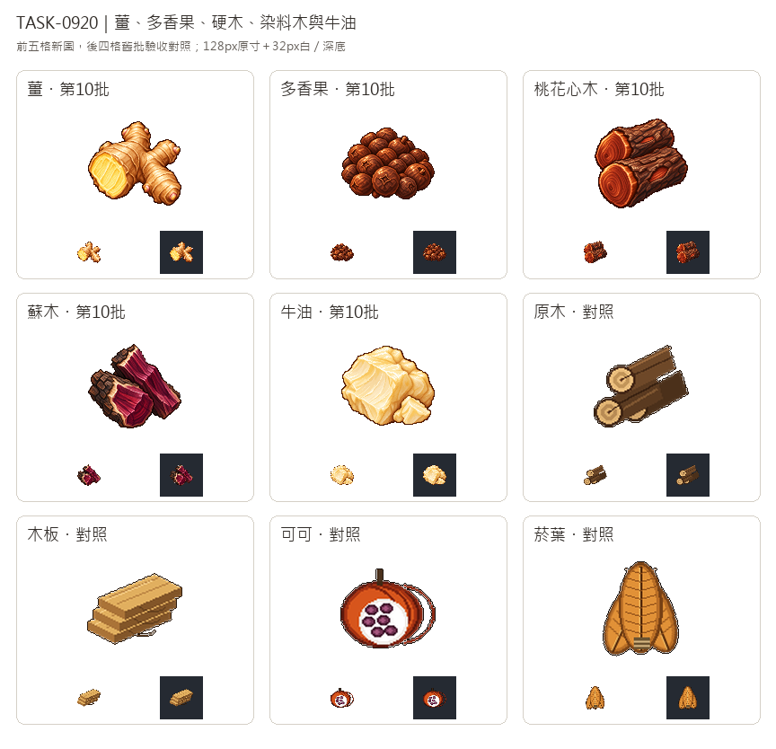

# 🖼️ 《Blocksail》根莖、香料與木心｜農林原料

原料的名字常常比外觀更容易混淆，所以這一批把辨識點留在材料本身。薑根的分枝、環紋與淡黃切面，是它和一般根塊的差別；多香果以深褐圓乾果與果萼凹點形成緊湊一把，避免畫成可可豆莢、粉末或辣椒。牛油則保留乳白到淡黃的脂塊、柔軟斷面與一小塊碎片，表現準備做蠟燭、肥皂或塗料的原料，而非成品。

兩種木材用剖面與形狀拉開：桃花心木為紅褐色圓木，圓端年輪和深色樹皮仍在；蘇木則把深紅、紫紅的心材切面翻向觀者，剖裂的長紋與不規則木片區分一般圓木、木板。這是遊戲貨物圖示的顏色與輪廓設計，不是用圖片替代木材鑑定或生產配方。

五張由內建image_gen獨立生成。薑、多香果與牛油實際輸入Sirius第3批黏土白底原稿，兩種木材另附工具原稿，僅借新版光源、離散像素色階、深色階梯輪廓與材質厚度。白底原稿完整留存，另去背裁切到128×128透明遊戲圖，主體最大邊104px；淺色牛油的高光與內部質地保留。

總覽前五格是新圖，後四格原木、木板、可可與菸葉只作驗收對照，未送入生成工具。每格128px原寸與32px白／深底並列，用紅褐圓端、紅紫裂面、淡黃脂塊及深褐乾果的大色塊檢查辨識。五種仍屬規劃資源，本單不將它們加入貨物表或模擬機制。

## 完整實際提示詞

工具：內建image_gen。黏土及工具原稿位於`RawImages/sirius_blocksail_goods_batch3_<clay或tools>_master.png`；各張實際輸入、來源及派生SHA與參數見Blocksail `docs/evidence/goods-batch10/generation.json`。

### 薑 (ginger)

實際參考：clay。

```text
Use case: stylized-concept. ONE inventory icon for Blocksail: a single freshly harvested GINGER RHIZOME with a branching knobbly hand-like shape, three short rounded lateral knobs and one cleanly cut end revealing pale golden-yellow fibrous flesh. Dry buff-tan papery skin, fine horizontal growth rings and a few tiny light-pink buds. Strong irregular branched silhouette, yellow cut face clearly visible toward front left; recognizable at32px. No leaves, roots trailing far away, vegetables, plate or garnish. Draw the raw root itself, not prepared food. Use attached Sirius TASK-0896 white master ONLY for exquisite16/32-bit pixel-art rendering: saturated material-specific colours, upper-left highlights, discrete shaded clusters, crisp stair-step edges, restrained deep brown outlines, tactile dimensional depth. Do not copy reference objects or their unrelated colours. Deliberate polished sprite pixels, not soft painting, vector or photograph. Compact centered three-quarter view, all subject visible, generous margins. Pure solid white #FFFFFF background, no ground plane or external cast shadow. No lettering, numbers, labels, border, watermark, checkerboard, packaging, barrels, sacks, boxes or containers. Square composition. White master retained separately from transparent128px game sprite.
```

### 多香果 (pimento)

實際參考：clay。

```text
Use case: stylized-concept. ONE inventory icon for Blocksail: a compact handful of dried ALLSPICE BERRIES, Jamaican pimento. About twenty small round deep cocoa-brown dried fruits, roughly spherical with slightly wrinkled matte skins, a few short stem stubs and tiny four-point calyx crowns visible on the largest foreground fruits. Vary coffee-brown and warm russet highlights while keeping the pile distinctly dark brown. Several clearly round large foreground berries define the shape; smaller berries nestled behind. No green pepper, chili, grapes, cocoa pods, beans, leaves, bowl, bag or packaging. Compact low mound with a scalloped silhouette readable at32px. These are dried whole berries, not ground powder. Use attached Sirius TASK-0896 white master ONLY for exquisite16/32-bit pixel-art rendering: saturated material-specific colours, upper-left highlights, discrete shaded clusters, crisp stair-step edges, restrained deep brown outlines, tactile dimensional depth. Do not copy reference objects or their unrelated colours. Deliberate polished sprite pixels, not soft painting, vector or photograph. Compact centered three-quarter view, all subject visible, generous margins. Pure solid white #FFFFFF background, no ground plane or external cast shadow. No lettering, numbers, labels, border, watermark, checkerboard, packaging, barrels, sacks, boxes or containers. Square composition. White master retained separately from transparent128px game sprite.
```

### 桃花心木 (mahogany)

實際參考：tools, clay。

```text
Use case: stylized-concept. ONE inventory icon for Blocksail: MAHOGANY HARDWOOD as TWO short unprocessed cylindrical logs stacked diagonally, front cut ends facing lower left. Thin rugged dark brown bark surrounds rich reddish-brown heartwood with subtle concentric grain and golden-copper upper-left highlights. One log lies below, the second slightly behind and above, compact low silhouette. A small lengthwise bark scar reveals the same fine red-brown wood grain. The prominent cut faces should be distinctly polished-looking RED-BROWN hardwood, not pale yellow common timber, not purple dye-wood. No square boards, furniture, tools, twine, leaves, sawdust, crates or packaging. Strong round log ends and deep russet material readable at32px. Use attached Sirius TASK-0896 white master ONLY for exquisite16/32-bit pixel-art rendering: saturated material-specific colours, upper-left highlights, discrete shaded clusters, crisp stair-step edges, restrained deep brown outlines, tactile dimensional depth. Do not copy reference objects or their unrelated colours. Deliberate polished sprite pixels, not soft painting, vector or photograph. Compact centered three-quarter view, all subject visible, generous margins. Pure solid white #FFFFFF background, no ground plane or external cast shadow. No lettering, numbers, labels, border, watermark, checkerboard, packaging, barrels, sacks, boxes or containers. Square composition. White master retained separately from transparent128px game sprite.
```

### 蘇木 (logwood)

實際參考：tools, clay。

```text
Use case: stylized-concept. ONE inventory icon for Blocksail: LOGWOOD DYESTUFF, two chunky split pieces of raw dye-wood arranged as a compact crossing wedge cluster. Rough near-black brown outer bark along one side, newly split angular interior faces dominated by DEEP WINE-RED and PLUM-PURPLE heartwood with burgundy grain striations and a thin pale sapwood strip immediately under bark. One short cut end points toward viewer, another split piece leans behind, clearly irregular raw wood rather than uniform sawn planks. Saturated dark red-purple cut faces are the defining large colour mass; keep unmistakably different from reddish-brown round mahogany logs and pale common timber at32px. No extracted pigment powder, bottles, tools, leaves or containers. Use attached Sirius TASK-0896 white master ONLY for exquisite16/32-bit pixel-art rendering: saturated material-specific colours, upper-left highlights, discrete shaded clusters, crisp stair-step edges, restrained deep brown outlines, tactile dimensional depth. Do not copy reference objects or their unrelated colours. Deliberate polished sprite pixels, not soft painting, vector or photograph. Compact centered three-quarter view, all subject visible, generous margins. Pure solid white #FFFFFF background, no ground plane or external cast shadow. No lettering, numbers, labels, border, watermark, checkerboard, packaging, barrels, sacks, boxes or containers. Square composition. White master retained separately from transparent128px game sprite.
```

### 牛油 (tallow)

實際參考：clay。

```text
Use case: stylized-concept. ONE inventory icon for Blocksail: RAW TALLOW, rendered cattle fat used as material for candles, soap and hull coating. A substantial irregular off-white to pale straw-yellow solid fat block with softly rounded broken edges, a broad uneven creamy cut face, faint layered waxy fracture lines and a gently greasy upper-left sheen. One small rough chip of the same fat rests against the base. Compact asymmetrical squat silhouette; predominantly ivory with warm pale-yellow shadows and muted beige-brown outline, opaque dense waxlike material. Not a perfect rectangular butter stick, cheese wedge, bread, soap bar or finished candle: no rind, holes, wrapper, dish, knife, wick, flames, labels or food garnish. No meat or blood. Readable as a pale raw material lump at32px, with enough contrast and defined edges for both white and dark UI backgrounds. Use attached Sirius TASK-0896 white master ONLY for exquisite16/32-bit pixel-art rendering: saturated material-specific colours, upper-left highlights, discrete shaded clusters, crisp stair-step edges, restrained deep brown outlines, tactile dimensional depth. Do not copy reference objects or their unrelated colours. Deliberate polished sprite pixels, not soft painting, vector or photograph. Compact centered three-quarter view, all subject visible, generous margins. Pure solid white #FFFFFF background, no ground plane or external cast shadow. No lettering, numbers, labels, border, watermark, checkerboard, packaging, barrels, sacks, boxes or containers. Square composition. White master retained separately from transparent128px game sprite.
```


