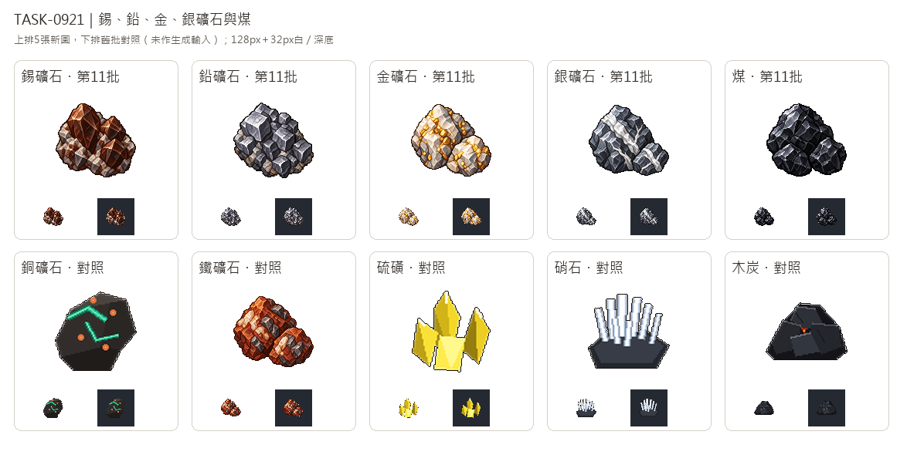

# 🖼️ 《Blocksail》礦脈與斷面｜礦石和煤 (Veins and Fractures)

這五種原料靠顏色與斷面辨識：錫礦用深褐晶面，鉛礦用銀灰立方階面；金礦在淺色石英中嵌入金點，銀礦讓銀白分叉脈穿過深灰岩面；煤則以黑亮不規則斷面區分霧面的木炭與木紋。圖像依任務指定的視覺特徵作遊戲化設計，不替代實物鑑定。

五張各自由內建image_gen生成，實際只輸入Sirius第3批新版鐵礦石原稿作畫風參考，借左上高光、離散像素色階、階梯輪廓與立體厚度；不複製鐵礦的鐵鏽紅色。白底原稿完整留存，另做128×128透明遊戲圖，主體最大邊104px，淺石英與銀白脈的高光保留。

總覽上排是五張新圖，下排銅礦、鐵礦、硫磺、硝石與木炭僅作驗收對照，未作生成輸入（新版鐵礦白底原稿是上段明示的畫風輸入，這張舊批總覽不是）。每格128px原寸與32px白／深底並列，檢查整組礦石與煤的差異。五列仍維持規劃，本單不新增貨物、配方或建築。

## 完整實際提示詞

工具：內建image_gen；逐張參考路徑、SHA與派生參數見Blocksail `docs/evidence/goods-batch11/generation.json`。

### 錫礦石 (tin-ore)

```text
Create a TIN ORE inventory icon: a compact irregular cluster of dark chestnut-brown to near-black cassiterite crystals embedded in a modest cool pale-grey stone matrix. Several stout sharply faceted brown prismatic crystals with pyramidal terminations catch warm brown resinous upper-left glints; the dominant mass remains DEEP BROWN, not orange rust, yellow gold or silver. One large angular crystal and two smaller intergrown crystals define an uneven peaked silhouette. Raw mineral specimen, not refined tin ingots, not chocolate, coal, polished gem or jewellery. Recognizable dark-brown crystalline texture at32px.  Use attached Sirius TASK-0896 iron-ore master ONLY as a finely detailed16/32-bit pixel-art style reference: rich material-specific colours, upper-left highlights, discrete shaded clusters, crisp stair-step contours, restrained dark outline, dimensional tactile facets. Do NOT copy rusty red iron-ore matrix or the exact specimen shape. Deliberate polished sprite pixels, not photo, vector or soft painting. Centered compact three-quarter mineral specimen, generous margins on every side. Pure solid white #FFFFFF background, no floor, ground shadow, text, numbers, labels, frame, checkerboard, magical glow, tools, sacks, crates, bars or containers. One inventory icon, square composition. White master retained separately from transparent128px game sprite.
```

### 鉛礦石 (lead-ore)

```text
Create a LEAD ORE inventory icon: raw GALENA, a compact intergrown cluster of SILVER-GREY METALLIC CUBES and stepped cubic cleavage faces. Broad square flat facets with crisp right angles, dark lead-grey recesses, bright cool-grey upper-left metallic planes, tiny patches of neutral host rock only at the base. Clearly cubic stepped silhouette, substantial metallic mass, neither polished silver bars nor smooth round stones. No gold, copper, red rusty rock or blue fantasy crystals. Readable square block facets at32px distinguish this from other ores and from black coal.  Use attached Sirius TASK-0896 iron-ore master ONLY as a finely detailed16/32-bit pixel-art style reference: rich material-specific colours, upper-left highlights, discrete shaded clusters, crisp stair-step contours, restrained dark outline, dimensional tactile facets. Do NOT copy rusty red iron-ore matrix or the exact specimen shape. Deliberate polished sprite pixels, not photo, vector or soft painting. Centered compact three-quarter mineral specimen, generous margins on every side. Pure solid white #FFFFFF background, no floor, ground shadow, text, numbers, labels, frame, checkerboard, magical glow, tools, sacks, crates, bars or containers. One inventory icon, square composition. White master retained separately from transparent128px game sprite.
```

### 金礦石 (gold-ore)

```text
Create a GOLD ORE inventory icon: two rough irregular milky quartz rocks with clearly visible small warm GOLD-YELLOW metallic flecks and thin irregular gold seams embedded IN the quartz. Off-white to cool pale-grey crystalline quartz is the dominant stone, with restrained charcoal crevices; rich yellow gold occupies small patches clustered across the front face, no giant polished nugget, no pyrite cubes, no coins, bars or jewellery. Angular light stone silhouette with warm gold dots, instantly distinct from grey silver-vein ore at32px. Do not colour the whole rock yellow.  Use attached Sirius TASK-0896 iron-ore master ONLY as a finely detailed16/32-bit pixel-art style reference: rich material-specific colours, upper-left highlights, discrete shaded clusters, crisp stair-step contours, restrained dark outline, dimensional tactile facets. Do NOT copy rusty red iron-ore matrix or the exact specimen shape. Deliberate polished sprite pixels, not photo, vector or soft painting. Centered compact three-quarter mineral specimen, generous margins on every side. Pure solid white #FFFFFF background, no floor, ground shadow, text, numbers, labels, frame, checkerboard, magical glow, tools, sacks, crates, bars or containers. One inventory icon, square composition. White master retained separately from transparent128px game sprite.
```

### 銀礦石 (silver-ore)

```text
Create a SILVER ORE inventory icon: one compact jagged dark slate-blue-grey host-rock chunk crossed by TWO branching SILVER-WHITE METALLIC VEINS that run visibly through the broken face, with one small matching chipped stone nestled at the base. Strong broad diagonal white vein and finer forked branch, bright cool highlights on vein edges against dark matrix. The host rock has irregular fracture planes, NOT stepped galena cubes; the silver remains within raw ore, not refined metal, jewellery or futuristic crystal. Cool grey-blue and white palette, no yellow gold, green copper stains, rusty orange, magical sparkle or glow. Clear white-veined silhouette readable at32px.  Use attached Sirius TASK-0896 iron-ore master ONLY as a finely detailed16/32-bit pixel-art style reference: rich material-specific colours, upper-left highlights, discrete shaded clusters, crisp stair-step contours, restrained dark outline, dimensional tactile facets. Do NOT copy rusty red iron-ore matrix or the exact specimen shape. Deliberate polished sprite pixels, not photo, vector or soft painting. Centered compact three-quarter mineral specimen, generous margins on every side. Pure solid white #FFFFFF background, no floor, ground shadow, text, numbers, labels, frame, checkerboard, magical glow, tools, sacks, crates, bars or containers. One inventory icon, square composition. White master retained separately from transparent128px game sprite.
```

### 煤 (coal)

```text
Create a COAL inventory icon for Blocksail: three irregular angular pieces of glossy BLACK COAL in a compact low cluster, one large fractured lump behind and two smaller sharp fragments in front. Deep near-black body colour, crisp broad cool slate-grey upper-left reflected highlights and sparse pale glints, curved-to-angular freshly fractured planes with fine cracks. Rich jet-black glossy mineral surface, unmistakably brighter and more reflective than matte wood charcoal. Absolutely NO wood grain, tree growth rings, cylindrical charred sticks, orange embers, flame or smoke. No ore veins, metallic cubes or crystals. Keep the black dominant so it remains distinct from silver-grey lead ore at32px.  Use attached Sirius TASK-0896 iron-ore master ONLY as a finely detailed16/32-bit pixel-art style reference: rich material-specific colours, upper-left highlights, discrete shaded clusters, crisp stair-step contours, restrained dark outline, dimensional tactile facets. Do NOT copy rusty red iron-ore matrix or the exact specimen shape. Deliberate polished sprite pixels, not photo, vector or soft painting. Centered compact three-quarter mineral specimen, generous margins on every side. Pure solid white #FFFFFF background, no floor, ground shadow, text, numbers, labels, frame, checkerboard, magical glow, tools, sacks, crates, bars or containers. One inventory icon, square composition. White master retained separately from transparent128px game sprite.
```


