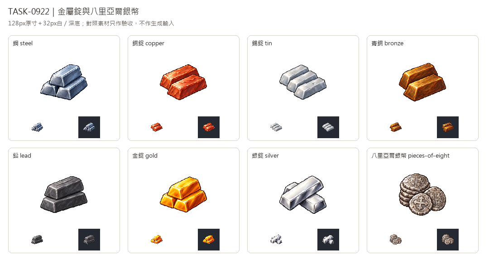

# 🖼️ 《Blocksail》鑄成光澤｜金屬錠與銀幣

Tim指定繼續用新版畫風。這批以新版可可的獨立白底原稿作唯一生成參考，沿用左上光源、細緻離散像素與階梯輪廓；金屬使用自己的色彩與反射。每種獨立生成，完整提示詞與原稿保留。

鋼採藍灰堆疊，銅呈紅銅色，錫用亮灰平排；青銅的暗金褐與鉛的低光澤深灰，保留冶煉材料的差別。金錠用飽和金黃與明亮折邊，銀錠則以交疊長條和近白反光和錫區分。

銀幣以疊幣、磨損邊緣及盾徽／十字浮雕呈現。它是遊戲風格化圖示，不是某一鑄造年份錢幣的考據復原；沒有文字數字。八里亞爾是否作為貨物仍待遊戲設計決定，本次只補美術。

八張去背為128×128 RGBA、主體最大邊104px；另檢查32px白深底。對照板加入既有生鐵、熟鐵與第11批礦石和煤，對照圖只作生成完成後的驗收。資料追溯見Blocksail docs/evidence/goods-batch12/generation.json，未更動貨物表或配方。

## 完整實際提示詞

工具：內建image_gen。唯一畫風輸入：`RawImages/sirius_blocksail_goods_refresh932_cocoa_master.png`。

### 鋼 (steel)

```text
Create ONE Blocksail inventory icon of STEEL INGOTS: three precisely cast long trapezoidal ingots stacked in a compact triangular pile, cool blue-grey steel, crisp machined-looking bevels but age-of-sail simple cast form, restrained bright silver edge glints and deep navy-grey undercuts. Fine smooth steel texture, no rust, stamps, letters or symbols. Use attached NEW CACAO solely as pixel-art rendering STYLE reference: saturated material-specific colours, upper-left highlights, discrete fine shaded pixel clusters, crisp stair-step contour, restrained dark outlines, tactile dimensional depth. Design subject independently, no cacao and no forcing orange onto unrelated materials. Polished 16/32-bit inventory sprite, readable at32px. ONE compact centered three-quarter object or group, complete silhouette and generous margins, pure solid WHITE #FFFFFF background, no ground plane or external cast shadow, no text, labels, watermark, checkerboard or scenery. White original retained; separate transparent128px game version derived.
```

### 銅錠 (copper)

```text
Create ONE Blocksail inventory icon of COPPER INGOTS: two broad short trapezoidal copper bars overlapping diagonally, unmistakable rich reddish-copper body, salmon highlights and dark russet-brown bevels, small subtle cast ripples. No green ore crust, gold-yellow dominant colour, coins, stamps or labels. Use attached NEW CACAO solely as pixel-art rendering STYLE reference: saturated material-specific colours, upper-left highlights, discrete fine shaded pixel clusters, crisp stair-step contour, restrained dark outlines, tactile dimensional depth. Design subject independently, no cacao and no forcing orange onto unrelated materials. Polished 16/32-bit inventory sprite, readable at32px. ONE compact centered three-quarter object or group, complete silhouette and generous margins, pure solid WHITE #FFFFFF background, no ground plane or external cast shadow, no text, labels, watermark, checkerboard or scenery. White original retained; separate transparent128px game version derived.
```

### 錫錠 (tin)

```text
Create ONE Blocksail inventory icon of TIN INGOTS: three squat small rectangular-trapezoidal bars in a shallow staggered row, very light cool silver-grey metal, softly reflective pale highlights and restrained blue-grey side faces, slightly rounded cast corners, one shallow unmarked casting dimple. No lettering, symbols or coins. Light neutral metal distinguishable from darker blue steel and lead. Use attached NEW CACAO solely as pixel-art rendering STYLE reference: saturated material-specific colours, upper-left highlights, discrete fine shaded pixel clusters, crisp stair-step contour, restrained dark outlines, tactile dimensional depth. Design subject independently, no cacao and no forcing orange onto unrelated materials. Polished 16/32-bit inventory sprite, readable at32px. ONE compact centered three-quarter object or group, complete silhouette and generous margins, pure solid WHITE #FFFFFF background, no ground plane or external cast shadow, no text, labels, watermark, checkerboard or scenery. White original retained; separate transparent128px game version derived.
```

### 青銅 (bronze)

```text
Create ONE Blocksail inventory icon of BRONZE INGOTS: two thick cast trapezoidal billets, one behind and one in front, muted dark golden-brown bronze with rich olive-ochre midtones, warm subdued gold edge highlights, dark brown sides, subtle cast surface. Not bright yellow gold, red copper or green raw ore. No inscriptions or packaging. Use attached NEW CACAO solely as pixel-art rendering STYLE reference: saturated material-specific colours, upper-left highlights, discrete fine shaded pixel clusters, crisp stair-step contour, restrained dark outlines, tactile dimensional depth. Design subject independently, no cacao and no forcing orange onto unrelated materials. Polished 16/32-bit inventory sprite, readable at32px. ONE compact centered three-quarter object or group, complete silhouette and generous margins, pure solid WHITE #FFFFFF background, no ground plane or external cast shadow, no text, labels, watermark, checkerboard or scenery. White original retained; separate transparent128px game version derived.
```

### 鉛 (lead)

```text
Create ONE Blocksail inventory icon of LEAD INGOTS: two chunky low broad trapezoidal lead pigs, dense heavy appearance, very dark dull neutral graphite-grey faces, soft muted grey upper highlights, subtly rounded corners, slight shallow casting crease across top. Matte and subdued, not shiny blue steel or crystalline coal. No ore texture, lettering, stamped glyphs or containers. Use attached NEW CACAO solely as pixel-art rendering STYLE reference: saturated material-specific colours, upper-left highlights, discrete fine shaded pixel clusters, crisp stair-step contour, restrained dark outlines, tactile dimensional depth. Design subject independently, no cacao and no forcing orange onto unrelated materials. Polished 16/32-bit inventory sprite, readable at32px. ONE compact centered three-quarter object or group, complete silhouette and generous margins, pure solid WHITE #FFFFFF background, no ground plane or external cast shadow, no text, labels, watermark, checkerboard or scenery. White original retained; separate transparent128px game version derived.
```

### 金錠 (gold)

```text
Create ONE Blocksail inventory icon of GOLD INGOTS: three precious clean golden bullion bars in a compact pyramidal stack, one partly crossing at front, broad trapezoid cast bars with polished bevels. Deep rich orange-gold side faces, saturated yellow-gold tops, small pale lemon specular edge glints, strong sense of weight and precious metal. No stamped writing, numbers, symbols, gems, coins, chest or packaging. Use attached NEW CACAO solely as pixel-art rendering STYLE reference: saturated material-specific colours, upper-left highlights, discrete fine shaded pixel clusters, crisp stair-step contour, restrained dark outlines, tactile dimensional depth. Design subject independently, no cacao and no forcing orange onto unrelated materials. Polished 16/32-bit inventory sprite, readable at32px. ONE compact centered three-quarter object or group, complete silhouette and generous margins, pure solid WHITE #FFFFFF background, no ground plane or external cast shadow, no text, labels, watermark, checkerboard or scenery. White original retained; separate transparent128px game version derived.
```

### 銀錠 (silver)

```text
Create ONE Blocksail inventory icon of SILVER INGOTS: two elegant long broad precious silver bars crossing slightly, distinctive luminous almost-white silver top planes with clear crisp reflective bevels, cool grey sides and restrained deep charcoal reflections, premium polished metal. Broad long silhouette differs from three squat tin bars. No stamped text, numbers, symbols, coins, packaging or gemstones. Use attached NEW CACAO solely as pixel-art rendering STYLE reference: saturated material-specific colours, upper-left highlights, discrete fine shaded pixel clusters, crisp stair-step contour, restrained dark outlines, tactile dimensional depth. Design subject independently, no cacao and no forcing orange onto unrelated materials. Polished 16/32-bit inventory sprite, readable at32px. ONE compact centered three-quarter object or group, complete silhouette and generous margins, pure solid WHITE #FFFFFF background, no ground plane or external cast shadow, no text, labels, watermark, checkerboard or scenery. White original retained; separate transparent128px game version derived.
```

### 八里亞爾銀幣 (pieces-of-eight)

```text
Create ONE Blocksail inventory icon of PIECES OF EIGHT: a small compact stack of worn Spanish-style silver coins plus two loose overlapping coins leaning at front. Thick pale silver rims and grey tarnished recesses; irregular hand-struck circular edges. Coin faces bear a simple raised heraldic shield on one and a short equal-armed cross on another, decorative worn relief only, absolutely NO letters, numbers or legible inscriptions. Some rims catch cool white light, modest tarnish. Currency itself dominates, no bags, chest, gold coins or gemstones. Use attached NEW CACAO solely as pixel-art rendering STYLE reference: saturated material-specific colours, upper-left highlights, discrete fine shaded pixel clusters, crisp stair-step contour, restrained dark outlines, tactile dimensional depth. Design subject independently, no cacao and no forcing orange onto unrelated materials. Polished 16/32-bit inventory sprite, readable at32px. ONE compact centered three-quarter object or group, complete silhouette and generous margins, pure solid WHITE #FFFFFF background, no ground plane or external cast shadow, no text, labels, watermark, checkerboard or scenery. White original retained; separate transparent128px game version derived.
```



[含生鐵、熟鐵、礦石的驗收對照](../RawImages/sirius_blocksail_goods_batch12_comparison.png)
