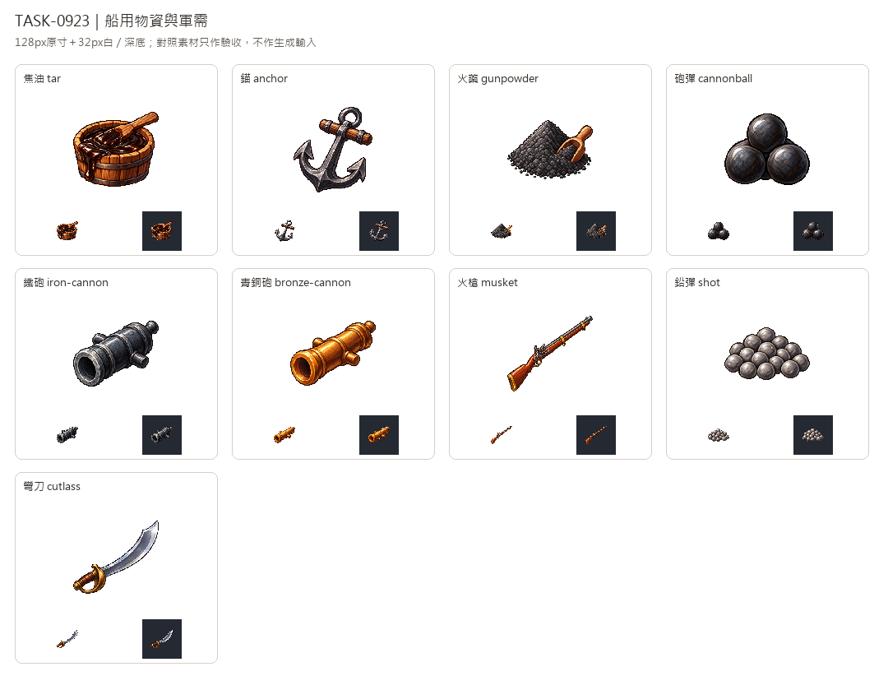

# 🖼️ 《Blocksail》甲板備品與武備｜船用與軍需

Tim指定沿用新版畫風。九張各自用內建image_gen生成，唯一畫風附圖為新版可可獨立白底原稿，沿用左上光源、離散像素層次與深色階梯輪廓；材質依木、鐵、青銅與鋼各自呈現。

焦油用矮桶盛裝並溢出深黑液體，這是任務指定的容器例外，與空木桶有明確差別。錨保留木橫桿與鐵吊環，火藥是帶量勺的黑色顆粒堆。砲彈用少量大鐵球，鉛彈用一群較亮的小鉛球，讓兩種彈丸的尺度在縮圖也能分開。

鐵砲與青銅砲只畫砲管，以灰黑與金褐金屬色區分；火槍保留完整木托、長管及燧發外形，彎刀保留曲刃與黃銅護手。這些是遊戲道具美術，不是製作或操作圖。完整白底原稿另存，透明版為128×128、主體最大邊104px，另驗32px白深底與環孔去背。

對照板納入鐵件、鐵釘、工具、船具、繩、帆布與空木桶；它們只作完成後驗收，不作生成輸入。九種仍保留規劃狀態，不改貨物表、配方或生產鏈。完整提示詞與SHA見Blocksail docs/evidence/goods-batch13/generation.json。

## 完整實際提示詞

工具：內建image_gen。唯一畫風輸入：`RawImages/sirius_blocksail_goods_refresh932_cocoa_master.png`。

### 焦油 (tar)

```text
Create ONE Blocksail inventory icon of SHIP TAR: a small squat open plain wooden tar tub, dark almost-black glossy tar visible inside and a thick irregular viscous drip overflowing one side; short broad flat wooden tar paddle resting diagonally across rim with tar-coated end. Tar dominates visually, dark cool brown-black with tiny warm amber edge highlights. Container exception is intentional for this shapeless material. Distinct from a clean empty upright cask. No text, labels, smoke, fire, ropes or scenery. Use attached NEW CACAO solely as pixel-art rendering STYLE reference: saturated material-specific colours, upper-left highlights, discrete fine shaded pixel clusters, crisp stair-step contour, restrained dark outlines, tactile dimensional depth. Design subject independently, no cacao and no forcing orange onto unrelated materials. Polished 16/32-bit inventory sprite, readable at32px. ONE compact centered three-quarter object or group, complete silhouette and generous margins, pure solid WHITE #FFFFFF background, no ground plane or external cast shadow, no text, labels, watermark, checkerboard or scenery. White original retained; separate transparent128px game version derived.
```

### 錨 (anchor)

```text
Create ONE Blocksail inventory icon of ONE traditional IRON SHIP ANCHOR: long dark forged iron shank, crosswise sturdy weathered brown wooden stock near the upper ring, two symmetrical sweeping curved arms ending in sharp broad triangular flukes. A single thick iron suspension ring at top, no chain or rope. Entire anchor complete, diagonal compact three-quarter view, dark slate iron with silver-grey worn bevel highlights. Clear anchor silhouette, no crossed tools, sea, ship or extra props. Open ring interior is plain white background. Use attached NEW CACAO solely as pixel-art rendering STYLE reference: saturated material-specific colours, upper-left highlights, discrete fine shaded pixel clusters, crisp stair-step contour, restrained dark outlines, tactile dimensional depth. Design subject independently, no cacao and no forcing orange onto unrelated materials. Polished 16/32-bit inventory sprite, readable at32px. ONE compact centered three-quarter object or group, complete silhouette and generous margins, pure solid WHITE #FFFFFF background, no ground plane or external cast shadow, no text, labels, watermark, checkerboard or scenery. White original retained; separate transparent128px game version derived.
```

### 火藥 (gunpowder)

```text
Create ONE Blocksail inventory icon of BLACK GUNPOWDER itself: one compact low mound of fine nearly black grey granular powder, a small simple wooden measuring scoop tucked into the side and a few tiny touching grains at base. Matte dark charcoal grains with subtle neutral-grey highlights, not glossy pitch or crystalline coal chunks, no sparks, flames, smoke, ingredients, recipe labels, bag or barrel. Powder mound dominates; scoop gives scale. Nontechnical game inventory illustration only. Use attached NEW CACAO solely as pixel-art rendering STYLE reference: saturated material-specific colours, upper-left highlights, discrete fine shaded pixel clusters, crisp stair-step contour, restrained dark outlines, tactile dimensional depth. Design subject independently, no cacao and no forcing orange onto unrelated materials. Polished 16/32-bit inventory sprite, readable at32px. ONE compact centered three-quarter object or group, complete silhouette and generous margins, pure solid WHITE #FFFFFF background, no ground plane or external cast shadow, no text, labels, watermark, checkerboard or scenery. White original retained; separate transparent128px game version derived.
```

### 砲彈 (cannonball)

```text
Create ONE Blocksail inventory icon of CANNONBALLS: FOUR LARGE solid cast-iron spherical cannonballs in a compact pyramidal stack, three at base one above. Deep cool black-grey iron, small silvery upper-left crescent glints, restrained cast surface, strong large round silhouette with dark gaps. No fuse, explosive shell opening, chain, cannon, powder, crates or background. Simple solid iron spheres, clearly a few big heavy balls, not a heap of tiny shot. Use attached NEW CACAO solely as pixel-art rendering STYLE reference: saturated material-specific colours, upper-left highlights, discrete fine shaded pixel clusters, crisp stair-step contour, restrained dark outlines, tactile dimensional depth. Design subject independently, no cacao and no forcing orange onto unrelated materials. Polished 16/32-bit inventory sprite, readable at32px. ONE compact centered three-quarter object or group, complete silhouette and generous margins, pure solid WHITE #FFFFFF background, no ground plane or external cast shadow, no text, labels, watermark, checkerboard or scenery. White original retained; separate transparent128px game version derived.
```

### 鐵砲 (iron-cannon)

```text
Create ONE Blocksail inventory icon of ONE cast IRON CANNON BARREL ONLY: a short thick age-of-sail naval gun tube in diagonal three-quarter view, large open circular muzzle toward lower-left, stepped reinforcing rings, two short side trunnions and a small rounded rear cascabel. Dark blue-grey cast iron, silvery worn rim bevel and muted surface highlights. Complete tube fits compact icon. No wooden carriage, wheels, ammunition, smoke, fuse, flame, labels, cross-section or technical schematic. Use attached NEW CACAO solely as pixel-art rendering STYLE reference: saturated material-specific colours, upper-left highlights, discrete fine shaded pixel clusters, crisp stair-step contour, restrained dark outlines, tactile dimensional depth. Design subject independently, no cacao and no forcing orange onto unrelated materials. Polished 16/32-bit inventory sprite, readable at32px. ONE compact centered three-quarter object or group, complete silhouette and generous margins, pure solid WHITE #FFFFFF background, no ground plane or external cast shadow, no text, labels, watermark, checkerboard or scenery. White original retained; separate transparent128px game version derived.
```

### 青銅砲 (bronze-cannon)

```text
Create ONE Blocksail inventory icon of ONE cast BRONZE CANNON BARREL ONLY: a stout age-of-sail naval gun tube angled from lower-left open muzzle toward upper-right breech, broad circular muzzle lip, simple reinforcing rings, two small side trunnions and rounded rear cascabel. Warm muted golden-brown bronze with honey edge glints and deep brown recesses, clearly bronze rather than black iron. Complete tube only. No wooden carriage, wheels, heraldic writing, ammunition, flame, smoke, cross-section or technical diagram. Use attached NEW CACAO solely as pixel-art rendering STYLE reference: saturated material-specific colours, upper-left highlights, discrete fine shaded pixel clusters, crisp stair-step contour, restrained dark outlines, tactile dimensional depth. Design subject independently, no cacao and no forcing orange onto unrelated materials. Polished 16/32-bit inventory sprite, readable at32px. ONE compact centered three-quarter object or group, complete silhouette and generous margins, pure solid WHITE #FFFFFF background, no ground plane or external cast shadow, no text, labels, watermark, checkerboard or scenery. White original retained; separate transparent128px game version derived.
```

### 火槍 (musket)

```text
Create ONE Blocksail inventory icon of ONE antique FLINTLOCK MUSKET as a NONFUNCTIONAL GAME ICON: complete long slender wooden-stock firearm diagonally from lower-left butt to upper-right muzzle, warm walnut full-length stock, long dark iron barrel, simple visible external flintlock silhouette and curved trigger guard, brass buttplate and two restrained brass bands. Exaggerate thickness slightly for inventory readability while keeping a plausible antique silhouette. Show entire object, no cropping. No ammunition, hands, people, firing, smoke, exploded view, internal mechanism or instructional diagram. Use attached NEW CACAO solely as pixel-art rendering STYLE reference: saturated material-specific colours, upper-left highlights, discrete fine shaded pixel clusters, crisp stair-step contour, restrained dark outlines, tactile dimensional depth. Design subject independently, no cacao and no forcing orange onto unrelated materials. Polished 16/32-bit inventory sprite, readable at32px. ONE compact centered three-quarter object or group, complete silhouette and generous margins, pure solid WHITE #FFFFFF background, no ground plane or external cast shadow, no text, labels, watermark, checkerboard or scenery. White original retained; separate transparent128px game version derived.
```

### 鉛彈 (shot)

```text
Create ONE Blocksail inventory icon of SMALL LEAD MUSKET BALLS: a low wide compact pile of about FIFTEEN tiny dull grey round lead pellets, many small spheres touching and overlapping, a few at the front. Soft neutral pewter-grey with small pale upper-left glints, slightly imperfect hand-cast roundness. Clearly MANY SMALL pellets, not four big black cannonballs. No powder, bag, barrel, bullets with casings, tools, diagrams or labels. One neat mound entirely visible. Use attached NEW CACAO solely as pixel-art rendering STYLE reference: saturated material-specific colours, upper-left highlights, discrete fine shaded pixel clusters, crisp stair-step contour, restrained dark outlines, tactile dimensional depth. Design subject independently, no cacao and no forcing orange onto unrelated materials. Polished 16/32-bit inventory sprite, readable at32px. ONE compact centered three-quarter object or group, complete silhouette and generous margins, pure solid WHITE #FFFFFF background, no ground plane or external cast shadow, no text, labels, watermark, checkerboard or scenery. White original retained; separate transparent128px game version derived.
```

### 彎刀 (cutlass)

```text
Create ONE Blocksail inventory icon of ONE SAILOR CUTLASS: complete gently curved broad silver-grey single-edged blade with clipped rounded point, modest dark brass bowl handguard and short dark brown wooden grip with a small brass pommel. Diagonal from lower-left hilt to upper-right tip, bright cool steel bevel, darker flat face, rich warm brass. Chunky readable weapon silhouette, entire blade and hilt visible. No blood, people, skull symbols, scabbard, crossed swords, combat or lettering. Antique fantasy game inventory prop, not a technical schematic. Use attached NEW CACAO solely as pixel-art rendering STYLE reference: saturated material-specific colours, upper-left highlights, discrete fine shaded pixel clusters, crisp stair-step contour, restrained dark outlines, tactile dimensional depth. Design subject independently, no cacao and no forcing orange onto unrelated materials. Polished 16/32-bit inventory sprite, readable at32px. ONE compact centered three-quarter object or group, complete silhouette and generous margins, pure solid WHITE #FFFFFF background, no ground plane or external cast shadow, no text, labels, watermark, checkerboard or scenery. White original retained; separate transparent128px game version derived.
```



[含船用物資及空木桶的驗收對照](../RawImages/sirius_blocksail_goods_batch13_comparison.png)
