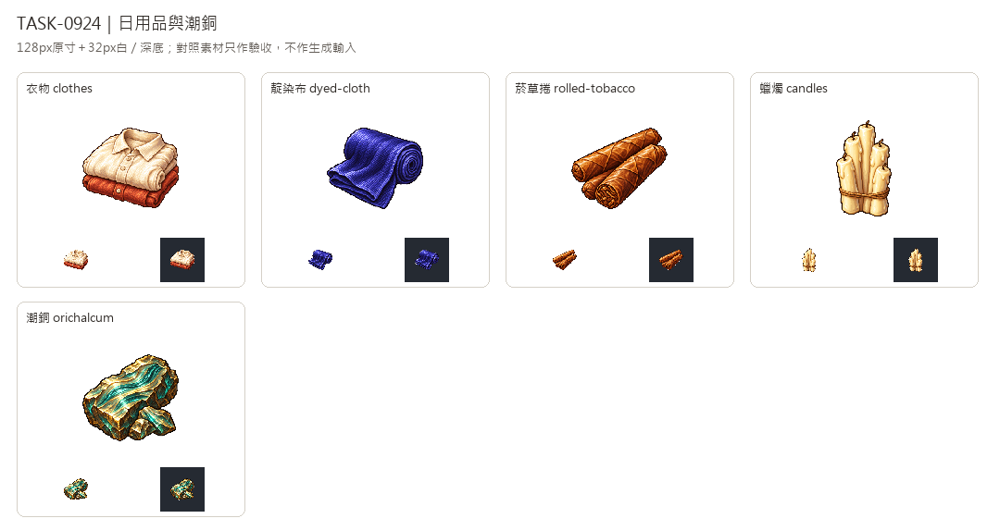

# 🖼️ 《Blocksail》日常織物與異海微光｜日用品與潮銅

Tim指定沿用新版畫風。五張各自透過內建image_gen生成，唯一實際畫風附圖為新版可可的獨立白底原稿，延續左上光源、離散像素色階與階梯輪廓，各物件保留自己的材質色彩。

衣物以領口、袖口和鈕扣呈現做好的一疊上衣；靛染布用深藍卷布與垂下的布面區分摺疊棉布。菸草捲保留斜向葉片接縫與切面纖維，牛油燭是綁成一束、沒有點燃的淡黃成品。

潮銅依WORLD_LORE §3.4的古代金屬設定，淡金與海碧色交疊，潮紋像層層流動的金屬記憶，微光只留在紋理內。它來自漂流船或亞特蘭提斯，不屬於一般生產鏈；這次只補圖，不替遊戲新增製造配方。

原稿完整另存，透明版128×128 RGBA、主體最大邊104px，驗看32px白深底與淺色衣物、蠟燭高光。對照板加入棉布、帆布、靛藍、菸葉及家具，它們只作驗收，不作生成參考。完整提示詞與SHA見Blocksail docs/evidence/goods-batch14/generation.json。

## 完整實際提示詞

工具：內建image_gen。唯一畫風輸入：`RawImages/sirius_blocksail_goods_refresh932_cocoa_master.png`；潮銅文字設定依Blocksail `docs/WORLD_LORE.md` §3.4。

### 衣物 (clothes)

```text
Create ONE Blocksail inventory icon of FINISHED CLOTHES: a neat compact stack of TWO folded simple age-of-sail linen shirts, top shirt warm ivory with a clearly visible small folded collar, short front button placket and tucked sleeves; lower shirt muted terracotta-rust red, edges and cuffs peeking out. Soft woven cloth, cream highlights and warm shadowed folds, tiny plain buttons without markings. Clearly finished garments rather than a fabric bolt, no mannequin, body, hanger, embroidery, labels, basket or modern T-shirt. Use attached NEW CACAO solely as pixel-art rendering STYLE reference: saturated material-specific colours, upper-left highlights, discrete fine shaded pixel clusters, crisp stair-step contour, restrained dark outlines, tactile dimensional depth. Design subject independently, no cacao and no forcing orange onto unrelated materials. Polished 16/32-bit inventory sprite, readable at32px. ONE compact centered three-quarter object or group, complete silhouette and generous margins, pure solid WHITE #FFFFFF background, no ground plane or external cast shadow, no text, labels, watermark, checkerboard or scenery. White original retained; separate transparent128px game version derived.
```

### 靛染布 (dyed-cloth)

```text
Create ONE Blocksail inventory icon of INDIGO-DYED TEXTILE: one tightly rolled bolt of rich deep violet-indigo fabric, broad folded flap unfurling toward front to reveal layered soft folds and fine weave. Dark navy-violet body, subdued periwinkle edge highlights, deep blue-purple shadows. A rolled circular end distinguishes it from a stack of folded blue cotton cloth; blue mass and soft weave distinguish it from cream sailcloth or solid pigment cakes. No grommets, brass fittings, ribbon, wrapping, labels, tools or containers. Use attached NEW CACAO solely as pixel-art rendering STYLE reference: saturated material-specific colours, upper-left highlights, discrete fine shaded pixel clusters, crisp stair-step contour, restrained dark outlines, tactile dimensional depth. Design subject independently, no cacao and no forcing orange onto unrelated materials. Polished 16/32-bit inventory sprite, readable at32px. ONE compact centered three-quarter object or group, complete silhouette and generous margins, pure solid WHITE #FFFFFF background, no ground plane or external cast shadow, no text, labels, watermark, checkerboard or scenery. White original retained; separate transparent128px game version derived.
```

### 菸草捲 (rolled-tobacco)

```text
Create ONE Blocksail inventory icon of ROLLED TOBACCO: three short thick hand-rolled brown tobacco cigars in a compact slightly overlapping group, two nearly parallel and one crossing gently in front. Rich earthy tan-to-dark-chestnut wrinkled leaf wrappers, visible diagonal leaf seams and one cut end showing tightly packed curled tobacco fibres. Plain rounded closed tips, no paper bands, text, branding, burning end, ember, flame, smoke, ashtray, box or loose whole leaves. Tobacco itself only, textured rather than smooth wood. Use attached NEW CACAO solely as pixel-art rendering STYLE reference: saturated material-specific colours, upper-left highlights, discrete fine shaded pixel clusters, crisp stair-step contour, restrained dark outlines, tactile dimensional depth. Design subject independently, no cacao and no forcing orange onto unrelated materials. Polished 16/32-bit inventory sprite, readable at32px. ONE compact centered three-quarter object or group, complete silhouette and generous margins, pure solid WHITE #FFFFFF background, no ground plane or external cast shadow, no text, labels, watermark, checkerboard or scenery. White original retained; separate transparent128px game version derived.
```

### 蠟燭 (candles)

```text
Create ONE Blocksail inventory icon of TALLOW CANDLES: a compact bundle of FIVE unlit handmade ivory-cream taper candles at slightly different heights, resting together and loosely bound near base with one thin brown twine tie. Uneven softly rounded wax shafts, a few subtle hardened wax drips, tiny dark short unlit wicks visible at tops. Warm buttery pale wax with tan-grey shadows and restrained dark warm outlines, complete bases visible. No flame, glow, candlestick, holder, plate, lantern, writing, ribbon bow or other props. Use attached NEW CACAO solely as pixel-art rendering STYLE reference: saturated material-specific colours, upper-left highlights, discrete fine shaded pixel clusters, crisp stair-step contour, restrained dark outlines, tactile dimensional depth. Design subject independently, no cacao and no forcing orange onto unrelated materials. Polished 16/32-bit inventory sprite, readable at32px. ONE compact centered three-quarter object or group, complete silhouette and generous margins, pure solid WHITE #FFFFFF background, no ground plane or external cast shadow, no text, labels, watermark, checkerboard or scenery. White original retained; separate transparent128px game version derived.
```

### 潮銅 (orichalcum)

```text
Create ONE Blocksail inventory icon of ORICHALCUM, fictional ancient ATLANTEAN TIDAL METAL from the Blocksail world lore: one heavy irregular broken metal billet with a smaller matching fragment at its foot, metallic pale-gold to sea-teal material, dark weathered bronze outer edges. Distinct sweeping parallel wave-like tidal striations embedded through the broad face, a restrained eerie sea-aquamarine light from thin seams and subtle pale-gold internal highlights. Keep compact tangible metal silhouette with solid fractured bevels; looks like ancient salvaged metal, NOT a generic bright crystal cluster or ordinary copper ingot. Glow confined to metal seams, no external aura on white background, floating particles, magic circles, rune letters, inscriptions, tools, container, city or scenery. Use attached NEW CACAO solely as pixel-art rendering STYLE reference: saturated material-specific colours, upper-left highlights, discrete fine shaded pixel clusters, crisp stair-step contour, restrained dark outlines, tactile dimensional depth. Design subject independently, no cacao and no forcing orange onto unrelated materials. Polished 16/32-bit inventory sprite, readable at32px. ONE compact centered three-quarter object or group, complete silhouette and generous margins, pure solid WHITE #FFFFFF background, no ground plane or external cast shadow, no text, labels, watermark, checkerboard or scenery. White original retained; separate transparent128px game version derived.
```



[含棉布、帆布、靛藍、菸葉與家具的驗收對照](../RawImages/sirius_blocksail_goods_batch14_comparison.png)
