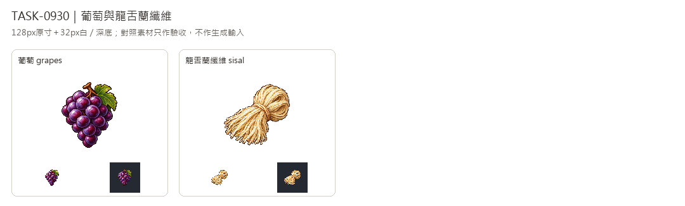

# 🖼️ 《Blocksail》葡萄與長纖維｜葡萄、龍舌蘭纖維

Tim指定沿用新版畫風。兩張各自使用內建image_gen生成，唯一實際畫風附圖為新版可可獨立白底原稿，延續左上光源、離散像素色階與深色階梯輪廓。

葡萄以深紫果串、短枝與一片綠葉呈現成熟果實，龍舌蘭纖維則是提取後尚未搓繩的淡米色長纖維束，末端散開。兩者沿用遊戲已有的葡萄園釀酒鏈與加勒比製繩鏈，不更動貨物資料與配方。

完整白底原稿另存，透明版128×128、主體最大邊104px，檢查32px白深底及纖維淺色高光。棉花、繩、麻、可可只加入完成後的驗收對照，不作生成輸入。完整提示詞與SHA見Blocksail docs/evidence/goods-batch16/generation.json。

## 完整實際提示詞

工具：內建image_gen。唯一畫風輸入：`RawImages/sirius_blocksail_goods_refresh932_cocoa_master.png`。

### 葡萄 (grapes)

```text
Create ONE Blocksail inventory icon of FRESH WINE GRAPES: one plump compact bunch of ripe deep purple grapes, rounded berries with soft dusky violet bloom, rich wine-purple shadowed undersides and small pale lavender upper-left glints. A short forked woody brown stem at top and ONE modest muted green lobed vine leaf tucked behind the upper side. Heavy tapered hanging-bunch silhouette, appetizing fresh fruit, distinguishable from cocoa pods or brown pimento berries. No wine bottle, bowl, basket, vine trellis, label or packaging. Use attached NEW CACAO solely as pixel-art rendering STYLE reference: saturated material-specific colours, upper-left highlights, discrete fine shaded pixel clusters, crisp stair-step contour, restrained dark outlines, tactile dimensional depth. Design subject independently, no cacao and no forcing orange onto unrelated materials. Polished 16/32-bit inventory sprite, readable at32px. ONE compact centered three-quarter object or group, complete silhouette and generous margins, pure solid WHITE #FFFFFF background, no ground plane or external cast shadow, no text, labels, watermark, checkerboard or scenery. White original retained; separate transparent128px game version derived.
```

### 龍舌蘭纖維 (sisal)

```text
Create ONE Blocksail inventory icon of RAW SISAL AGAVE FIBRE: one compact loose hank of long pale straw-ivory plant fibres, broad softly folded loop at back and many straight separated fine fibre ends fanning down in front. A simple narrow natural-fibre tie around the middle, delicate longitudinal strands with warm tan shadows and cream highlights, coarse dry fibrous texture. Clearly RAW UNTWISTED extracted fibres, NOT a finished twisted rope coil, cotton fluffy bolls, wheat stalks or folded cloth. No whole agave plant, green leaf, spindle, tool, sack, container or label. Use attached NEW CACAO solely as pixel-art rendering STYLE reference: saturated material-specific colours, upper-left highlights, discrete fine shaded pixel clusters, crisp stair-step contour, restrained dark outlines, tactile dimensional depth. Design subject independently, no cacao and no forcing orange onto unrelated materials. Polished 16/32-bit inventory sprite, readable at32px. ONE compact centered three-quarter object or group, complete silhouette and generous margins, pure solid WHITE #FFFFFF background, no ground plane or external cast shadow, no text, labels, watermark, checkerboard or scenery. White original retained; separate transparent128px game version derived.
```



[含棉花、繩、麻、可可的驗收對照](../RawImages/sirius_blocksail_goods_batch16_comparison.png)
