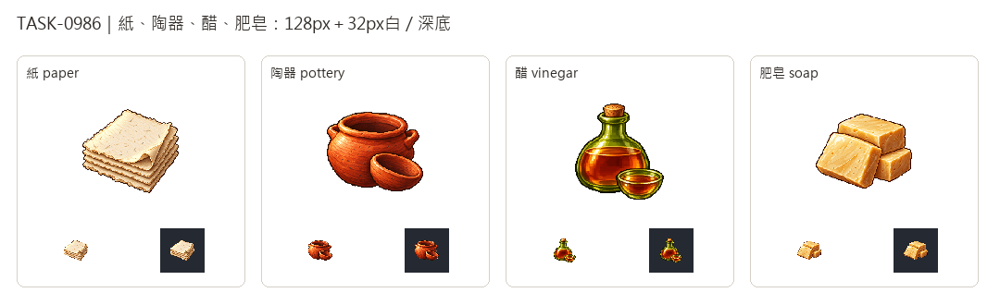

# 🖼️ 《Blocksail》城鎮日常的四種加工品

城鎮除了船砲和糧食，也需要寫文書的紙、盛食的陶器、調味的醋，以及清洗用的肥皂。這批延伸現有棉布、黏土、葡萄酒與規劃牛油的用途，先固定貨物名稱及視覺，生產建築、需求與供應前提另由TASK-0985承接。

四張原稿由內建image_gen獨立生成，唯一畫風附圖為新版可可；沿用左上亮光、清楚階梯邊線與離散像素明暗。紙以毛邊疊頁區分帆布，陶器以空陶罐與淺碗表達商品本體，醋用綠色玻璃與琥珀液體區分酒水，肥皂則採整齊手切皂塊。這是遊戲圖示設計，並非加勒比特定城鎮、特定年份的器物復原；肥皂畫硬皂塊也不代表木灰鹼必然直接產硬皂。

完整白底原稿保留在館內，另製128×128透明版及32px白深底對照。此卡先於遊戲匯入上架；資源登錄不代表工坊已投產，詳細建築、原料、批次與下游規劃住在Blocksail docs/PROCESSED_GOODS_EXPANSION.md。

## 完整實際提示詞

唯一畫風附圖：`RawImages/sirius_blocksail_goods_refresh932_cocoa_master.png`。

### 紙 (paper)

```text
ONE inventory icon of handmade RAG PAPER: a compact stack of five thick warm ivory blank rectangular sheets with irregular deckled edges. The top sheet has its front-right corner gently curled upward, revealing the layers. Fine visible rag-fibre flecks and subtle pressed texture, pale cream highlights and warm beige shaded edges. Broad flat unmarked surfaces with NO writing, letters, maps, quill, scroll, ribbon, book, cloth weave, packaging or symbols. Use attached NEW CACAO solely as pixel-art rendering STYLE reference: rich material-specific colours, upper-left highlights, discrete fine shaded pixel clusters, crisp stair-step contours, restrained dark outlines, tactile dimensional depth. Design subject independently, no cacao or forcing orange onto unrelated materials. Polished16/32-bit inventory sprite, readable at32px. ONE compact centered three-quarter object or group, complete silhouette and generous margins, pure solid WHITE #FFFFFF background, no ground plane or external cast shadow, no text, labels, watermark, checkerboard or scenery. White original retained; separate transparent128px game version derived.
```

[獨立白底原稿](../RawImages/sirius_blocksail_goods_batch17_paper_master.png)

### 陶器 (pottery)

```text
ONE inventory icon of finished utilitarian EARTHENWARE POTTERY itself: one squat round-bellied reddish terracotta cooking pot with thick rolled open rim, two very short solid lug handles, and a smaller shallow empty earthenware bowl leaning against its front. Visible dark empty interiors, warm fired clay walls, slightly irregular handmade rim and tactile pottery texture. No food, liquid, decorated pattern, glaze painting, lid, barrel, sack or packaging. Strong compact two-vessel silhouette. Pottery is the commodity itself. Use attached NEW CACAO solely as pixel-art rendering STYLE reference: rich material-specific colours, upper-left highlights, discrete fine shaded pixel clusters, crisp stair-step contours, restrained dark outlines, tactile dimensional depth. Design subject independently, no cacao or forcing orange onto unrelated materials. Polished16/32-bit inventory sprite, readable at32px. ONE compact centered three-quarter object or group, complete silhouette and generous margins, pure solid WHITE #FFFFFF background, no ground plane or external cast shadow, no text, labels, watermark, checkerboard or scenery. White original retained; separate transparent128px game version derived.
```

[獨立白底原稿](../RawImages/sirius_blocksail_goods_batch17_pottery_master.png)

### 醋 (vinegar)

```text
ONE inventory icon of WINE VINEGAR: a compact squat olive-green translucent glass cruet with broad rounded base, short narrow neck and a small brown cork, filled three quarters with amber-russet vinegar. A clear liquid level visible across front. Beside its base one small shallow matching glass tasting dish containing the same amber liquid. No handle, labels, writing, grapes, foliage, food, alcohol emblem, barrel, sack or box. Strong green flask and amber liquid contrast, clear dark contour; do not make clear regions white holes. Vessel included only to make liquid resource visible. Use attached NEW CACAO solely as pixel-art rendering STYLE reference: rich material-specific colours, upper-left highlights, discrete fine shaded pixel clusters, crisp stair-step contours, restrained dark outlines, tactile dimensional depth. Design subject independently, no cacao or forcing orange onto unrelated materials. Polished16/32-bit inventory sprite, readable at32px. ONE compact centered three-quarter object or group, complete silhouette and generous margins, pure solid WHITE #FFFFFF background, no ground plane or external cast shadow, no text, labels, watermark, checkerboard or scenery. White original retained; separate transparent128px game version derived.
```

[獨立白底原稿](../RawImages/sirius_blocksail_goods_batch17_vinegar_master.png)

### 肥皂 (soap)

```text
ONE inventory icon of handmade utilitarian SOAP: three substantial squat rectangular hand-cut bars stacked offset in a compact low pyramid, one leaning across the front. Opaque warm pale honey-beige surfaces, slight uneven beveled edges, fine waxy grain and tiny pinholes, subtly darker caramel-brown side planes. Distinct straight cut planes and small curved scrape marks differentiate from raw tallow. No lettering, stamps, logos, wrapper, ribbons, flowers, herbs, bubbles, foam, dish, towels or packaging. Soap bars themselves only. Use attached NEW CACAO solely as pixel-art rendering STYLE reference: rich material-specific colours, upper-left highlights, discrete fine shaded pixel clusters, crisp stair-step contours, restrained dark outlines, tactile dimensional depth. Design subject independently, no cacao or forcing orange onto unrelated materials. Polished16/32-bit inventory sprite, readable at32px. ONE compact centered three-quarter object or group, complete silhouette and generous margins, pure solid WHITE #FFFFFF background, no ground plane or external cast shadow, no text, labels, watermark, checkerboard or scenery. White original retained; separate transparent128px game version derived.
```

[獨立白底原稿](../RawImages/sirius_blocksail_goods_batch17_soap_master.png)


