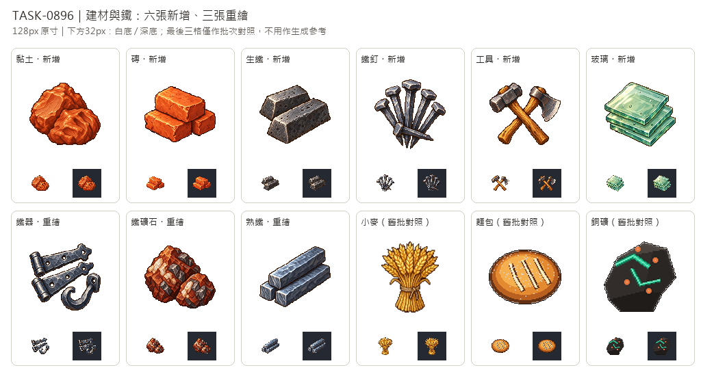

# 🖼️ 《Blocksail》建材與鐵｜六種新增與三張重繪

這批素材依 Tim 在本次委託提供的麥穗圖，採用飽滿材質色、左上光源、細緻像素色階與深色輪廓。沒有使用先前灰色道具作為生成參考；各張保留全白背景原稿，再整理為 128×128 透明遊戲圖，實際物件最大邊 104px，四周保留安全留白。舊畫廊展品不覆寫。

圖示將原料、加工品與成品區分開：黏土是帶指壓痕的濕土；磚是堆疊的燒製方磚；生鐵為粗糙鑄錠，熟鐵為細長鍛條，鐵礦石則用赤褐岩體與金屬礦面表現。鐵器改為鉸鏈和掛鉤，與鐵釘及錘斧工具組合各有不同剪影；玻璃以青綠疊片和厚邊反光呈現。

下方總覽以128px原寸及32px白／深底對照檢查，最後三格的小麥、麵包與銅礦只是任務要求的舊批對照，沒有輸入生成工具。玻璃的透明感是像素色階表現，遊戲成品只有0/255 alpha，並非物理透光模擬。所有圖內都沒有文字；總覽標籤由排版工具另外加上。

## 完整實際生成提示詞

工具：內建 image_gen。唯一畫風輸入：Tim提供的麥穗圖。以下每項逐張生成，沒有共用箱桶替代物產本體。

### 黏土 (clay)

```text
Use case: stylized-concept. ONE inventory icon for a Caribbean age-of-sail trading game. A compact mound of raw moist RED-BROWN CLAY, two irregular soft heavy lumps with a freshly cut smooth face and several natural thumb-pressed grooves. Warm ochre and terracotta earth, visibly soft cohesive wet clay, not rock, not pottery, no pot, no tools. STYLE reference: match ONLY the attached golden wheat icon's refined 16/32-bit pixel-art craft: rich material-specific colors, warm luminous upper-left highlights, shaded pixel clusters, crisp fine stair-step contours, restrained dark brown/charcoal outline and tactile depth. Improve detail and dimensional material rendering while retaining a clear simple silhouette at 32px. NOT flat vector, not low-poly, not photorealistic. Centered isolated object group, THREE-QUARTER top/front view, fills about 78–84% of square, generous whitespace on all four sides. PURE SOLID WHITE #FFFFFF BACKGROUND, NO checkerboard, NO ground plane, NO cast shadow outside object, NO text, letters, numerals, symbols, labels, border or watermark. This is a 128x128 game icon master, uniform pixel density; render clean large pixel-art source for reduction. DO NOT copy any pre-existing gray game item designs; wheat image is ONLY a style reference.
```

### 磚 (bricks)

```text
Use case: stylized-concept. ONE inventory icon for a Caribbean age-of-sail trading game. Three small handmade fired RED CLAY BRICKS stacked in a compact staggered pile: two low bricks and one resting above. Rectangular cuboids, slightly chipped rounded corners, orange terracotta faces, warm granular fired texture, clear dark seams. No mortar wall, no stamped letters, no holes, no tools. STYLE reference: match ONLY the attached golden wheat icon's refined 16/32-bit pixel-art craft: rich material-specific colors, warm luminous upper-left highlights, shaded pixel clusters, crisp fine stair-step contours, restrained dark brown/charcoal outline and tactile depth. Improve detail and dimensional material rendering while retaining a clear simple silhouette at 32px. NOT flat vector, not low-poly, not photorealistic. Centered isolated object group, THREE-QUARTER top/front view, fills about 78–84% of square, generous whitespace on all four sides. PURE SOLID WHITE #FFFFFF BACKGROUND, NO checkerboard, NO ground plane, NO cast shadow outside object, NO text, letters, numerals, symbols, labels, border or watermark. This is a 128x128 game icon master, uniform pixel density; render clean large pixel-art source for reduction. DO NOT copy any pre-existing gray game item designs; wheat image is ONLY a style reference.
```

### 生鐵 (pig-iron)

```text
Use case: stylized-concept. ONE inventory icon for a Caribbean age-of-sail trading game. Two heavy rough cast PIG IRON INGOTS, one squat tapered bar diagonally behind the other, cold charcoal steel gray with coarse porous cast surface, small irregular pitted faces and a subtle silvery bevel on upper left. Thick blocky trapezoidal bars. NOT mineral rocks, NOT an I-beam, no rivet holes, no red-hot glow. STYLE reference: match ONLY the attached golden wheat icon's refined 16/32-bit pixel-art craft: rich material-specific colors, warm luminous upper-left highlights, shaded pixel clusters, crisp fine stair-step contours, restrained dark brown/charcoal outline and tactile depth. Improve detail and dimensional material rendering while retaining a clear simple silhouette at 32px. NOT flat vector, not low-poly, not photorealistic. Centered isolated object group, THREE-QUARTER top/front view, fills about 78–84% of square, generous whitespace on all four sides. PURE SOLID WHITE #FFFFFF BACKGROUND, NO checkerboard, NO ground plane, NO cast shadow outside object, NO text, letters, numerals, symbols, labels, border or watermark. This is a 128x128 game icon master, uniform pixel density; render clean large pixel-art source for reduction. DO NOT copy any pre-existing gray game item designs; wheat image is ONLY a style reference.
```

### 鐵釘 (nails)

```text
Use case: stylized-concept. ONE inventory icon for a Caribbean age-of-sail trading game. A compact fan of FIVE hand-forged IRON NAILS with broad irregular square heads, long tapered square shanks and sharp points. One shorter nail lies crosswise in front. Cold blue-gray metal, brighter silvery head bevels, dark tips. Each is a recognisable nail; no screws, no packaging, no tools. STYLE reference: match ONLY the attached golden wheat icon's refined 16/32-bit pixel-art craft: rich material-specific colors, warm luminous upper-left highlights, shaded pixel clusters, crisp fine stair-step contours, restrained dark brown/charcoal outline and tactile depth. Improve detail and dimensional material rendering while retaining a clear simple silhouette at 32px. NOT flat vector, not low-poly, not photorealistic. Centered isolated object group, THREE-QUARTER top/front view, fills about 78–84% of square, generous whitespace on all four sides. PURE SOLID WHITE #FFFFFF BACKGROUND, NO checkerboard, NO ground plane, NO cast shadow outside object, NO text, letters, numerals, symbols, labels, border or watermark. This is a 128x128 game icon master, uniform pixel density; render clean large pixel-art source for reduction. DO NOT copy any pre-existing gray game item designs; wheat image is ONLY a style reference.
```

### 工具 (tools)

```text
Use case: stylized-concept. ONE inventory icon for a Caribbean age-of-sail trading game. A sturdy wood-handled blacksmith HAMMER crossed with a small wood-handled HATCHET, compact readable silhouette. Warm honey-brown grain on handles, carefully shaded cool forged steel hammer head and clean broad ax blade, used but sound early eighteenth century hand tools. Exactly two tools, no anvil, no nails, no toolbox. STYLE reference: match ONLY the attached golden wheat icon's refined 16/32-bit pixel-art craft: rich material-specific colors, warm luminous upper-left highlights, shaded pixel clusters, crisp fine stair-step contours, restrained dark brown/charcoal outline and tactile depth. Improve detail and dimensional material rendering while retaining a clear simple silhouette at 32px. NOT flat vector, not low-poly, not photorealistic. Centered isolated object group, THREE-QUARTER top/front view, fills about 78–84% of square, generous whitespace on all four sides. PURE SOLID WHITE #FFFFFF BACKGROUND, NO checkerboard, NO ground plane, NO cast shadow outside object, NO text, letters, numerals, symbols, labels, border or watermark. This is a 128x128 game icon master, uniform pixel density; render clean large pixel-art source for reduction. DO NOT copy any pre-existing gray game item designs; wheat image is ONLY a style reference.
```

### 玻璃 (glass)

```text
Use case: stylized-concept. ONE inventory icon for a Caribbean age-of-sail trading game. Three small rectangular hand-blown WINDOW GLASS PANES stacked slightly offset, broad flat square silhouettes viewed three-quarter from above, pale seafoam-green transparent glass with clear green-blue thickness edges, subtle waviness and tiny antique glass bubbles, clean ivory upper-left reflected bands. No bottles, no jewels, no mirror, no frame, no starburst symbols. STYLE reference: match ONLY the attached golden wheat icon's refined 16/32-bit pixel-art craft: rich material-specific colors, warm luminous upper-left highlights, shaded pixel clusters, crisp fine stair-step contours, restrained dark brown/charcoal outline and tactile depth. Improve detail and dimensional material rendering while retaining a clear simple silhouette at 32px. NOT flat vector, not low-poly, not photorealistic. Centered isolated object group, THREE-QUARTER top/front view, fills about 78–84% of square, generous whitespace on all four sides. PURE SOLID WHITE #FFFFFF BACKGROUND, NO checkerboard, NO ground plane, NO cast shadow outside object, NO text, letters, numerals, symbols, labels, border or watermark. This is a 128x128 game icon master, uniform pixel density; render clean large pixel-art source for reduction. DO NOT copy any pre-existing gray game item designs; wheat image is ONLY a style reference.
```

### 鐵器 (ironware)

```text
Use case: stylized-concept. ONE inventory icon for a Caribbean age-of-sail trading game. A compact assortment of FORGED IRON FITTINGS: two tapered strap hinges with visible rivet holes and a thick curved iron hook beside them. Dense blue-gray and silver forged metal with hammered texture, substantial dark silhouettes and crisp light bevels. Hardware fittings themselves, no shackle-ring composition, no nails, no hammer, no container. STYLE reference: match ONLY the attached golden wheat icon's refined 16/32-bit pixel-art craft: rich material-specific colors, warm luminous upper-left highlights, shaded pixel clusters, crisp fine stair-step contours, restrained dark brown/charcoal outline and tactile depth. Improve detail and dimensional material rendering while retaining a clear simple silhouette at 32px. NOT flat vector, not low-poly, not photorealistic. Centered isolated object group, THREE-QUARTER top/front view, fills about 78–84% of square, generous whitespace on all four sides. PURE SOLID WHITE #FFFFFF BACKGROUND, NO checkerboard, NO ground plane, NO cast shadow outside object, NO text, letters, numerals, symbols, labels, border or watermark. This is a 128x128 game icon master, uniform pixel density; render clean large pixel-art source for reduction. DO NOT copy any pre-existing gray game item designs; wheat image is ONLY a style reference.
```

### 鐵礦石 (iron-ore)

```text
Use case: stylized-concept. ONE inventory icon for a Caribbean age-of-sail trading game. A small cluster of two irregular IRON ORE rocks: dense reddish brown hematite with earthy russet facets, scattered metallic dark iron-gray crystalline surfaces and natural pale quartz inclusions. Warm mineral richness and a strong angular rock silhouette. Not coal, not an ingot, no decorative orange zigzag line, no cut gem, no pickaxe. STYLE reference: match ONLY the attached golden wheat icon's refined 16/32-bit pixel-art craft: rich material-specific colors, warm luminous upper-left highlights, shaded pixel clusters, crisp fine stair-step contours, restrained dark brown/charcoal outline and tactile depth. Improve detail and dimensional material rendering while retaining a clear simple silhouette at 32px. NOT flat vector, not low-poly, not photorealistic. Centered isolated object group, THREE-QUARTER top/front view, fills about 78–84% of square, generous whitespace on all four sides. PURE SOLID WHITE #FFFFFF BACKGROUND, NO checkerboard, NO ground plane, NO cast shadow outside object, NO text, letters, numerals, symbols, labels, border or watermark. This is a 128x128 game icon master, uniform pixel density; render clean large pixel-art source for reduction. DO NOT copy any pre-existing gray game item designs; wheat image is ONLY a style reference.
```

### 熟鐵 (wrought-iron)

```text
Use case: stylized-concept. ONE inventory icon for a Caribbean age-of-sail trading game. THREE long narrow hand-forged WROUGHT IRON BARS neatly stacked at a slight diagonal. Solid square-section rectangular bars, straight elongated silhouettes, cool slate blue-gray metal, bright silver-blue upper-left edges, subtle hammered facets and fibrous end grain. Clearly forged uniform bars, smoother and longer than squat porous pig-iron cast ingots. No I-beam profiles, no holes, no rust stripes. STYLE reference: match ONLY the attached golden wheat icon's refined 16/32-bit pixel-art craft: rich material-specific colors, warm luminous upper-left highlights, shaded pixel clusters, crisp fine stair-step contours, restrained dark brown/charcoal outline and tactile depth. Improve detail and dimensional material rendering while retaining a clear simple silhouette at 32px. NOT flat vector, not low-poly, not photorealistic. Centered isolated object group, THREE-QUARTER top/front view, fills about 78–84% of square, generous whitespace on all four sides. PURE SOLID WHITE #FFFFFF BACKGROUND, NO checkerboard, NO ground plane, NO cast shadow outside object, NO text, letters, numerals, symbols, labels, border or watermark. This is a 128x128 game icon master, uniform pixel density; render clean large pixel-art source for reduction. DO NOT copy any pre-existing gray game item designs; wheat image is ONLY a style reference.
```


