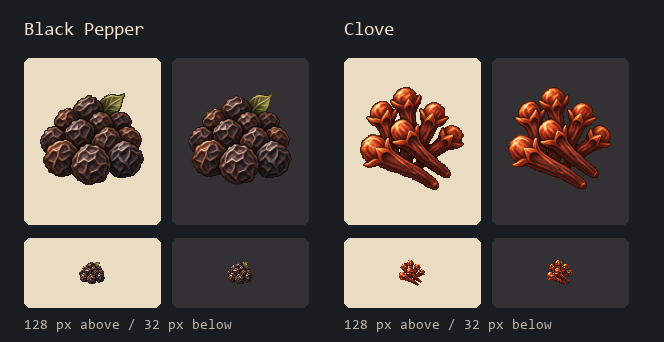

# 🖼️ 《Blocksail》VOC 香料貨物圖示

黑胡椒由暗褐、近黑的皺皮圓粒堆疊，留一點橄欖綠葉作識別。丁香把圓形蕾頭和長柄朝不同方向排開，以赤褐色照亮乾花萼。兩種剪影縮到交易介面的 32px 時，仍可分出胡椒粒與丁香花蕾。

畫風參考 TASK-0896 的黏土與鐵礦石原稿。以左上入光、深色外輪廓與離散的像素色塊描繪。純白原稿另存，下方圖板顯示透明遊戲版在淺底與深底的樣子。原稿分別為 [黑胡椒](../RawImages/sirius_blocksail_goods_batch30_black_pepper_master.png) 和 [丁香](../RawImages/sirius_blocksail_goods_batch30_clove_master.png)。

## 實際生成提示詞

### 黑胡椒

ONE 1:1 square Blocksail inventory icon of DRIED BLACK PEPPERCORNS (Piper nigrum), the actual traded spice. Roughly a dozen clearly individual small ROUND wrinkled black and charcoal-brown peppercorns, in a compact, mound-like arrangement with three especially legible rounded berries at the front. Their round wrinkly silhouette and dark cool near-black visible distinguish them from dried cloves. A single small muted olive pepper leaf tucked behind the upper edge as a secondary tiny accent, no vine or green berries. Use the attached Sirius TASK-0896 clay and iron-ore icons ONLY as pixel-art style references: rich material-specific colours, upper-left highlights, discrete shaded pixel clusters, crisp stairstep contours, restrained dark outline and tactile depth; do not draw rock or clay. Strong crisp hand-pixeled game object, smooth graduated tones built from chunky pixel clusters, readability at 32px. Centered compact three-quarter view, generous margins, pure solid white #FFFFFF background. No container, ground plane, external cast shadow, text, labels, border or checkerboard.

### 丁香

ONE 1:1 square Blocksail inventory icon of DRIED WHOLE CLOVES (Syzygium aromaticum), the actual traded spice. Depict a compact fanned cluster of a half-dozen staggered elongated woody reddish-brown dried flower buds. Each dried clove has a slim tapered dark-brown nail-like stem and a distinctly bulbous rounded head crowned with four small tapered calyx prongs beneath it. Show two large diagonal foreground cloves and others behind, so the long nail silhouette is unmistakable at 32px, visually different from peppercorns or cinnamon sticks. Warm russet, dark mahogany, amber-beige glints. Use the attached Sirius TASK-0896 clay and iron ore icons ONLY as pixel-art style references: rich material-specific colours, upper-left highlights, discrete shaded pixel clusters, crisp stairstep contours, restrained dark outline and tactile depth; do not draw rock, ore or clay. Strong crisp hand-pixeled game object, no smooth airbrush. Centered compact three-quarter view, generous margins, pure solid white #FFFFFF background. No container, ground plane, external cast shadow, text, labels, border or checkerboard.

