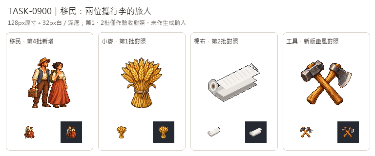

# 🖼️ 《Blocksail》候船的旅人｜移民圖示

木箱裡的家當與肩上的包袱，把兩位旅人連到下一段航程。男人的帽沿、藍背心與褲裝，和女人的盤髮、赭紅長裙形成不同剪影；兩人朝右看，像在等待船來。這是遊戲移民類別的象徵圖，不是特定人物肖像，也不以兩個人的圖像代表每桶移民的實際人數。

依Tim指定沿用新版畫風，生成時只輸入Sirius第3批黏土及工具原稿作材質色階、光源與輪廓參考。人物和行李重新設計，白底不畫碼頭場景，讓人物在縮圖裡仍是主體。這是貨物欄的移民圖示，使用自然髮色與衣色，不套用街道鎮民的青髮／洋紅衣換色標記。

原稿保留白底，另整理成128×128透明遊戲圖，主體最大邊104px。總覽同時呈現128px原寸及32px白／深底；小麥、棉布分別是第1、2批驗收對照，工具為新版畫風對照。總覽未作生成輸入，舊批造型也未用於生成。圖像是移民本人與隨身行李，不以箱子取代人物，無圖內文字。

## 完整實際提示詞

工具：內建image_gen。風格參考：`RawImages/sirius_blocksail_goods_batch3_clay_master.png`、`RawImages/sirius_blocksail_goods_batch3_tools_master.png`。

```text
Use case: stylized-concept. ONE square inventory icon representing EMIGRANTS waiting to board a ship, for a Caribbean age-of-sail game. Exactly TWO ordinary adult civilian travellers standing CLOSE SIDE BY SIDE, full bodies visible head to shoes: a man with a simple weathered ochre hat, ivory shirt, muted blue waistcoat and brown trousers, holding a compact wooden travel chest by its handle at his side; a woman with dark compact bun hair, ivory blouse, muted terracotta long skirt, a small tied olive-brown cloth bundle carried over one shoulder. Both naturally look toward screen right, calm hopeful expressions, compact standing silhouettes, no military dress or weapons. Main read is TWO PEOPLE WITH LUGGAGE, the chest is a secondary small prop. Different readable silhouettes, heads big enough for 32px recognition; not chibi, not portrait crop. Match ONLY the attached Sirius new batch-3 icons' fine 16/32-bit PIXEL ART STYLE: rich warm material colours, upper-left highlights, discrete shaded clusters, crisp stair-step contours, restrained dark brown outline and dimensional tactile texture. Do NOT copy the clay or tool objects. Centered compact group, three-quarter front view, entire hats/hair/hands/feet and luggage inside square, generous whitespace around all edges. PURE SOLID WHITE #FFFFFF background, no dock scenery, no ship, no water, no ground plane, no cast shadow outside figures, no lettering, symbols, labels, border or checkerboard. White master for a separate transparent128x128 game icon.
```


