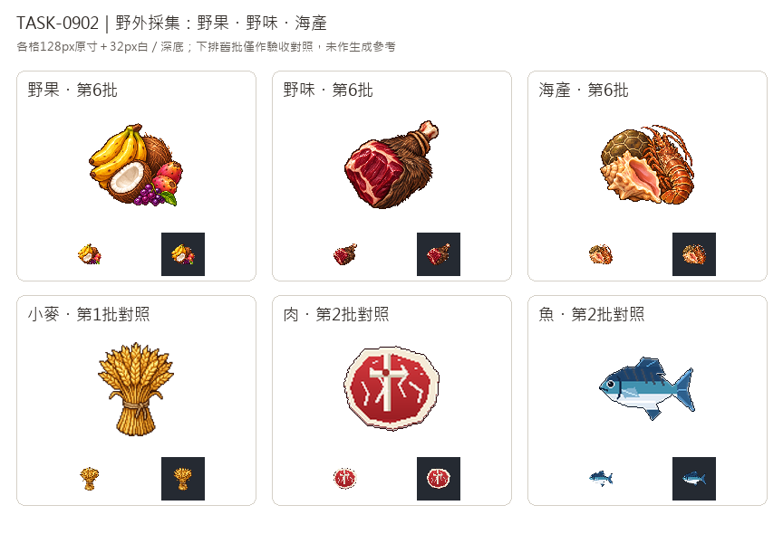

# 🖼️ 《Blocksail》採回來的食物｜野果、野味與海產

採集的收穫不會是整齊單一的貨物。野果將香蕉的金黃色弧線、椰子的纖維外殼與白色切面放在一起，再以刺梨及海葡萄添上紅紫色；依任務更正，代表加勒比海採集物，不採用已撤回的黑莓例子。野味用還帶著粗獸皮的腿肉與窄端綁繩區分養殖肉；海產則把龜殼的多角鱗甲、鳳凰螺的粉色開口與刺龍蝦的分節尾部緊湊疊放。它們是遊戲類別的代表，不表示每座城能採齊畫中的物種。

三張均由內建image_gen獨立生成，只將Sirius第3批黏土白底原稿用作畫風、光源與像素色階參考，物件重新設計。沿用左上光源、深色階梯輪廓、明確材質與飽滿固有色，沒有把土塊造型或橙色套給所有食物，也沒有參考舊的道具圖。白底原稿完整保存，另外裁切、去背及最近鄰整理為128×128透明遊戲版，主體最大邊104px。

總覽上排為這三種新採集物，下排小麥、肉與魚為第1、2批驗收對照，未送入生成工具。每格同時看128px原寸及32px白／深底縮圖：野味的粗皮與斜骨端區分平整肉排，海產的龜殼與螺口區分單魚輪廓。去背保留椰肉與螺殼淺色高光，也清除龍蝦觸角與腿間的白底。

## 完整實際提示詞

工具：內建image_gen。實際風格參考：`RawImages/sirius_blocksail_goods_batch3_clay_master.png`。原稿與遊戲版的SHA-256及處理參數記於Blocksail `docs/evidence/goods-batch6/generation.json`。

### 野果 (wild-fruit)

```text
Use case: stylized-concept. Create ONE exquisite pixel-art inventory icon for Blocksail: Caribbean foraged WILD FRUIT. A compact abundant cluster of 3 curved ripe golden bananas toward the upper left, one round fibrous brown coconut behind and one cut coconut half showing ivory flesh at front, two small rosy prickly-pear fruits and a tiny cluster of violet sea-grapes with one modest green leaf at the lower right. These are harvested fruit, no container. Balance a clear yellow arc with the brown round coconut and small purple accents; recognizable as mixed wild fruit at 32px. Use the attached Sirius TASK-0896 clay master ONLY as a pixel-art rendering style reference, not as subject or palette: saturated material-specific colours, rich discrete shaded pixel clusters, crisp stair-step contours, restrained deep brown outlines, tactile dimensional depth, upper-left highlights. Render as a highly polished 16/32-bit sprite with deliberate pixel edges, not a photograph, painting or vector. Centered compact three-quarter view, generous empty margin all around, all fruit fully visible. Pure solid white #FFFFFF background. No ground plane, no external cast shadow, no text, labels, numbers, border, checkerboard, baskets, sacks or barrels. Square composition. This white master will be preserved; a separate transparent 128x128 game icon will be derived.
```

### 野味 (wild-game)

```text
Use case: stylized-concept. Create ONE exquisite pixel-art inventory icon for Blocksail: WILD GAME brought back by hunters, a compact raw wild-boar haunch still partly wrapped in its dark brown coarse bristled hide. One small pale bone end at upper right, a curved exposed deep burgundy raw meat surface with very restrained ivory fat at front left, the bristly brown hide folded along the lower right. A plain thin tan hide cord loops twice firmly around the narrow shank, tying the bundle. No living animal, head, eyes, blood puddle, gore, weapons, containers or scenery. The attached Sirius TASK-0896 clay master is ONLY a reference for exquisite 16/32-bit pixel-art rendering: rich material-specific colours, upper-left highlights, discrete shaded clusters, crisp stair-step contours and restrained deep brown outlines, dimensional tactile materials. Do not copy clay shapes or orange palette. Design a distinctive asymmetrical diagonal haunch silhouette, brown bristles plus dark burgundy flesh and small bone, instantly distinct from a neat farm-meat steak and from fish at 32px. Centered compact three-quarter view, all cord and bone fully visible with generous margins. Pure solid white #FFFFFF background, no ground plane, no external cast shadow, no text, labels, numbers, border, checkerboard, barrel, sack or basket. Square image. White master retained separately from derived transparent 128x128 game icon.
```

### 海產 (seafood)

```text
Use case: stylized-concept. Create ONE exquisite pixel-art inventory icon for Blocksail: CARIBBEAN FORAGED SEAFOOD as a tightly grouped harvested catch. Three readable overlapping items: one small domed olive-brown empty sea-turtle shell at the back left with distinct polygon scutes, no animal head or limbs; one creamy peach queen-conch spiral shell at front left, its broad flared salmon-pink inner lip facing the viewer; and one whole Caribbean spiny lobster lying diagonally along the right side, with russet-orange segmented tail, small spiny carapace and thin tucked legs and short curving antennae kept inside the compact silhouette. Spiny lobster has NO large front claws. Natural shell and crustacean colours; no silver fish, no bowl or container, no plate, garnish, sea water, scenery, seaweed bed or external shadows. The attached Sirius TASK-0896 clay master is ONLY a pixel-art rendering style reference: rich material-specific colours, upper-left highlights, discrete shaded clusters, crisp stair-step contours, restrained deep brown outlines and tactile dimensional depth. Do not copy clay forms or its palette. Highly polished 16/32-bit sprite, deliberate pixels, not a photograph, oil painting or vector. Readable as a mixed shellfish/turtle-shell catch at 32px and visually distinct from a fish icon or a meat steak. Centered compact three-quarter view, all shell and appendages fully inside generous margins. Pure solid white #FFFFFF background, no ground plane, no cast shadow, no text, labels, numbers, border or checkerboard. Square composition. Preserve this white master; separate transparent 128x128 game icon derived later.
```


