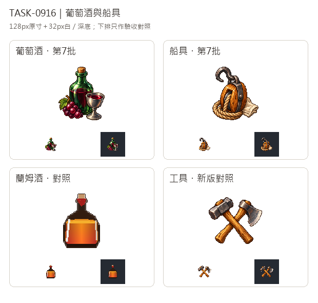

# 🖼️ 《Blocksail》酒與索具｜葡萄酒、船具

葡萄酒以深綠玻璃包住紅寶石色酒液，杯口與葡萄讓它在小圖裡也能說明內容，不必靠文字標籤。這是遊戲中彌撒用酒與奢侈貨物的共同代表，並非特定歷史酒瓶的考證。船具則把木滑輪、麻繩、鐵鉤與一小片帆布聚在一起：圓滑木殼與粗繩負責暖色體積，開口鐵鉤給出明確剪影，區分普通木工工具。圖像是貨物類別的代表，不是裝配或安全施工圖。

依Tim要求延續新版畫風：葡萄酒實際輸入Sirius第3批玻璃與工具獨立白底原稿，船具輸入工具原稿，只借左上高光、離散像素色階、階梯輪廓與材質厚度。沒有複製參考物的形狀；兩張均由內建image_gen各自生成，白底原稿完整保存，另做128×128透明遊戲圖，主體最大邊104px。

總覽上排是新圖，下排蘭姆酒與新版工具為驗收對照，整張總覽沒有用作生成輸入。每格並列128px原寸與32px白／深底縮圖，特別檢查酒杯亮邊、瓶身高光及鐵鉤／繩圈孔洞；淺色帆布不能在去背時消失。遊戲交付使用wine、ship-gear原本的貨物key，讓城鎮與地球儀貿易介面照既有載入方式顯示。

## 完整實際提示詞

工具：內建image_gen。風格參考為`RawImages/sirius_blocksail_goods_batch3_glass_master.png`、`RawImages/sirius_blocksail_goods_batch3_tools_master.png`，各張實際輸入與雜湊見Blocksail `docs/evidence/goods-batch7/generation.json`。

### 葡萄酒 (wine)

```text
Use case: stylized-concept. ONE highly polished 16/32-bit pixel-art inventory icon for Blocksail: RED GRAPE WINE. A short dark emerald-green glass wine bottle with rounded shoulders, cork stopper and NO label, standing just behind a simple small pewter stemmed wine cup tilted enough to reveal deep ruby-red wine; a modest compact cluster of purple-red grapes and ONE small vine leaf nestled against the base on the left. Bottle dominates the silhouette, the visible ruby liquid and grapes make this unmistakably grape wine, not rum or a generic potion. Age-of-sail trading-goods aesthetic, no religious emblems required. The attached Sirius TASK-0896 glass and tools white masters are ONLY pixel-art rendering references: saturated material-specific colour, upper-left crisp highlights, discrete shaded clusters, sharp stair-step contours, restrained deep brown/charcoal outlines, substantial tactile depth. Do not copy their objects. Rich emerald bottle shading, burgundy-red wine, warm grey pewter; controlled glass reflections, no glowing effects. Compact centered three-quarter view, generous empty margin on all sides; no cropped objects. Pure solid white #FFFFFF background. No ground plane, no external cast shadow, text, lettering, numbers, labels, watermark, border, checkerboard, barrels, sacks or crates. Square composition. Preserve this white master; a separate transparent128x128 sprite will be derived.
```

### 船具 (ship-gear)

```text
Use case: stylized-concept. ONE exquisite16/32-bit pixel-art inventory icon for Blocksail: SHIP GEAR, age-of-sail rigging hardware. A compact carefully arranged cluster of a single substantial oval honey-brown wooden pulley block with dark iron strap and clearly visible grooved sheave, a thick tan hemp rope reeved around its sheave and curling into a small coil along the base, and a dark wrought-iron lifting hook attached to the top iron eye, curving towards the upper left with a clear open gap. A modest folded cream sailcloth patch tucked behind the lower right emphasizes ship supplies. Readable strong silhouette dominated by the oval pulley and hooked top, NOT carpenter tools, weapons, ship steering wheel, anchor or whole boat. Only one pulley, one rope, one hook, small cloth patch; avoid clutter. Use the attached Sirius TASK-0896 tools master ONLY as reference for rich material-specific colour, upper-left highlights, discrete shaded pixel clusters, crisp stair-step contours, restrained dark outlines, tactile wooden grain, hemp fibres and forged iron. Do not copy the hammer/axe design. Centered compact three-quarter view, generous margins, complete hook and rope visible. Pure solid white #FFFFFF background. No ground plane, external cast shadow, text, letters, numbers, labels, watermark, border, checkerboard, barrels, boxes or sacks. Highly polished pixel sprite, not vector, photo or soft painting. Square composition. White master retained, transparent128x128 game icon derived separately.
```


