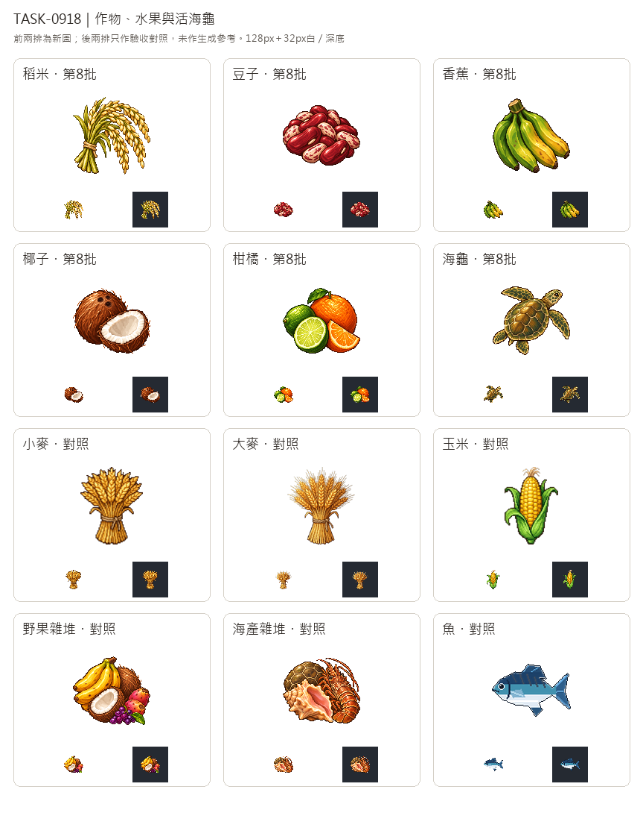

# 🖼️ 《Blocksail》穀穗與果實｜作物、水果、活海龜

這批把穀物與果實從「採回來的雜堆」拆成各自清楚的貨物。稻穗向下彎垂，與直立的小麥、大麥形成方向差；乾豆用紅色腎形與斑點淺豆交疊，區分穗狀穀物。大蕉只畫連在一個冠部的青黃整串，椰子只保留整顆與剖半白肉，柑橘則以深綠萊姆、明橙柳橙及放射切面交代內容。各種果物維持單一類別，不用野果雜堆代替。

海龜畫成整隻活的綠蠵龜，橢圓背甲、頭、兩片長前鰭與兩片短後鰭都在圖裡；殼紋服務輪廓，四肢使它與先前的龜殼、鳳凰螺海產雜堆區分。這些是遊戲貨物類別的美術設定，不表示圖片已增加實際捕撈、農作或消耗機制；本單六種在開工時均屬規劃資源，依Tim要求先畫素材。

六張均由內建image_gen各自生成，只輸入Sirius第3批黏土獨立白底原稿作新版畫風參考，借用左上高光、離散像素色階、深色階梯輪廓與立體厚度。稻穗另用同工具清除穗旁一小塊紫色雜點，記錄了原始與編修提示詞。白底原稿完整留存，遊戲版另外去背、裁切、最近鄰整理到128×128，主體最大邊104px。椰肉、萊姆果瓤與穀粒的淺色高光保留。

總覽前兩排是六張新圖，後兩排的小麥、大麥、玉米、野果、海產與魚只用作驗收對照，未送入生成工具。每格都有128px原寸與32px白／深底縮圖，檢查彼此剪影與邊緣；海龜的完整頭腳、大蕉的青黃整串、椰子的棕白雙圓形，即使縮小仍與舊類別不同。

## 完整實際提示詞

工具：內建image_gen。實際畫風參考：`RawImages/sirius_blocksail_goods_batch3_clay_master.png`；SHA-256、來源及派生參數見Blocksail `docs/evidence/goods-batch8/generation.json`。

### 稻米 (rice)

```text
Use case: stylized-concept. ONE inventory icon for Blocksail: a gathered sheaf of RIPE RICE PANICLES, not wheat. Five slender pale-green stalks tied at their lower third with a plain tan twine loop, fanning outward into long gracefully drooping branches heavy with narrow ivory-golden rice grains. Clear sparse arching rice branches and fine hanging grains instead of upright dense wheat ears or barley awns. Muted yellow-green stems and pale straw grain with warm brown shadows; compact asymmetrical fan silhouette readable at32px. No loose cooked rice or bowl. Use the attached Sirius TASK-0896 clay white master ONLY as a refined16/32-bit pixel-art style reference: saturated material-specific colour, upper-left highlights, discrete shaded clusters, crisp stair-step contours, restrained dark outlines and tactile dimensional depth. Do not copy its clay shape or orange palette. Deliberate pixel clusters, not photograph, vector or soft painting. Compact centered three-quarter inventory view, all parts visible, generous margins on every side. Pure solid white #FFFFFF background. No ground plane, external cast shadow, text, labels, numbers, border, checkerboard, container, barrel, sack or box. Square image. Preserve the white master; transparent128x128 game sprite will be derived separately.
```

稻穗局部清除雜點，實際編修提示詞：

```text
Edit the supplied rice-sheaf pixel-art icon. Remove ONLY the small accidental lavender/purple triangular fleck in the white gap between the stalks, just right of the twine tie around the middle-lower left. Replace that tiny fleck with pure white background. Preserve absolutely everything else: exact rice panicles, individual grains, green stalks, leaves, twine, crisp pixel contours, colours, upper-left light, composition, generous margins and square white background. Do not redraw, add, restyle or move any other detail. No text, shadows or border.
```

### 豆子 (beans)

```text
Use case: stylized-concept. ONE inventory icon for Blocksail: a small harvested handful of DRIED BEANS piled in a compact low mound, roughly twenty plump kidney-shaped beans. Rich burgundy-red beans mixed with a few ivory beans bearing muted reddish speckles; visible pale hilum marks on the largest foreground beans. A few overlapping large beans define the silhouette and smooth curved forms, with smaller beans behind; no pods, leaves, sprouts, plate, sack or packaging. Dry matte seeds with upper-left glints, distinct from grain ears, grapes and fruit. Keep the foreground kidney shapes large and readable at32px. Use the attached Sirius TASK-0896 clay white master ONLY as a refined16/32-bit pixel-art style reference: saturated material-specific colour, upper-left highlights, discrete shaded clusters, crisp stair-step contours, restrained dark outlines and tactile dimensional depth. Do not copy its clay shape or orange palette. Deliberate pixel clusters, not photograph, vector or soft painting. Compact centered three-quarter inventory view, all parts visible, generous margins on every side. Pure solid white #FFFFFF background. No ground plane, external cast shadow, text, labels, numbers, border, checkerboard, container, barrel, sack or box. Square image. Preserve the white master; transparent128x128 game sprite will be derived separately.
```

### 香蕉 (banana)

```text
Use case: stylized-concept. ONE inventory icon for Blocksail: a freshly harvested connected HAND OF GREEN-YELLOW PLANTAINS, not dessert bananas and not a mixed fruit pile. Six large thick elongated gently curved plantains attached to a single stout trimmed crown, layered into one compact hanging bunch leaning diagonally. Clearly angular ridges, mostly deep leaf-green peel grading through yellow-green to warm ochre-yellow on two ripening outer fruits, dark tips. All fruit unpeeled and whole, no sliced flesh. Broad clean silhouette, crown visible, readable green-yellow colour at32px. No other fruits, leaves, ribbons or decoration. Use the attached Sirius TASK-0896 clay white master ONLY as a refined16/32-bit pixel-art style reference: saturated material-specific colour, upper-left highlights, discrete shaded clusters, crisp stair-step contours, restrained dark outlines and tactile dimensional depth. Do not copy its clay shape or orange palette. Deliberate pixel clusters, not photograph, vector or soft painting. Compact centered three-quarter inventory view, all parts visible, generous margins on every side. Pure solid white #FFFFFF background. No ground plane, external cast shadow, text, labels, numbers, border, checkerboard, container, barrel, sack or box. Square image. Preserve the white master; transparent128x128 game sprite will be derived separately.
```

### 椰子 (coconut)

```text
Use case: stylized-concept. ONE inventory icon for Blocksail: COCONUTS as a single-crop trading good. One whole round mature brown fibrous coconut slightly behind, three natural dark eyes visible near its upper front; one cleanly split half coconut in front, tilted up toward viewer to show thick ivory-white flesh around a pale shaded hollow and dark brown hard shell rim. A few short coarse husk fibres, natural irregular cut, warm brown and cream palette. Compact pair of whole and half coconut, no bananas, grapes, other fruit or leaves. Distinct from mixed wild-fruit icon and readable at32px, no drink straw. Use the attached Sirius TASK-0896 clay white master ONLY as a refined16/32-bit pixel-art style reference: saturated material-specific colour, upper-left highlights, discrete shaded clusters, crisp stair-step contours, restrained dark outlines and tactile dimensional depth. Do not copy its clay shape or orange palette. Deliberate pixel clusters, not photograph, vector or soft painting. Compact centered three-quarter inventory view, all parts visible, generous margins on every side. Pure solid white #FFFFFF background. No ground plane, external cast shadow, text, labels, numbers, border, checkerboard, container, barrel, sack or box. Square image. Preserve the white master; transparent128x128 game sprite will be derived separately.
```

### 柑橘 (citrus)

```text
Use case: stylized-concept. ONE inventory icon for Blocksail: CITRUS FRUIT for ships, specifically LIME AND ORANGE together. One whole round orange with dimpled saturated orange peel at back right, one smaller oval deep green lime at back left, one cut lime half at the front showing pale yellow-green radial juicy segments with a cream pith rim, and one small orange wedge leaning on the right. A tiny joined dark-green leaf may rest at the top, no other fruit. Compact low pyramid silhouette, simple large green and orange colour masses readable at32px. Fresh natural fruit, no prepared drink, bottles, containers or decorative background. Use the attached Sirius TASK-0896 clay white master ONLY as a refined16/32-bit pixel-art style reference: saturated material-specific colour, upper-left highlights, discrete shaded clusters, crisp stair-step contours, restrained dark outlines and tactile dimensional depth. Do not copy its clay shape or orange palette. Deliberate pixel clusters, not photograph, vector or soft painting. Compact centered three-quarter inventory view, all parts visible, generous margins on every side. Pure solid white #FFFFFF background. No ground plane, external cast shadow, text, labels, numbers, border, checkerboard, container, barrel, sack or box. Square image. Preserve the white master; transparent128x128 game sprite will be derived separately.
```

### 海龜 (turtle)

```text
Use case: stylized-concept. ONE inventory icon for Blocksail: a WHOLE LIVING GREEN SEA TURTLE, not an empty shell or a shellfish catch. Dorsal three-quarter view from above, the turtle faces diagonally toward the upper right. Full olive-brown domed oval shell with defined five central scutes and cream-olive edge, small alert mottled olive head with dark eye and rounded beak, TWO long tapered front flippers extended to either side and TWO shorter rear flippers, tiny tail visible. All four flippers, head and shell entirely in frame, correct sea-turtle anatomy, no tortoise feet. Natural warm olive, ochre and muted dark green colours, clear dark outlines around limbs so the full live animal reads at32px, calm and healthy. No rope, bindings, injury, gore, other animals, shells, seafood pile, water, landscape or pool. Use the attached Sirius TASK-0896 clay white master ONLY as a refined16/32-bit pixel-art style reference: saturated material-specific colour, upper-left highlights, discrete shaded clusters, crisp stair-step contours, restrained dark outlines and tactile dimensional depth. Do not copy its clay shape or orange palette. Deliberate pixel clusters, not photograph, vector or soft painting. Compact centered three-quarter inventory view, all parts visible, generous margins on every side. Pure solid white #FFFFFF background. No ground plane, external cast shadow, text, labels, numbers, border, checkerboard, container, barrel, sack or box. Square image. Preserve the white master; transparent128x128 game sprite will be derived separately.
```


