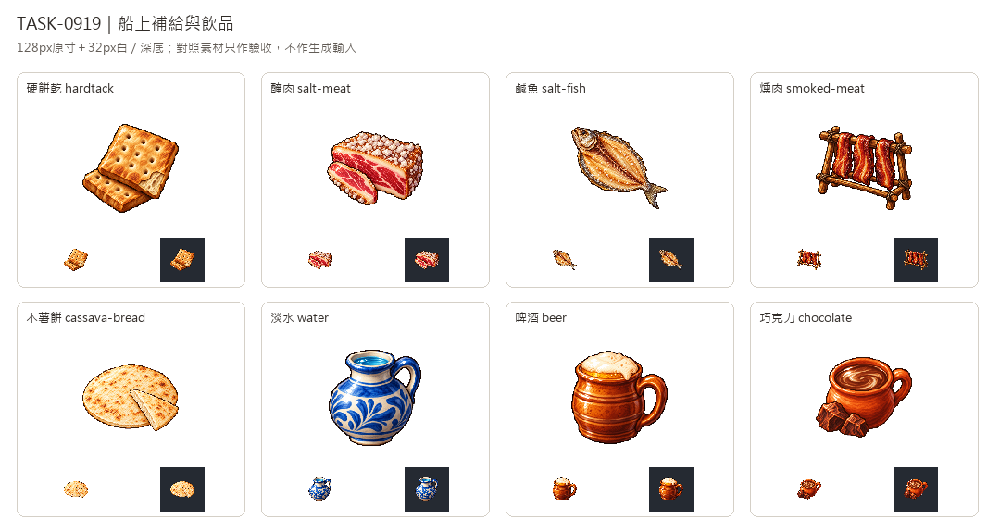

# 🖼️ 《Blocksail》航程中的一餐｜船上補給與飲品

Tim指定沿用新版畫風。這批以新版可可白底原稿作唯一生成附圖，分別設計八種物產，延續左上光源、離散像素明暗、飽滿固有色與深色階梯輪廓。

乾糧從保存方式得到自己的形狀：硬餅乾的方孔、醃肉的粗鹽、鹹魚的剖面與燻肉的木架。木薯餅保留薄圓形與切片；藍釉水罐、泡沫陶杯、熱巧克力杯及可可塊，則各用容器與內容物區分。這些是遊戲圖示的創作表現，並非特定年代器物的考據復原。

八張白底原稿完整保留，另作128×128透明版，主體最大邊104px。杯把與燻架孔洞逐一去背，保留泡沫、鹽粒與陶器亮部，並以32px白深底與七張既有食品對照。本次只補圖，不更動貨物表、木薯餅配方或生產鏈。完整提示詞、來源及雜湊見Blocksail docs/evidence/goods-batch9/generation.json。

## 完整實際提示詞

工具：內建image_gen。唯一畫風輸入：`RawImages/sirius_blocksail_goods_refresh932_cocoa_master.png`。

### 硬餅乾 (hardtack)

```text
ONE compact group of two square thick hardtack ship biscuits, ochre dry toasted crumb, clearly spaced regular punched holes, one biscuit propped diagonally against another, chipped corner revealing dense pale interior. Distinct square outline, never a fluffy bread loaf. Use attached NEW CACAO solely as pixel-art rendering STYLE reference: saturated material-specific colours, upper-left highlights, discrete fine shaded pixel clusters, crisp stair-step contour, restrained dark outlines, tactile dimensional depth. Design subject independently, no cacao and no forcing orange onto unrelated materials. Polished 16/32-bit inventory sprite, readable at32px. ONE compact centered three-quarter object or group, complete silhouette and generous margins, pure solid WHITE #FFFFFF background, no ground plane or external cast shadow, no text, labels, watermark, checkerboard or scenery. White original retained; separate transparent128px game version derived.
```

### 醃肉 (salt-meat)

```text
ONE thick compact slab of salt-preserved pinkish red meat, ivory fat rim and abundant large angular coarse salt crystals crusting its top and edge; a small cut slice leans against it. No plate, rack, raw steak garnish or container. Use attached NEW CACAO solely as pixel-art rendering STYLE reference: saturated material-specific colours, upper-left highlights, discrete fine shaded pixel clusters, crisp stair-step contour, restrained dark outlines, tactile dimensional depth. Design subject independently, no cacao and no forcing orange onto unrelated materials. Polished 16/32-bit inventory sprite, readable at32px. ONE compact centered three-quarter object or group, complete silhouette and generous margins, pure solid WHITE #FFFFFF background, no ground plane or external cast shadow, no text, labels, watermark, checkerboard or scenery. White original retained; separate transparent128px game version derived.
```

### 鹹魚 (salt-fish)

```text
ONE butterflied split-open dried salted fish, recognisable fish head and forked tail, two flattened pale golden fillet sides spread around a dark central spine, leathery dry silver-brown skin edge, a few coarse salt grains. Diagonal compact silhouette, no plate or rack. Use attached NEW CACAO solely as pixel-art rendering STYLE reference: saturated material-specific colours, upper-left highlights, discrete fine shaded pixel clusters, crisp stair-step contour, restrained dark outlines, tactile dimensional depth. Design subject independently, no cacao and no forcing orange onto unrelated materials. Polished 16/32-bit inventory sprite, readable at32px. ONE compact centered three-quarter object or group, complete silhouette and generous margins, pure solid WHITE #FFFFFF background, no ground plane or external cast shadow, no text, labels, watermark, checkerboard or scenery. White original retained; separate transparent128px game version derived.
```

### 燻肉 (smoked-meat)

```text
ONE miniature compact boucan wooden smoking rack, four short legs and horizontal crossbars with THREE dark reddish brown smoked meat strips draped across it. Meat has dry mahogany edges and fat streaks. Rack unmistakably part of item, no fire, smoke clouds, scenery or ground. Use attached NEW CACAO solely as pixel-art rendering STYLE reference: saturated material-specific colours, upper-left highlights, discrete fine shaded pixel clusters, crisp stair-step contour, restrained dark outlines, tactile dimensional depth. Design subject independently, no cacao and no forcing orange onto unrelated materials. Polished 16/32-bit inventory sprite, readable at32px. ONE compact centered three-quarter object or group, complete silhouette and generous margins, pure solid WHITE #FFFFFF background, no ground plane or external cast shadow, no text, labels, watermark, checkerboard or scenery. White original retained; separate transparent128px game version derived.
```

### 木薯餅 (cassava-bread)

```text
ONE casabe cassava flatbread group: a broad thin pale ivory round flatbread, slight toasted speckles and coarse pressed fibrous crumb, one triangular wedge removed and leaned against the round showing very thin edge. Flatter than pancakes, no butter, filling, plates or bread loaf. Use attached NEW CACAO solely as pixel-art rendering STYLE reference: saturated material-specific colours, upper-left highlights, discrete fine shaded pixel clusters, crisp stair-step contour, restrained dark outlines, tactile dimensional depth. Design subject independently, no cacao and no forcing orange onto unrelated materials. Polished 16/32-bit inventory sprite, readable at32px. ONE compact centered three-quarter object or group, complete silhouette and generous margins, pure solid WHITE #FFFFFF background, no ground plane or external cast shadow, no text, labels, watermark, checkerboard or scenery. White original retained; separate transparent128px game version derived.
```

### 淡水 (water)

```text
ONE squat blue glazed ceramic drinking-water jug with round belly, short narrow open neck visibly holding clear blue water, curved side handle. Simple age-of-sail handmade pottery, blue and ivory glaze, no lettering, no cork, no goblet, no barrel. Use attached NEW CACAO solely as pixel-art rendering STYLE reference: saturated material-specific colours, upper-left highlights, discrete fine shaded pixel clusters, crisp stair-step contour, restrained dark outlines, tactile dimensional depth. Design subject independently, no cacao and no forcing orange onto unrelated materials. Polished 16/32-bit inventory sprite, readable at32px. ONE compact centered three-quarter object or group, complete silhouette and generous margins, pure solid WHITE #FFFFFF background, no ground plane or external cast shadow, no text, labels, watermark, checkerboard or scenery. White original retained; separate transparent128px game version derived.
```

### 啤酒 (beer)

```text
ONE stout warm brown glazed earthenware beer mug, broad open mouth showing golden amber beer topped by a thick creamy ivory foam cap, sturdy curved side handle, handmade ceramic ridges. No modern brand, bottle label, barrel or scenery. Use attached NEW CACAO solely as pixel-art rendering STYLE reference: saturated material-specific colours, upper-left highlights, discrete fine shaded pixel clusters, crisp stair-step contour, restrained dark outlines, tactile dimensional depth. Design subject independently, no cacao and no forcing orange onto unrelated materials. Polished 16/32-bit inventory sprite, readable at32px. ONE compact centered three-quarter object or group, complete silhouette and generous margins, pure solid WHITE #FFFFFF background, no ground plane or external cast shadow, no text, labels, watermark, checkerboard or scenery. White original retained; separate transparent128px game version derived.
```

### 巧克力 (chocolate)

```text
ONE small terracotta handled cup full of rich dark hot chocolate, glossy brown drink surface and delicate pale swirls, accompanied by two irregular coarse cocoa-paste chunks at cup base. Historical drinking chocolate, no modern scored chocolate bar, no marshmallows, no whipped cream. Compact readable group. Use attached NEW CACAO solely as pixel-art rendering STYLE reference: saturated material-specific colours, upper-left highlights, discrete fine shaded pixel clusters, crisp stair-step contour, restrained dark outlines, tactile dimensional depth. Design subject independently, no cacao and no forcing orange onto unrelated materials. Polished 16/32-bit inventory sprite, readable at32px. ONE compact centered three-quarter object or group, complete silhouette and generous margins, pure solid WHITE #FFFFFF background, no ground plane or external cast shadow, no text, labels, watermark, checkerboard or scenery. White original retained; separate transparent128px game version derived.
```



[含七種既有食品的驗收對照](../RawImages/sirius_blocksail_goods_batch9_comparison.png)
